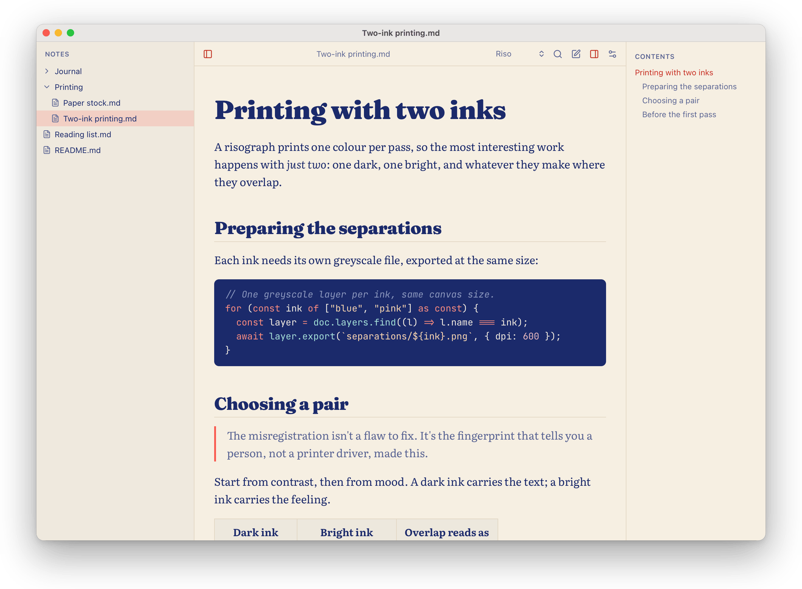
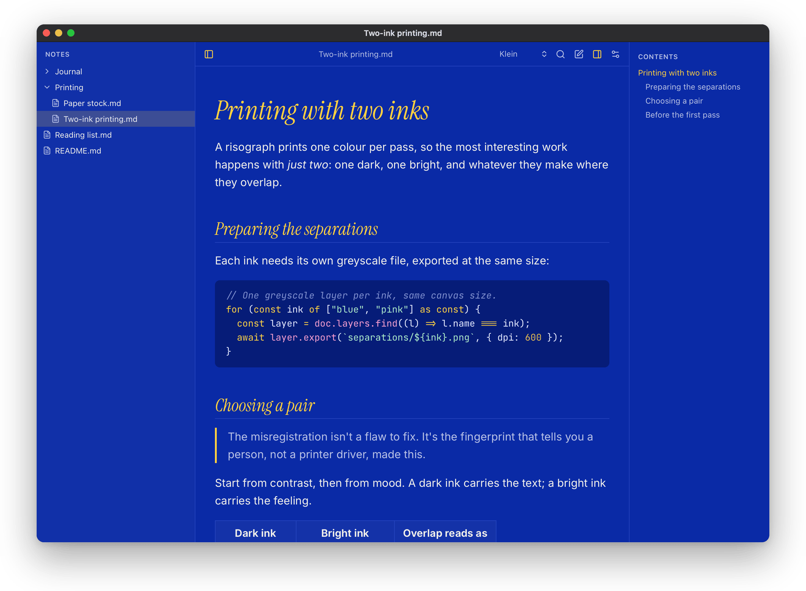
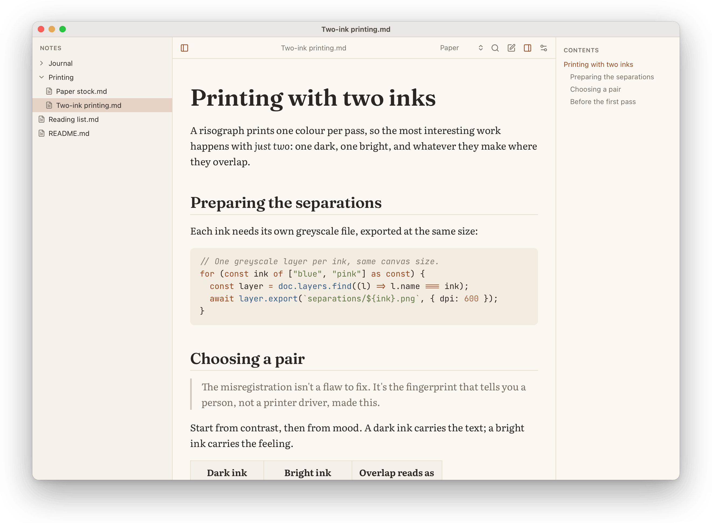
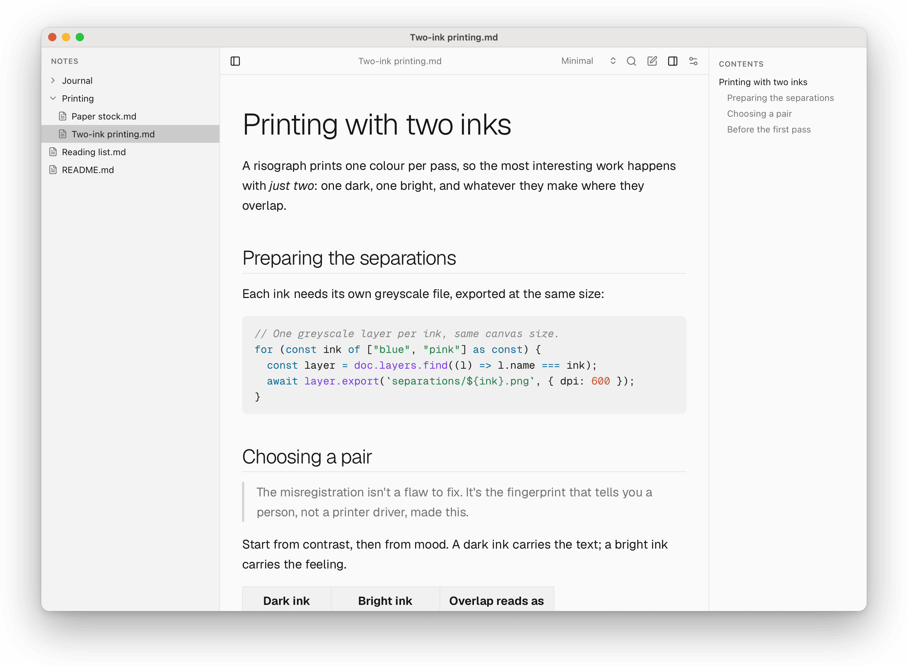
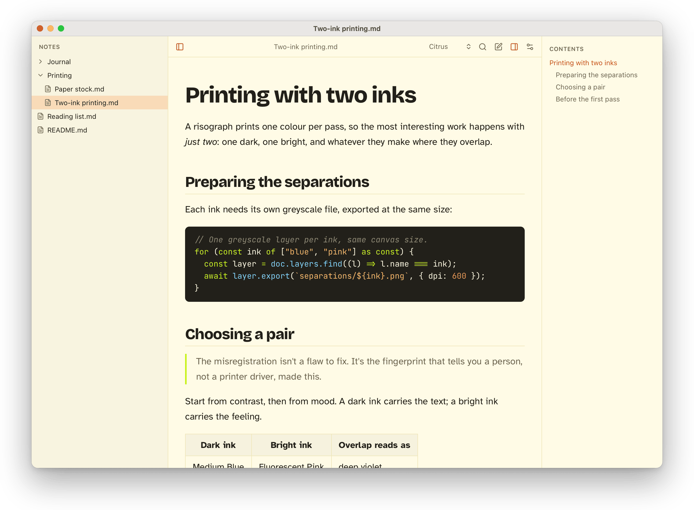
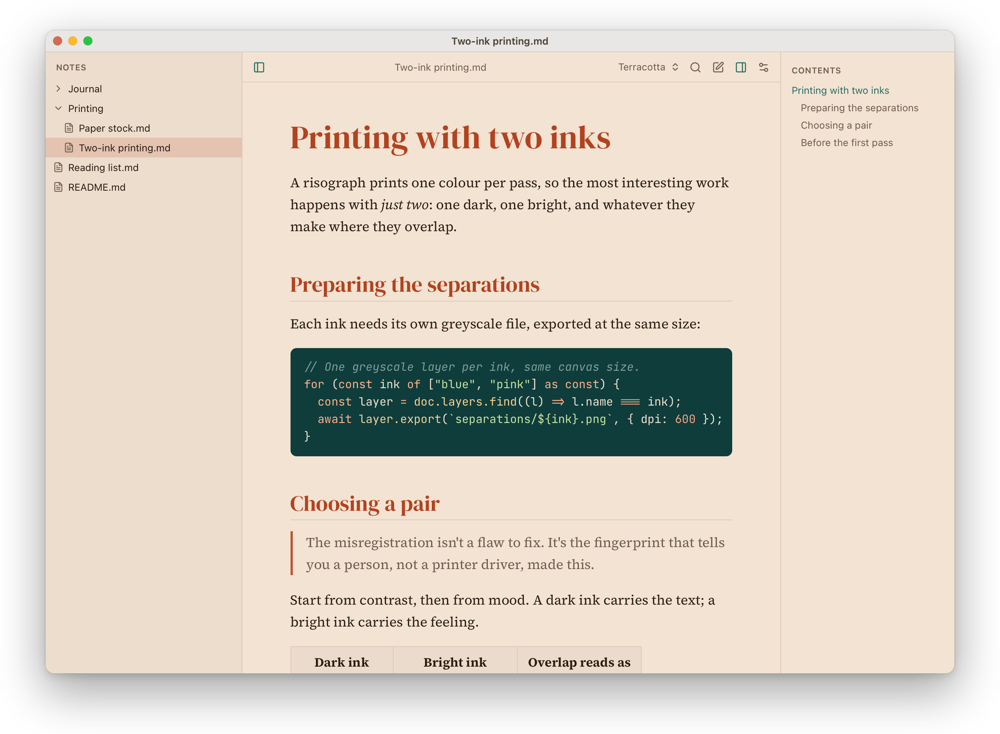
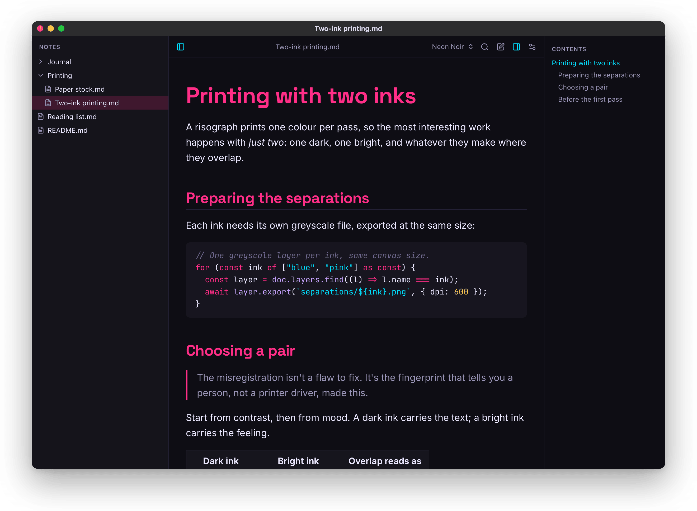
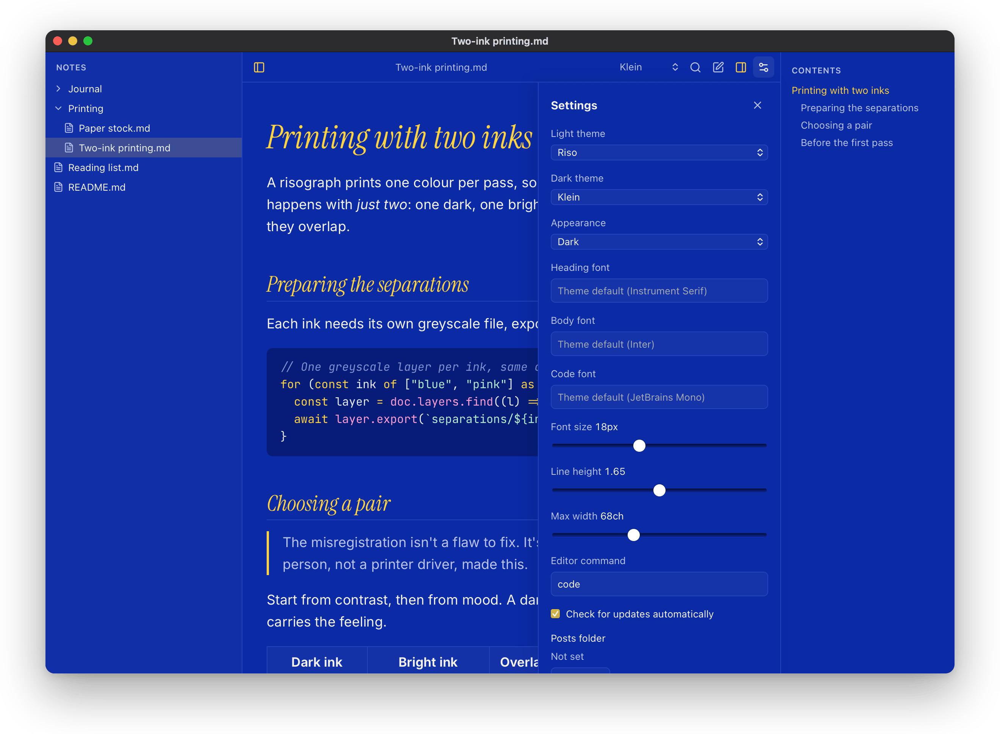
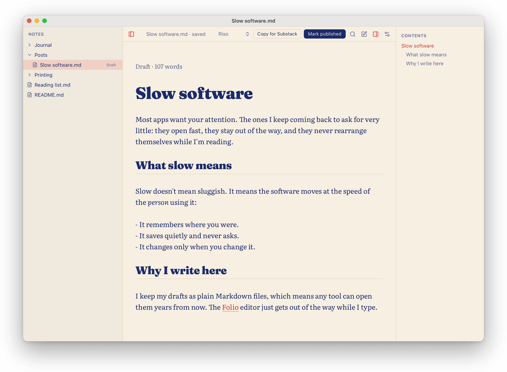

<p align="center"><picture><source media="(prefers-color-scheme: dark)" srcset="docs/assets/folio-wordmark-dark.svg"></picture></p>

# Folio

A personal macOS app for reading local Markdown files. Folio only writes to posts in your posts folder, and only when you edit them; every other file is read-only. Built with Tauri 2 and React/TypeScript.

<picture><source media="(prefers-color-scheme: dark)" srcset="docs/screenshots/klein.png"></picture>

## Install

Download the DMG from the [latest release](https://github.com/alxvallejo/folio/releases) (Apple Silicon). The app isn't signed by Apple yet, so the release notes explain how to open it the first time.

From 0.3.0 on, Folio checks for updates on its own and offers to install them; **Folio → Check for Updates…** checks right away. Turn the automatic check off in Settings.

## Themes

Folio switches with macOS appearance. Pick a light theme and a dark theme separately in Settings (⌘,); each theme brings its own heading, body and code fonts.

<table>
  <tr>
    <td><br><b>Riso</b> · light, default</td>
    <td><br><b>Klein</b> · dark, default</td>
  </tr>
  <tr>
    <td><br><b>Paper</b> · light and dark</td>
    <td><br><b>Minimal</b> · light and dark</td>
  </tr>
  <tr>
    <td><br><b>Citrus</b> · light</td>
    <td><br><b>Terracotta</b> · light</td>
  </tr>
  <tr>
    <td><br><b>Neon Noir</b> · dark</td>
    <td><br><b>Settings</b> · fonts, size, line height, width</td>
  </tr>
</table>

## Writing posts

Choose a posts folder in Settings and Folio opens the Markdown files in it for writing, with the same themes as reading.



- **New post** (⌘N) asks for a title and creates `<Title>.md` as a draft in the posts folder.
- **Autosave** writes about a second after you stop typing, and again when you switch files, leave the window, close it, quit or install an update. The title bar shows saved, saving or not saved.
- **Links**: ⌘K, right-click, or paste a URL over selected text.
- **Copy for Substack** (⇧⌘C) puts the post on the clipboard as formatted text, ready to paste into a Substack draft.
- **Mark published** sets `status: published` and adds a `published` date; **Mark as draft** flips it back.

## Develop

```sh
npm install
npm run tauri dev          # run the app
npm test                   # frontend tests
cd src-tauri && cargo test # backend tests
npx tauri build --bundles app
```

### Screenshots

`npm run screenshots` regenerates everything in `docs/screenshots/`. It renders the real frontend in WebKit against mocked Tauri commands and a sample document (`scripts/screenshots/`). The first run needs `npx playwright install webkit`.

### Releasing

Releases are signed for the updater with a key made once by `scripts/setup-updater-key.sh` (it lives in `~/.tauri/folio-updater.key`, with its password in the login Keychain). Then:

```sh
scripts/release.sh 0.3.1 notes.md --dry-run   # build and stage only
scripts/release.sh 0.3.1 notes.md             # bump, build, tag, push and publish
```

The script checks that you're on a clean, pushed `master` and that the tests pass, and asks before it publishes.

## Config

Settings live in `~/.config/folio/config.json`. Besides posts you edit, it is the only file Folio writes.
