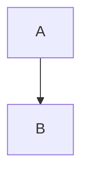

# Folio v1 Implementation Plan

> **For agentic workers:** REQUIRED SUB-SKILL: Use superpowers:subagent-driven-development (recommended) or superpowers:executing-plans to implement this plan task-by-task. Steps use checkbox (`- [ ]`) syntax for tracking.

**Goal:** Build Folio, a personal macOS app that renders local Markdown files beautifully, with a folder sidebar, TOC, live reload, six themes, find, and open-in-editor.

**Architecture:** Tauri 2 with a thin Rust backend (file reads, folder tree, file watching, config I/O, OS open-file events, editor launch) and a React + TypeScript frontend. The frontend's `render/` module is a pure Markdown → sanitized HTML pipeline (markdown-it + Shiki + DOMPurify). `themes/` and `settings/` are pure modules with a small store. `ui/` composes everything.

**Tech Stack:** Tauri 2.12, Rust (notify-debouncer-mini 0.7 / notify 8), Vite, React 19, TypeScript, markdown-it 15, Shiki 4 (JavaScript regex engine), DOMPurify 3, github-slugger 2, Fontsource, lucide-react, Vitest 4 + jsdom.

**Spec:** `docs/superpowers/specs/2026-10-12-folio-design.md`. Read it before starting any task.

## Global Constraints

- Platform: macOS only. Audience: Alex only. No code signing, notarization, or distribution work.
- Project root: `~/Sites/personal/folio/`. Bundle identifier: `com.alexvallejo.folio`. Product name: `Folio`.
- Folio is read-only: no code path ever writes to a Markdown file. The only file Folio writes is `~/.config/folio/config.json`.
- Config path is exactly `~/.config/folio/config.json` (not `~/Library/Application Support`).
- Settings ranges: font size 14–24 px (default 18); line height 1.3–2.0 (default 1.65); max width 55–90 `ch` (default 68); editor command default `code`; theme default `paper`; appearance default `system`.
- `maxWidth` is stored as a number of `ch`.
- Watch debounce: 100 ms. Large-file confirmation threshold: 5 MB (5 × 1024 × 1024 bytes).
- Folder tree: only `.md`/`.markdown` files and dirs containing them; skip `node_modules` and any dot-file or dot-dir; never follow symlinked dirs; stop at depth 10 or 5,000 files and report `truncated`.
- TOC shows H1–H4 and is hidden when the document has fewer than 3 headings.
- User-facing copy (verbatim from spec): banner `File no longer exists`; editor failure toast ``Couldn't run `<cmd>` — set your editor in Settings``.
- Rust is the only place that touches the filesystem. The frontend never uses `@tauri-apps/plugin-fs`.
- Every commit message ends with the line `Co-Authored-By: Claude Opus 5.5 <noreply@anthropic.com>` (after a blank line). Commit messages are short imperative sentences ("Add folder tree builder"), matching the existing history.
- Run all `npm` commands from the project root. Run all `cargo` commands from `src-tauri/`. Every shell that runs `cargo` must first `source "$HOME/.cargo/env"` (the Rust toolchain is installed in Task 1).

## Review Focus

1. **Editors that save atomically** (write a temp file, then rename it over the original: vim, many JetBrains/Zed configs). The live reload must keep firing after the first such save. Pinned by `watch::tests::survives_atomic_saves` in Task 3.
2. **Headings whose slug collides with a DOM property** ("Links", "Images", "Title", "Forms"). DOMPurify's default DOM-clobbering protection strips such `id`s, which silently breaks TOC and `#anchor` links. That includes this spec's own "Links" and "Images" sections. Pinned by the `keeps heading ids that collide with DOM properties` test in Task 9.
3. **Paths with spaces, percent signs, or unicode** in image `src` and `.md` links (``, `[x](<My Notes.md>)`). They must resolve to the real file, not to a percent-encoded path that doesn't exist. Pinned by the `decodes percent-encoded relative paths` tests in Task 9.
4. **Cold-start open from Finder.** macOS delivers the open-file event before the webview has registered its listener. The file must still open, not disappear. Pinned by `open::tests::queues_paths_until_frontend_ready` in Task 5.
5. **Code fences with an alias or unknown language** (```` ```ts ````, ```` ```sh ````, ```` ```mermaid ````, empty info string). Must never throw and blank the document; unknown languages render as plain escaped text. Pinned by the `falls back to plain text for unknown languages` tests in Task 8.

---

## File Structure

```
folio/
├── index.html                      (scaffold)
├── package.json                    (scaffold + deps, test script)
├── vite.config.ts                  (scaffold + vitest config)
├── src/
│   ├── main.tsx                    entry: fonts, styles, <App/>
│   ├── types/markdown-it-plugins.d.ts
│   ├── lib/
│   │   ├── paths.ts                pure path helpers
│   │   └── api.ts                  typed wrappers for Rust commands + events
│   ├── render/
│   │   ├── markdown.ts             markdown-it instance + heading-id core rule
│   │   ├── highlight.ts            Shiki highlighter (all preset themes, common langs)
│   │   ├── postprocess.ts          DOMPurify + image/link rewriting
│   │   ├── index.ts                createRenderer(): (src, opts) => { html, headings }
│   │   └── __fixtures__/gfm.md
│   ├── themes/
│   │   ├── presets.ts              six presets × light/dark palettes + Shiki pairs
│   │   ├── fonts.ts                font registry + fontStack()
│   │   ├── load-fonts.ts           Fontsource imports + ia-fonts.css
│   │   ├── ia-fonts.css            @font-face for bundled iA fonts
│   │   └── apply.ts                themeVariables(), applyTheme(), resolveAppearance()
│   ├── settings/
│   │   ├── schema.ts               Settings type, defaults, effectiveSettings, applyPatch, parse/serialize
│   │   └── store.ts                createSettingsStore(io, notify)
│   ├── assets/fonts/ia/            iA Writer Quattro S + Mono S TTFs + LICENSE.md
│   ├── styles/
│   │   ├── app.css                 layout/chrome
│   │   └── prose.css               document typography, Shiki switching, find highlights
│   └── ui/
│       ├── App.tsx                 orchestration
│       ├── useRenderer.ts, useDocument.ts, useFolder.ts, useSystemDark.ts
│       ├── Toasts.tsx              useToasts() + <Toasts/>
│       ├── DocumentView.tsx, EmptyState.tsx, Sidebar.tsx, Toc.tsx, FindBar.tsx
│       ├── Toolbar.tsx, SettingsPanel.tsx
│       ├── scroll.ts               scrollToFragment()
│       ├── tree.ts                 ancestorDirs()
│       ├── spy.ts                  activeHeadingIndex()
│       ├── find.ts                 findRanges()
│       └── shortcuts.ts            actionFor()
└── src-tauri/
    ├── Cargo.toml, build.rs, tauri.conf.json, capabilities/default.json, icons/ (scaffold)
    └── src/
        ├── main.rs                 (scaffold) calls folio_lib::run()
        ├── lib.rs                  builder, plugins, state, handlers, RunEvent::Opened
        ├── fs.rs                   read_file, list_tree
        ├── watch.rs                file/folder watchers
        ├── config.rs               read/write/watch config.json
        ├── open.rs                 PendingOpen queue, frontend_ready, deliver()
        └── editor.rs               open_in_editor
```

Test files sit next to their modules (`*.test.ts`); Rust tests are `#[cfg(test)] mod tests` inside each module.

---

### Task 1: Toolchain, scaffold, and project configuration

**Files:**
- Create: everything produced by `create-tauri-app` (react-ts template)
- Modify: `package.json`, `vite.config.ts`, `src/main.tsx`, `src/App.tsx` (delete), `src-tauri/Cargo.toml`, `src-tauri/tauri.conf.json`, `src-tauri/capabilities/default.json`, `src-tauri/src/lib.rs`

**Interfaces:**
- Consumes: nothing.
- Produces: a building Tauri app with the `dialog` and `opener` plugins registered, the asset protocol enabled for `$HOME/**`, `.md`/`.markdown` file associations, `npm test` (Vitest, jsdom) and `cargo test` both runnable. Rust crate lib name `folio_lib`.

- [ ] **Step 1: Install the Rust toolchain**

```bash
xcode-select -p   # must print a path; if not, run: xcode-select --install
curl --proto '=https' --tlsv1.2 -sSf https://sh.rustup.rs | sh -s -- -y --profile minimal
source "$HOME/.cargo/env"
rustc --version && cargo --version
```
Expected: both print versions (rustc 1.9x or newer).

- [ ] **Step 2: Scaffold into a temp dir and copy into the repo**

The repo already has `docs/` and `.git`, so scaffold elsewhere and copy over.

```bash
SCAFFOLD="$(mktemp -d)"
cd "$SCAFFOLD" && npm create tauri-app@4.8.0 folio -- --template react-ts --manager npm --identifier com.alexvallejo.folio --yes
rsync -a --exclude .git "$SCAFFOLD/folio/" ~/Sites/personal/folio/
cd ~/Sites/personal/folio && ls
```
Expected: `index.html package.json src src-tauri tsconfig.json vite.config.ts docs …`. If `create-tauri-app` still prompts, answer: project name `folio`, identifier `com.alexvallejo.folio`, language TypeScript/JavaScript, package manager npm, UI template React, flavor TypeScript.

- [ ] **Step 3: Remove the demo code**

```bash
rm -f src/App.tsx src/App.css src/assets/react.svg public/tauri.svg public/vite.svg
```

Replace `src/main.tsx` with a placeholder (Task 12 replaces it again). StrictMode is intentionally dropped, because its double-mounted effects would double-register Rust watchers and race the cold-start `frontend_ready` drain:

```tsx
import ReactDOM from "react-dom/client";

ReactDOM.createRoot(document.getElementById("root") as HTMLElement).render(<p>Folio</p>);
```

Replace `src-tauri/src/lib.rs`:

```rust
#[cfg_attr(mobile, tauri::mobile_entry_point)]
pub fn run() {
    tauri::Builder::default()
        .plugin(tauri_plugin_dialog::init())
        .plugin(tauri_plugin_opener::init())
        .run(tauri::generate_context!())
        .expect("error while running Folio");
}
```

Leave `src-tauri/src/main.rs` as scaffolded (it calls `folio_lib::run()`). If the scaffold named the lib differently, check `[lib] name` in `src-tauri/Cargo.toml` and make it `folio_lib`.

- [ ] **Step 4: Rust dependencies**

In `src-tauri/Cargo.toml`, make the `[dependencies]` and `[dev-dependencies]` sections exactly:

```toml
[dependencies]
tauri = { version = "2", features = ["protocol-asset"] }
tauri-plugin-opener = "2"
tauri-plugin-dialog = "2"
serde = { version = "1", features = ["derive"] }
serde_json = "1"
notify-debouncer-mini = "0.7"

[dev-dependencies]
tempfile = "3"
```

Leave `[package]`, `[lib]`, and `[build-dependencies]` as scaffolded.

- [ ] **Step 5: Tauri config**

Replace `src-tauri/tauri.conf.json`. Keep the scaffold's `bundle.icon` array exactly as it was, and copy it over before replacing the file:

```json
{
  "$schema": "https://schema.tauri.app/config/2",
  "productName": "Folio",
  "version": "0.1.0",
  "identifier": "com.alexvallejo.folio",
  "build": {
    "beforeDevCommand": "npm run dev",
    "devUrl": "http://localhost:1420",
    "beforeBuildCommand": "npm run build",
    "frontendDist": "../dist"
  },
  "app": {
    "windows": [
      { "title": "Folio", "width": 1200, "height": 850, "minWidth": 640, "minHeight": 400 }
    ],
    "security": {
      "csp": "default-src 'self'; img-src 'self' asset: http://asset.localhost https: http: data: blob:; style-src 'self' 'unsafe-inline'; font-src 'self' data:; connect-src ipc: http://ipc.localhost",
      "assetProtocol": {
        "enable": true,
        "scope": { "allow": ["$HOME/**"], "requireLiteralLeadingDot": false }
      }
    }
  },
  "bundle": {
    "active": true,
    "targets": "all",
    "icon": [
      "icons/32x32.png",
      "icons/128x128.png",
      "icons/128x128@2x.png",
      "icons/icon.icns",
      "icons/icon.ico"
    ],
    "fileAssociations": [
      { "ext": ["md", "markdown"], "name": "Markdown Document", "role": "Viewer", "mimeType": "text/markdown" }
    ]
  }
}
```

Why these settings:
- `style-src 'unsafe-inline'`: Shiki emits inline `style` attributes.
- `img-src https: http:`: remote images load normally (spec).
- `requireLiteralLeadingDot: false`: images inside dot-dirs such as `.github/` load.

- [ ] **Step 6: Capabilities**

Replace `src-tauri/capabilities/default.json`:

```json
{
  "$schema": "../gen/schemas/desktop-schema.json",
  "identifier": "default",
  "description": "Folio main window",
  "windows": ["main"],
  "permissions": [
    "core:default",
    "core:window:allow-set-title",
    "opener:default",
    "dialog:allow-open"
  ]
}
```

App-defined commands (Tasks 2–5) need no permission entries; Tauri allows them by default when no app manifest is declared.

- [ ] **Step 7: Frontend dependencies and test setup**

```bash
npm install @tauri-apps/plugin-dialog @tauri-apps/plugin-opener markdown-it markdown-it-task-lists markdown-it-footnote github-slugger dompurify shiki @shikijs/themes @shikijs/langs lucide-react @fontsource-variable/literata @fontsource-variable/source-serif-4 @fontsource-variable/inter @fontsource-variable/jetbrains-mono @fontsource/atkinson-hyperlegible
npm install -D vitest jsdom
npm pkg set scripts.test="vitest run --passWithNoTests" scripts.test:watch="vitest"
```

`@tauri-apps/api` and `@tauri-apps/plugin-opener` may already be present from the scaffold; reinstalling is harmless. Do not install `@types/dompurify` (DOMPurify 3 ships its own types) or `@types/markdown-it` (markdown-it 15 ships its own).

Edit the scaffold's `vite.config.ts`:
- Change `import { defineConfig } from "vite";` to `import { defineConfig } from "vitest/config";`.
- Add this property inside the returned config object, next to `server`:

```ts
  test: {
    environment: "jsdom",
    include: ["src/**/*.test.ts"],
  },
```

Keep everything else (port 1420, `TAURI_DEV_HOST` handling, `watch.ignored`).

- [ ] **Step 8: Verify both test runners and the type-check**

```bash
npm test
npm run build
cd src-tauri && source "$HOME/.cargo/env" && cargo test
```

Expected:
- `npm test` exits 0 ("No test files found").
- `npm run build` exits 0.
- `cargo test` compiles (the first build takes several minutes) and reports `0 passed`.
- If `npm run build` fails with `Unused '@ts-expect-error' directive` in `vite.config.ts`, delete that comment line (vitest pulled in Node types) and rerun.

- [ ] **Step 9: Launch the app**

```bash
npm run tauri dev
```
Expected: a window titled "Folio" shows the text "Folio". Close it.

- [ ] **Step 10: Commit**

```bash
git add -A
git commit -m "Scaffold Tauri app with plugins, asset protocol, and test runners

Co-Authored-By: Claude Opus 5.5 <noreply@anthropic.com>"
```

---

### Task 2: Rust `fs`: read files and build the folder tree

**Files:**
- Create: `src-tauri/src/fs.rs`
- Modify: `src-tauri/src/lib.rs`

**Interfaces:**
- Consumes: Task 1 crate.
- Produces (Rust, used by Tasks 3–4):
  - `pub fn decode(bytes: &[u8]) -> String`
  - `pub fn is_markdown(path: &Path) -> bool`
  - `pub fn is_ignored(name: &str) -> bool`
- Produces (commands, used by the frontend in Task 6):
  - `read_file(path: String) -> Result<FileContents, String>`, which serializes as `{ text: string, size: number }`
  - `list_tree(root: String) -> Result<Tree, String>`, which serializes as `{ root: TreeNode, truncated: boolean }`, where `TreeNode = { name: string, path: string, isDir: boolean, children: TreeNode[] }`
  - Children are ordered dirs first, then files, each case-insensitively alphabetical.

- [ ] **Step 1: Write the failing tests**

Create `src-tauri/src/fs.rs` with only the test module for now:

```rust
#[cfg(test)]
mod tests {
    use super::*;
    use std::path::Path;

    fn touch(path: &Path) {
        std::fs::create_dir_all(path.parent().unwrap()).unwrap();
        std::fs::write(path, "# x").unwrap();
    }

    fn names(node: &TreeNode) -> Vec<&str> {
        node.children.iter().map(|c| c.name.as_str()).collect()
    }

    #[test]
    fn decode_strips_bom_and_replaces_invalid_utf8() {
        assert_eq!(decode(b"\xEF\xBB\xBFhello"), "hello");
        assert_eq!(decode(b"a\xFFb"), "a\u{FFFD}b");
    }

    #[test]
    fn read_text_reports_byte_size() {
        let dir = tempfile::tempdir().unwrap();
        let file = dir.path().join("a.md");
        std::fs::write(&file, "héllo").unwrap();
        let contents = read_text(&file).unwrap();
        assert_eq!(contents.text, "héllo");
        assert_eq!(contents.size, 6);
    }

    #[test]
    fn tree_keeps_markdown_prunes_empty_dirs_and_sorts_dirs_first() {
        let dir = tempfile::tempdir().unwrap();
        let root = dir.path();
        touch(&root.join("b.md"));
        touch(&root.join("A.markdown"));
        std::fs::write(root.join("notes.txt"), "x").unwrap();
        std::fs::create_dir_all(root.join("empty")).unwrap();
        touch(&root.join("docs/c.md"));
        std::fs::create_dir_all(root.join("images")).unwrap();
        std::fs::write(root.join("images/x.png"), "x").unwrap();

        let tree = build_tree(root, Limits::default()).unwrap();
        assert_eq!(names(&tree.root), vec!["docs", "A.markdown", "b.md"]);
        assert!(tree.root.children[0].is_dir);
        assert_eq!(names(&tree.root.children[0]), vec!["c.md"]);
        assert!(!tree.truncated);
    }

    #[test]
    fn tree_skips_dot_entries_and_node_modules() {
        let dir = tempfile::tempdir().unwrap();
        let root = dir.path();
        touch(&root.join(".git/x.md"));
        touch(&root.join(".github/README.md"));
        touch(&root.join(".hidden.md"));
        touch(&root.join("node_modules/pkg/readme.md"));
        touch(&root.join("keep.md"));

        let tree = build_tree(root, Limits::default()).unwrap();
        assert_eq!(names(&tree.root), vec!["keep.md"]);
    }

    #[test]
    fn tree_skips_symlinked_dirs_but_keeps_symlinked_files() {
        let dir = tempfile::tempdir().unwrap();
        let outside = tempfile::tempdir().unwrap();
        touch(&outside.path().join("other.md"));
        let root = dir.path();
        std::os::unix::fs::symlink(outside.path(), root.join("linked-dir")).unwrap();
        std::os::unix::fs::symlink(outside.path().join("other.md"), root.join("linked.md")).unwrap();

        let tree = build_tree(root, Limits::default()).unwrap();
        assert_eq!(names(&tree.root), vec!["linked.md"]);
    }

    #[test]
    fn tree_stops_descending_at_depth_limit() {
        let dir = tempfile::tempdir().unwrap();
        let root = dir.path();
        touch(&root.join("a/shallow.md"));
        touch(&root.join("a/b/deep.md"));

        let tree = build_tree(root, Limits { max_depth: 2, max_files: 100 }).unwrap();
        assert_eq!(names(&tree.root), vec!["a"]);
        assert_eq!(names(&tree.root.children[0]), vec!["shallow.md"]);
        assert!(tree.truncated);
    }

    #[test]
    fn tree_stops_at_file_limit() {
        let dir = tempfile::tempdir().unwrap();
        for name in ["1.md", "2.md", "3.md", "4.md", "5.md"] {
            touch(&dir.path().join(name));
        }
        let tree = build_tree(dir.path(), Limits { max_depth: 10, max_files: 3 }).unwrap();
        assert_eq!(names(&tree.root), vec!["1.md", "2.md", "3.md"]);
        assert!(tree.truncated);
    }

    #[test]
    fn tree_reports_unreadable_root() {
        assert!(build_tree(Path::new("/definitely/not/here"), Limits::default()).is_err());
    }

    #[test]
    fn is_markdown_is_case_insensitive() {
        assert!(is_markdown(Path::new("/a/README.MD")));
        assert!(is_markdown(Path::new("/a/x.markdown")));
        assert!(!is_markdown(Path::new("/a/x.mdx")));
    }
}
```

Add `mod fs;` at the top of `src-tauri/src/lib.rs`.

- [ ] **Step 2: Run tests to verify they fail**

Run: `cd src-tauri && cargo test fs::`
Expected: compile errors (`cannot find function decode`, `TreeNode`, `build_tree`, `Limits`, …).

- [ ] **Step 3: Implement**

Put this above the test module in `src-tauri/src/fs.rs`:

```rust
use serde::Serialize;
use std::path::Path;

#[derive(Debug, Serialize)]
pub struct FileContents {
    pub text: String,
    pub size: u64,
}

#[derive(Debug, Serialize, PartialEq)]
#[serde(rename_all = "camelCase")]
pub struct TreeNode {
    pub name: String,
    pub path: String,
    pub is_dir: bool,
    pub children: Vec<TreeNode>,
}

#[derive(Debug, Serialize)]
pub struct Tree {
    pub root: TreeNode,
    pub truncated: bool,
}

#[derive(Debug, Clone, Copy)]
pub struct Limits {
    pub max_depth: usize,
    pub max_files: usize,
}

impl Default for Limits {
    fn default() -> Self {
        Self { max_depth: 10, max_files: 5_000 }
    }
}

/// Lossy UTF-8 decode with any leading BOM removed.
pub fn decode(bytes: &[u8]) -> String {
    let text = String::from_utf8_lossy(bytes);
    text.strip_prefix('\u{feff}').unwrap_or(&text).to_string()
}

pub fn read_text(path: &Path) -> Result<FileContents, String> {
    let bytes = std::fs::read(path).map_err(|e| e.to_string())?;
    Ok(FileContents { size: bytes.len() as u64, text: decode(&bytes) })
}

pub fn is_markdown(path: &Path) -> bool {
    path.extension()
        .and_then(|e| e.to_str())
        .is_some_and(|e| e.eq_ignore_ascii_case("md") || e.eq_ignore_ascii_case("markdown"))
}

pub fn is_ignored(name: &str) -> bool {
    name.starts_with('.') || name == "node_modules"
}

fn path_string(path: &Path) -> String {
    path.to_string_lossy().into_owned()
}

pub fn build_tree(root: &Path, limits: Limits) -> Result<Tree, String> {
    // Surface an unreadable root as an error; unreadable subdirs are skipped silently.
    std::fs::read_dir(root).map_err(|e| e.to_string())?;
    let mut walk = Walk { limits, files: 0, truncated: false };
    let children = walk.dir(root, 1);
    let name = root
        .file_name()
        .map(|n| n.to_string_lossy().into_owned())
        .unwrap_or_else(|| path_string(root));
    Ok(Tree {
        root: TreeNode { name, path: path_string(root), is_dir: true, children },
        truncated: walk.truncated,
    })
}

struct Walk {
    limits: Limits,
    files: usize,
    truncated: bool,
}

impl Walk {
    /// Entries of `dir` sit at `depth` (the root's children are depth 1).
    fn dir(&mut self, dir: &Path, depth: usize) -> Vec<TreeNode> {
        let Ok(read) = std::fs::read_dir(dir) else { return Vec::new() };
        let mut entries: Vec<_> = read.filter_map(Result::ok).collect();
        entries.sort_by_key(|e| e.file_name().to_string_lossy().to_lowercase());

        let mut dirs = Vec::new();
        let mut files = Vec::new();
        for entry in entries {
            let name = entry.file_name().to_string_lossy().into_owned();
            if is_ignored(&name) {
                continue;
            }
            let path = entry.path();
            // DirEntry::file_type does not follow symlinks, so symlinked dirs are never walked.
            let Ok(kind) = entry.file_type() else { continue };
            if kind.is_dir() {
                if depth >= self.limits.max_depth {
                    self.truncated = true;
                    continue;
                }
                let children = self.dir(&path, depth + 1);
                if !children.is_empty() {
                    dirs.push(TreeNode { name, path: path_string(&path), is_dir: true, children });
                }
            } else if (kind.is_file() || (kind.is_symlink() && path.is_file())) && is_markdown(&path) {
                if self.files >= self.limits.max_files {
                    self.truncated = true;
                    break;
                }
                self.files += 1;
                files.push(TreeNode { name, path: path_string(&path), is_dir: false, children: Vec::new() });
            }
        }
        dirs.extend(files);
        dirs
    }
}

#[tauri::command]
pub async fn read_file(path: String) -> Result<FileContents, String> {
    read_text(Path::new(&path))
}

#[tauri::command]
pub async fn list_tree(root: String) -> Result<Tree, String> {
    build_tree(Path::new(&root), Limits::default())
}
```

Register the commands in `src-tauri/src/lib.rs` by adding this before `.run(...)`:

```rust
        .invoke_handler(tauri::generate_handler![fs::read_file, fs::list_tree])
```

- [ ] **Step 4: Run tests to verify they pass**

Run: `cd src-tauri && cargo test fs::`
Expected: 9 passed.

- [ ] **Step 5: Commit**

```bash
git add src-tauri/src/fs.rs src-tauri/src/lib.rs
git commit -m "Add file reading and Markdown folder tree commands

Co-Authored-By: Claude Opus 5.5 <noreply@anthropic.com>"
```

---

### Task 3: Rust `watch`: debounced file and folder watchers

**Files:**
- Create: `src-tauri/src/watch.rs`
- Modify: `src-tauri/src/lib.rs`

**Interfaces:**
- Consumes: `crate::fs::{is_markdown, is_ignored}` (Task 2).
- Produces (Rust, used by Task 4):
  - `pub enum FileEvent { Changed, Removed }`
  - `pub fn watch_file_with<F: Fn(FileEvent) + Send + 'static>(path: &Path, on_event: F) -> notify::Result<Watcher>`
  - `pub struct Watchers` (managed state) with `pub(crate)` fields `file`, `folder`, `config: Mutex<Option<Watcher>>`
  - `pub type Watcher`
- Produces (commands and events, used by the frontend):
  - `watch_file(path)` emits `file-changed` / `file-removed` with payload = the exact `path` string passed in.
  - `watch_folder(root)` emits `tree-changed` with payload = the exact `root` string passed in.
  - Each new call replaces the previous watcher of the same kind.

Design note: the file watcher watches the file's **parent directory** (non-recursive) and filters for the file. Watching the file inode directly breaks after the first atomic save (rename-over), which is how vim and many editors save. Paths are canonicalized because macOS FSEvents reports `/private/var/...` for `/var/...`.

- [ ] **Step 1: Write the failing tests**

Create `src-tauri/src/watch.rs` with the test module:

```rust
#[cfg(test)]
mod tests {
    use super::*;
    use std::sync::mpsc::{channel, Receiver};
    use std::thread::sleep;

    const SETTLE: Duration = Duration::from_millis(300);
    const WAIT: Duration = Duration::from_secs(3);
    const QUIET: Duration = Duration::from_millis(600);

    fn drain<T>(rx: &Receiver<T>) {
        while rx.try_recv().is_ok() {}
    }

    fn file_watch(path: &Path) -> (Watcher, Receiver<FileEvent>) {
        let (tx, rx) = channel();
        let watcher = watch_file_with(path, move |event| {
            let _ = tx.send(event);
        })
        .unwrap();
        sleep(SETTLE);
        drain(&rx);
        (watcher, rx)
    }

    #[test]
    fn reports_in_place_writes() {
        let dir = tempfile::tempdir().unwrap();
        let file = dir.path().join("doc.md");
        std::fs::write(&file, "one").unwrap();
        sleep(SETTLE);
        let (_w, rx) = file_watch(&file);

        std::fs::write(&file, "two").unwrap();
        assert_eq!(rx.recv_timeout(WAIT).unwrap(), FileEvent::Changed);
    }

    #[test]
    fn survives_atomic_saves() {
        let dir = tempfile::tempdir().unwrap();
        let file = dir.path().join("doc.md");
        std::fs::write(&file, "one").unwrap();
        sleep(SETTLE);
        let (_w, rx) = file_watch(&file);

        for text in ["two", "three"] {
            let tmp = dir.path().join(".doc.md.swp");
            std::fs::write(&tmp, text).unwrap();
            std::fs::rename(&tmp, &file).unwrap();
            assert_eq!(rx.recv_timeout(WAIT).unwrap(), FileEvent::Changed, "save {text}");
            sleep(SETTLE);
            drain(&rx);
        }
    }

    #[test]
    fn reports_removal() {
        let dir = tempfile::tempdir().unwrap();
        let file = dir.path().join("doc.md");
        std::fs::write(&file, "one").unwrap();
        sleep(SETTLE);
        let (_w, rx) = file_watch(&file);

        std::fs::remove_file(&file).unwrap();
        assert_eq!(rx.recv_timeout(WAIT).unwrap(), FileEvent::Removed);
    }

    #[test]
    fn ignores_sibling_files() {
        let dir = tempfile::tempdir().unwrap();
        let file = dir.path().join("doc.md");
        std::fs::write(&file, "one").unwrap();
        sleep(SETTLE);
        let (_w, rx) = file_watch(&file);

        std::fs::write(dir.path().join("other.md"), "x").unwrap();
        assert!(rx.recv_timeout(QUIET).is_err());
    }

    #[test]
    fn coalesces_bursts() {
        let dir = tempfile::tempdir().unwrap();
        let file = dir.path().join("doc.md");
        std::fs::write(&file, "0").unwrap();
        sleep(SETTLE);
        let (_w, rx) = file_watch(&file);

        for i in 0..20 {
            std::fs::write(&file, i.to_string()).unwrap();
        }
        assert_eq!(rx.recv_timeout(WAIT).unwrap(), FileEvent::Changed);
        let mut extra = 0;
        while rx.recv_timeout(QUIET).is_ok() {
            extra += 1;
        }
        // 20 writes must collapse to one event (FSEvents may occasionally split a burst once).
        assert!(extra <= 1, "got {} events for one burst", extra + 1);
    }

    #[test]
    fn folder_watch_reports_markdown_changes_but_not_ignored_dirs() {
        let dir = tempfile::tempdir().unwrap();
        let root = dir.path();
        std::fs::create_dir_all(root.join("sub")).unwrap();
        std::fs::create_dir_all(root.join(".git")).unwrap();
        std::fs::create_dir_all(root.join("node_modules")).unwrap();
        sleep(SETTLE);

        let (tx, rx) = channel();
        let _w = watch_folder_with(root, move || {
            let _ = tx.send(());
        })
        .unwrap();
        sleep(SETTLE);
        drain(&rx);

        std::fs::write(root.join(".git/HEAD"), "x").unwrap();
        std::fs::write(root.join("node_modules/readme.md"), "x").unwrap();
        assert!(rx.recv_timeout(QUIET).is_err(), "ignored paths must not refresh the tree");

        std::fs::write(root.join("sub/new.md"), "# new").unwrap();
        assert!(rx.recv_timeout(WAIT).is_ok());
    }
}
```

Add `mod watch;` to `src-tauri/src/lib.rs`.

- [ ] **Step 2: Run tests to verify they fail**

Run: `cd src-tauri && cargo test watch::`
Expected: compile errors (`watch_file_with`, `FileEvent`, `Watcher`, `watch_folder_with` not found).

- [ ] **Step 3: Implement**

Put this above the test module:

```rust
use notify_debouncer_mini::{
    new_debouncer,
    notify::{self, RecommendedWatcher, RecursiveMode},
    DebounceEventResult, Debouncer,
};
use std::path::{Component, Path, PathBuf};
use std::sync::Mutex;
use std::time::Duration;
use tauri::{AppHandle, Emitter, State};

use crate::fs::{is_ignored, is_markdown};

pub const DEBOUNCE: Duration = Duration::from_millis(100);

pub type Watcher = Debouncer<RecommendedWatcher>;

#[derive(Debug, Clone, Copy, PartialEq, Eq)]
pub enum FileEvent {
    Changed,
    Removed,
}

#[derive(Default)]
pub struct Watchers {
    pub(crate) file: Mutex<Option<Watcher>>,
    pub(crate) folder: Mutex<Option<Watcher>>,
    pub(crate) config: Mutex<Option<Watcher>>,
}

/// Canonical form of `path`, even when the file itself doesn't exist yet.
pub fn resolve(path: &Path) -> PathBuf {
    if let Ok(p) = std::fs::canonicalize(path) {
        return p;
    }
    match (path.parent(), path.file_name()) {
        (Some(parent), Some(name)) => std::fs::canonicalize(parent)
            .map(|p| p.join(name))
            .unwrap_or_else(|_| path.to_path_buf()),
        _ => path.to_path_buf(),
    }
}

/// Watches `path` through its parent directory so editors that save by writing
/// a temp file and renaming it over the original keep triggering events.
pub fn watch_file_with<F>(path: &Path, on_event: F) -> notify::Result<Watcher>
where
    F: Fn(FileEvent) + Send + 'static,
{
    let target = resolve(path);
    let parent = target.parent().map(Path::to_path_buf).unwrap_or_else(|| PathBuf::from("/"));
    let watched = target.clone();
    let mut debouncer = new_debouncer(DEBOUNCE, move |result: DebounceEventResult| {
        let Ok(events) = result else { return };
        if events.iter().any(|e| e.path == watched) {
            on_event(if watched.exists() { FileEvent::Changed } else { FileEvent::Removed });
        }
    })?;
    debouncer.watcher().watch(&parent, RecursiveMode::NonRecursive)?;
    Ok(debouncer)
}

pub fn watch_folder_with<F>(root: &Path, on_change: F) -> notify::Result<Watcher>
where
    F: Fn() + Send + 'static,
{
    let root = resolve(root);
    let base = root.clone();
    let mut debouncer = new_debouncer(DEBOUNCE, move |result: DebounceEventResult| {
        let Ok(events) = result else { return };
        if events.iter().any(|e| affects_tree(&base, &e.path)) {
            on_change();
        }
    })?;
    debouncer.watcher().watch(&root, RecursiveMode::Recursive)?;
    Ok(debouncer)
}

/// True for changes to Markdown files or directories outside ignored dirs.
/// Paths that no longer exist count, since a deleted dir or file may change the tree.
fn affects_tree(root: &Path, path: &Path) -> bool {
    let rel = path.strip_prefix(root).unwrap_or(path);
    let hidden = rel
        .components()
        .any(|c| matches!(c, Component::Normal(n) if is_ignored(&n.to_string_lossy())));
    !hidden && (is_markdown(path) || !path.is_file())
}

#[tauri::command]
pub fn watch_file(app: AppHandle, watchers: State<'_, Watchers>, path: String) -> Result<(), String> {
    let payload = path.clone();
    let watcher = watch_file_with(Path::new(&path), move |event| {
        let name = match event {
            FileEvent::Changed => "file-changed",
            FileEvent::Removed => "file-removed",
        };
        let _ = app.emit(name, &payload);
    })
    .map_err(|e| e.to_string())?;
    *watchers.file.lock().unwrap() = Some(watcher);
    Ok(())
}

#[tauri::command]
pub fn watch_folder(app: AppHandle, watchers: State<'_, Watchers>, root: String) -> Result<(), String> {
    let payload = root.clone();
    let watcher = watch_folder_with(Path::new(&root), move || {
        let _ = app.emit("tree-changed", &payload);
    })
    .map_err(|e| e.to_string())?;
    *watchers.folder.lock().unwrap() = Some(watcher);
    Ok(())
}
```

In `src-tauri/src/lib.rs`, add `.manage(watch::Watchers::default())` after the plugins, and extend the handler list:

```rust
        .invoke_handler(tauri::generate_handler![
            fs::read_file,
            fs::list_tree,
            watch::watch_file,
            watch::watch_folder,
        ])
```

- [ ] **Step 4: Run tests to verify they pass**

Run: `cd src-tauri && cargo test watch::`
Expected: 6 passed. If `coalesces_bursts` or a timing test flakes once, rerun it alone (`cargo test watch::tests::coalesces_bursts`). If it fails consistently, the debounce is broken; fix the code, not the timing constants.

- [ ] **Step 5: Commit**

```bash
git add src-tauri/src/watch.rs src-tauri/src/lib.rs
git commit -m "Add debounced file and folder watchers

Co-Authored-By: Claude Opus 5.5 <noreply@anthropic.com>"
```

---

### Task 4: Rust `config`: read, write, and watch `config.json`

**Files:**
- Create: `src-tauri/src/config.rs`
- Modify: `src-tauri/src/lib.rs`

**Interfaces:**
- Consumes: `crate::fs::decode` (Task 2); `crate::watch::{watch_file_with, Watchers}` (Task 3).
- Produces (commands and events, used by Task 6 / Task 11):
  - `read_config() -> Result<Option<String>, String>`. `None` (JS `null`) when the file is missing.
  - `write_config(text: String) -> Result<(), String>`. Creates `~/.config/folio/` if needed. Writes through a symlink, preserving it.
  - `watch_config() -> Result<(), String>`. Emits `config-changed` (no payload) on any change, including Folio's own writes. Watches the symlink **target** when `config.json` is a link, so hand edits in a dotfiles repo are seen.

- [ ] **Step 1: Write the failing tests**

Create `src-tauri/src/config.rs`:

```rust
#[cfg(test)]
mod tests {
    use super::*;

    #[test]
    fn missing_file_reads_as_none() {
        let dir = tempfile::tempdir().unwrap();
        assert_eq!(read_config_at(&dir.path().join("config.json")).unwrap(), None);
    }

    #[test]
    fn write_creates_parent_dirs_and_round_trips() {
        let dir = tempfile::tempdir().unwrap();
        let path = dir.path().join(".config/folio/config.json");
        write_config_at(&path, "{\"fontSize\": 20}\n").unwrap();
        assert_eq!(read_config_at(&path).unwrap().as_deref(), Some("{\"fontSize\": 20}\n"));
    }

    #[test]
    fn write_through_symlink_preserves_the_link() {
        let dotfiles = tempfile::tempdir().unwrap();
        let target = dotfiles.path().join("folio.json");
        std::fs::write(&target, "{}").unwrap();
        let dir = tempfile::tempdir().unwrap();
        let link = dir.path().join("config.json");
        std::os::unix::fs::symlink(&target, &link).unwrap();

        write_config_at(&link, "{\"theme\": \"nord\"}").unwrap();

        assert!(std::fs::symlink_metadata(&link).unwrap().file_type().is_symlink());
        assert_eq!(std::fs::read_to_string(&target).unwrap(), "{\"theme\": \"nord\"}");
        assert_eq!(read_config_at(&link).unwrap().as_deref(), Some("{\"theme\": \"nord\"}"));
    }

    #[test]
    fn config_path_is_under_dot_config() {
        assert!(config_path().ends_with(".config/folio/config.json"));
    }
}
```

Add `mod config;` to `src-tauri/src/lib.rs`.

- [ ] **Step 2: Run tests to verify they fail**

Run: `cd src-tauri && cargo test config::`
Expected: compile errors (`read_config_at`, `write_config_at`, `config_path` not found).

- [ ] **Step 3: Implement**

Put this above the test module:

```rust
use std::io::ErrorKind;
use std::path::{Path, PathBuf};
use tauri::{AppHandle, Emitter, State};

use crate::watch::{watch_file_with, Watchers};

pub fn config_path() -> PathBuf {
    let home = std::env::var_os("HOME").map(PathBuf::from).unwrap_or_else(|| PathBuf::from("/"));
    home.join(".config").join("folio").join("config.json")
}

pub fn read_config_at(path: &Path) -> Result<Option<String>, String> {
    match std::fs::read(path) {
        Ok(bytes) => Ok(Some(crate::fs::decode(&bytes))),
        Err(e) if e.kind() == ErrorKind::NotFound => Ok(None),
        Err(e) => Err(e.to_string()),
    }
}

/// `std::fs::write` follows symlinks, so a config.json that links into a
/// dotfiles repo stays a link and the target gets the new contents.
pub fn write_config_at(path: &Path, text: &str) -> Result<(), String> {
    let is_link = std::fs::symlink_metadata(path).is_ok_and(|m| m.file_type().is_symlink());
    if !is_link {
        if let Some(dir) = path.parent() {
            std::fs::create_dir_all(dir).map_err(|e| e.to_string())?;
        }
    }
    std::fs::write(path, text).map_err(|e| e.to_string())
}

#[tauri::command]
pub fn read_config() -> Result<Option<String>, String> {
    read_config_at(&config_path())
}

#[tauri::command]
pub fn write_config(text: String) -> Result<(), String> {
    write_config_at(&config_path(), &text)
}

#[tauri::command]
pub fn watch_config(app: AppHandle, watchers: State<'_, Watchers>) -> Result<(), String> {
    let path = config_path();
    if let Some(dir) = path.parent() {
        std::fs::create_dir_all(dir).map_err(|e| e.to_string())?;
    }
    // watch_file_with canonicalizes, so a symlinked config is watched at its target.
    let watcher = watch_file_with(&path, move |_| {
        let _ = app.emit("config-changed", ());
    })
    .map_err(|e| e.to_string())?;
    *watchers.config.lock().unwrap() = Some(watcher);
    Ok(())
}
```

Add `config::read_config, config::write_config, config::watch_config,` to the `generate_handler!` list in `lib.rs`.

- [ ] **Step 4: Run tests to verify they pass**

Run: `cd src-tauri && cargo test config::`
Expected: 4 passed.

- [ ] **Step 5: Commit**

```bash
git add src-tauri/src/config.rs src-tauri/src/lib.rs
git commit -m "Add config.json read, symlink-safe write, and watch commands

Co-Authored-By: Claude Opus 5.5 <noreply@anthropic.com>"
```

---

### Task 5: Rust `open` + `editor`: Finder open events and editor handoff

**Files:**
- Create: `src-tauri/src/open.rs`, `src-tauri/src/editor.rs`
- Modify: `src-tauri/src/lib.rs` (final form)

**Interfaces:**
- Consumes: Tasks 2–4 modules.
- Produces (commands and events, used by Task 6 / Task 12):
  - Event `open-path` with payload = absolute path string. Emitted only after the frontend has called `frontend_ready`.
  - `frontend_ready() -> Vec<String>`. Marks the frontend as listening and returns paths queued before that (cold start). The frontend must register its `open-path` listener **before** calling this.
  - `open_in_editor(path: String, command: String) -> Result<(), String>`. Runs `<command> "<path>"` in the user's login shell. Err if the command exits non-zero within 3 s; Ok if it exits 0 or is still running after 3 s.
- Also: launching the binary with file paths as arguments (dev convenience: `npm run tauri dev -- -- /abs/path.md`) opens them.

- [ ] **Step 1: Write the failing tests**

Create `src-tauri/src/open.rs`:

```rust
#[cfg(test)]
mod tests {
    use super::*;

    #[test]
    fn queues_paths_until_frontend_ready() {
        let pending = PendingOpen::default();
        assert!(pending.push(vec!["/a.md".into()]).is_empty());
        assert!(pending.push(vec!["/b.md".into()]).is_empty());
        assert_eq!(pending.mark_ready(), vec!["/a.md".to_string(), "/b.md".to_string()]);
    }

    #[test]
    fn delivers_immediately_once_ready() {
        let pending = PendingOpen::default();
        assert!(pending.mark_ready().is_empty());
        assert_eq!(pending.push(vec!["/c.md".into()]), vec!["/c.md".to_string()]);
        assert!(pending.mark_ready().is_empty());
    }

    #[test]
    fn args_keep_only_existing_files() {
        let dir = tempfile::tempdir().unwrap();
        let file = dir.path().join("notes.md");
        std::fs::write(&file, "x").unwrap();
        let args = vec![
            "-psn_0_12345".to_string(),
            file.to_string_lossy().into_owned(),
            "/nope/missing.md".to_string(),
            dir.path().to_string_lossy().into_owned(),
        ];
        let paths = paths_from_args(args);
        assert_eq!(paths.len(), 1);
        assert!(paths[0].ends_with("notes.md"));
    }
}
```

Create `src-tauri/src/editor.rs`:

```rust
#[cfg(test)]
mod tests {
    use super::*;

    #[test]
    fn succeeds_for_a_working_command() {
        assert!(launch("true", "/tmp/x.md").is_ok());
    }

    #[test]
    fn fails_for_a_missing_command() {
        assert!(launch("folio-no-such-editor", "/tmp/x.md").is_err());
    }

    #[test]
    fn rejects_a_blank_command() {
        assert!(launch("   ", "/tmp/x.md").is_err());
    }

    #[test]
    fn passes_paths_with_spaces_as_one_argument() {
        let dir = tempfile::tempdir().unwrap();
        let file = dir.path().join("my notes.md");
        std::fs::write(&file, "x").unwrap();
        assert!(launch("test -f", file.to_str().unwrap()).is_ok());
    }

    #[test]
    fn never_evaluates_the_path() {
        let dir = tempfile::tempdir().unwrap();
        let marker = dir.path().join("pwned");
        let evil = format!("{}/x$(touch {}).md", dir.path().display(), marker.display());
        let _ = launch("test -f", &evil);
        assert!(!marker.exists());
    }
}
```

Add `mod editor;` and `mod open;` to `lib.rs`.

- [ ] **Step 2: Run tests to verify they fail**

Run: `cd src-tauri && cargo test open:: editor::`
(If cargo rejects two filters, run `cargo test open::` and `cargo test editor::` separately.)
Expected: compile errors (`PendingOpen`, `paths_from_args`, `launch` not found).

- [ ] **Step 3: Implement `open.rs`**

Above the test module:

```rust
use std::path::Path;
use std::sync::Mutex;
use tauri::{AppHandle, Emitter, Manager, State};

/// Paths the OS asked us to open. Finder can deliver them before the webview
/// has registered its listener (cold start), so they wait here until it is ready.
#[derive(Default)]
pub struct PendingOpen(Mutex<Pending>);

#[derive(Default)]
struct Pending {
    ready: bool,
    paths: Vec<String>,
}

impl PendingOpen {
    /// Queues `paths` while the frontend isn't listening; otherwise hands them back for immediate delivery.
    pub fn push(&self, paths: Vec<String>) -> Vec<String> {
        let mut pending = self.0.lock().unwrap();
        if pending.ready {
            paths
        } else {
            pending.paths.extend(paths);
            Vec::new()
        }
    }

    pub fn mark_ready(&self) -> Vec<String> {
        let mut pending = self.0.lock().unwrap();
        pending.ready = true;
        std::mem::take(&mut pending.paths)
    }
}

/// Existing files named on the command line, canonicalized. Flags and dirs are ignored.
pub fn paths_from_args(args: impl IntoIterator<Item = String>) -> Vec<String> {
    args.into_iter()
        .filter(|a| !a.starts_with('-') && Path::new(a).is_file())
        .filter_map(|a| std::fs::canonicalize(&a).ok())
        .map(|p| p.to_string_lossy().into_owned())
        .collect()
}

pub fn deliver(app: &AppHandle, paths: Vec<String>) {
    if paths.is_empty() {
        return;
    }
    for path in app.state::<PendingOpen>().push(paths) {
        let _ = app.emit("open-path", path);
    }
    if let Some(window) = app.get_webview_window("main") {
        let _ = window.set_focus();
    }
}

#[tauri::command]
pub fn frontend_ready(pending: State<'_, PendingOpen>) -> Vec<String> {
    pending.mark_ready()
}
```

- [ ] **Step 4: Implement `editor.rs`**

Above the test module:

```rust
use std::process::{Command, Stdio};
use std::thread;
use std::time::{Duration, Instant};

const GRACE: Duration = Duration::from_secs(3);

/// Runs `<command> "<path>"` through the user's login shell, so a GUI launch
/// sees the same PATH as Terminal (where `code`, `zed`, `subl` live).
/// The path is passed as `$1`, never interpolated into the script.
pub fn launch(command: &str, path: &str) -> Result<(), String> {
    let command = command.trim();
    if command.is_empty() {
        return Err("no editor command set".into());
    }
    let shell = std::env::var("SHELL").unwrap_or_else(|_| "/bin/zsh".into());
    let mut child = Command::new(shell)
        .arg("-lc")
        .arg(format!("{command} \"$1\""))
        .arg("folio")
        .arg(path)
        .stdin(Stdio::null())
        .stdout(Stdio::null())
        .stderr(Stdio::null())
        .spawn()
        .map_err(|e| e.to_string())?;

    let deadline = Instant::now() + GRACE;
    loop {
        match child.try_wait().map_err(|e| e.to_string())? {
            Some(status) if status.success() => return Ok(()),
            Some(status) => return Err(format!("`{command}` exited with {status}")),
            None if Instant::now() >= deadline => {
                // Still running (e.g. `code --wait`): treat as launched, reap it in the background.
                thread::spawn(move || {
                    let _ = child.wait();
                });
                return Ok(());
            }
            None => thread::sleep(Duration::from_millis(50)),
        }
    }
}

#[tauri::command]
pub async fn open_in_editor(path: String, command: String) -> Result<(), String> {
    tauri::async_runtime::spawn_blocking(move || launch(&command, &path))
        .await
        .map_err(|e| e.to_string())?
}
```

- [ ] **Step 5: Final `lib.rs`**

Replace `src-tauri/src/lib.rs` entirely:

```rust
mod config;
mod editor;
mod fs;
mod open;
mod watch;

#[cfg_attr(mobile, tauri::mobile_entry_point)]
pub fn run() {
    let app = tauri::Builder::default()
        .plugin(tauri_plugin_dialog::init())
        .plugin(tauri_plugin_opener::init())
        .manage(open::PendingOpen::default())
        .manage(watch::Watchers::default())
        .setup(|app| {
            open::deliver(app.handle(), open::paths_from_args(std::env::args().skip(1)));
            Ok(())
        })
        .invoke_handler(tauri::generate_handler![
            fs::read_file,
            fs::list_tree,
            watch::watch_file,
            watch::watch_folder,
            config::read_config,
            config::write_config,
            config::watch_config,
            open::frontend_ready,
            editor::open_in_editor,
        ])
        .build(tauri::generate_context!())
        .expect("error while building Folio");

    app.run(|handle, event| {
        // Finder double-click, Dock drop, `open -a Folio x.md`, including at cold start.
        #[cfg(target_os = "macos")]
        if let tauri::RunEvent::Opened { urls } = event {
            let paths = urls
                .iter()
                .filter_map(|url| url.to_file_path().ok())
                .map(|p| p.to_string_lossy().into_owned())
                .collect();
            open::deliver(handle, paths);
        }
    });
}
```

- [ ] **Step 6: Run the whole Rust suite**

Run: `cd src-tauri && cargo test`
Expected: all tests pass (fs 9, watch 6, config 4, open 3, editor 5 = 27). `cargo build` shows no warnings about unused items. If `RunEvent::Opened` fails to compile, check the variant's fields in `~/.cargo/registry/src/*/tauri-2.*/src/app.rs` (search `Opened`) and match them.

- [ ] **Step 7: Commit**

```bash
git add src-tauri/src
git commit -m "Handle Finder open events and add open-in-editor command

Co-Authored-By: Claude Opus 5.5 <noreply@anthropic.com>"
```

---
### Task 6: Frontend path helpers and typed Tauri API

**Files:**
- Create: `src/lib/paths.ts`, `src/lib/paths.test.ts`, `src/lib/api.ts`

**Interfaces:**
- Consumes: the Rust commands and events from Tasks 2–5 (names and payloads exactly as listed there).
- Produces:
  - `paths.ts`:
    - `dirname(p): string`
    - `basename(p): string`
    - `normalize(p): string`
    - `resolvePath(baseDir, target): string`
    - `isMarkdownPath(p): boolean`
    - `expandHome(p, home): string`
    - `abbreviateHome(p, home): string`
  - `api.ts`:
    - Types `FileContents`, `TreeNode`, `Tree`.
    - `api.{readFile, listTree, watchFile, watchFolder, readConfig, writeConfig, watchConfig, frontendReady, openInEditor}`.
    - `events.{onFileChanged, onFileRemoved, onTreeChanged, onConfigChanged, onOpenPath}`. Each returns `Promise<UnlistenFn>`.

- [ ] **Step 1: Write the failing tests**

`src/lib/paths.test.ts`:

```ts
import { describe, expect, it } from "vitest";
import { abbreviateHome, basename, dirname, expandHome, isMarkdownPath, normalize, resolvePath } from "./paths";

describe("paths", () => {
  it("splits dirname and basename", () => {
    expect(dirname("/a/b/c.md")).toBe("/a/b");
    expect(dirname("/c.md")).toBe("/");
    expect(basename("/a/b/c.md")).toBe("c.md");
  });

  it("normalizes dot segments", () => {
    expect(normalize("/a/./b/../c//d.md")).toBe("/a/c/d.md");
    expect(normalize("/a/../../b")).toBe("/b");
  });

  it("resolves relative and absolute targets", () => {
    expect(resolvePath("/notes/specs", "../plans/x.md")).toBe("/notes/plans/x.md");
    expect(resolvePath("/notes", "./img/a b.png")).toBe("/notes/img/a b.png");
    expect(resolvePath("/notes", "/abs/y.md")).toBe("/abs/y.md");
  });

  it("recognizes Markdown extensions case-insensitively", () => {
    expect(isMarkdownPath("/a/README.MD")).toBe(true);
    expect(isMarkdownPath("/a/x.markdown")).toBe(true);
    expect(isMarkdownPath("/a/x.mdx")).toBe(false);
  });

  it("expands and abbreviates the home directory", () => {
    expect(expandHome("~/Sites/x", "/Users/alex")).toBe("/Users/alex/Sites/x");
    expect(expandHome("~", "/Users/alex/")).toBe("/Users/alex/");
    expect(expandHome("/tmp/x", "/Users/alex")).toBe("/tmp/x");
    expect(abbreviateHome("/Users/alex/Sites/x", "/Users/alex/")).toBe("~/Sites/x");
    expect(abbreviateHome("/Users/alexandra/x", "/Users/alex")).toBe("/Users/alexandra/x");
  });
});
```

- [ ] **Step 2: Run tests to verify they fail**

Run: `npm test -- src/lib/paths.test.ts`
Expected: FAIL, `Failed to resolve import "./paths"`.

- [ ] **Step 3: Implement `src/lib/paths.ts`**

```ts
export function dirname(path: string): string {
  const i = path.lastIndexOf("/");
  return i <= 0 ? "/" : path.slice(0, i);
}

export function basename(path: string): string {
  return path.slice(path.lastIndexOf("/") + 1);
}

export function normalize(path: string): string {
  const out: string[] = [];
  for (const segment of path.split("/")) {
    if (!segment || segment === ".") continue;
    if (segment === "..") out.pop();
    else out.push(segment);
  }
  return (path.startsWith("/") ? "/" : "") + out.join("/");
}

export function resolvePath(baseDir: string, target: string): string {
  return normalize(target.startsWith("/") ? target : `${baseDir}/${target}`);
}

export function isMarkdownPath(path: string): boolean {
  return /\.(md|markdown)$/i.test(path);
}

export function expandHome(path: string, home: string): string {
  if (path === "~") return home;
  return path.startsWith("~/") ? home.replace(/\/$/, "") + path.slice(1) : path;
}

export function abbreviateHome(path: string, home: string): string {
  const h = home.replace(/\/$/, "");
  if (path === h) return "~";
  return path.startsWith(`${h}/`) ? `~${path.slice(h.length)}` : path;
}
```

- [ ] **Step 4: Implement `src/lib/api.ts`** (thin typed wrappers; no tests)

```ts
import { invoke } from "@tauri-apps/api/core";
import { listen, type UnlistenFn } from "@tauri-apps/api/event";

export interface FileContents {
  text: string;
  size: number;
}

export interface TreeNode {
  name: string;
  path: string;
  isDir: boolean;
  children: TreeNode[];
}

export interface Tree {
  root: TreeNode;
  truncated: boolean;
}

export const api = {
  readFile: (path: string) => invoke<FileContents>("read_file", { path }),
  listTree: (root: string) => invoke<Tree>("list_tree", { root }),
  watchFile: (path: string) => invoke<void>("watch_file", { path }),
  watchFolder: (root: string) => invoke<void>("watch_folder", { root }),
  readConfig: () => invoke<string | null>("read_config"),
  writeConfig: (text: string) => invoke<void>("write_config", { text }),
  watchConfig: () => invoke<void>("watch_config"),
  frontendReady: () => invoke<string[]>("frontend_ready"),
  openInEditor: (path: string, command: string) => invoke<void>("open_in_editor", { path, command }),
};

const on =
  <T>(name: string) =>
  (handler: (payload: T) => void): Promise<UnlistenFn> =>
    listen<T>(name, (event) => handler(event.payload));

export const events = {
  /** Payload: the path passed to watchFile. */
  onFileChanged: on<string>("file-changed"),
  onFileRemoved: on<string>("file-removed"),
  /** Payload: the root passed to watchFolder. */
  onTreeChanged: on<string>("tree-changed"),
  onConfigChanged: on<null>("config-changed"),
  /** Payload: absolute path the OS asked Folio to open. */
  onOpenPath: on<string>("open-path"),
};
```

- [ ] **Step 5: Run tests and type-check**

Run: `npm test -- src/lib/paths.test.ts && npx tsc --noEmit`
Expected: 5 passed; tsc exits 0.

- [ ] **Step 6: Commit**

```bash
git add src/lib
git commit -m "Add path helpers and typed Tauri command wrappers

Co-Authored-By: Claude Opus 5.5 <noreply@anthropic.com>"
```

---

### Task 7: `render/markdown`: markdown-it with GitHub-style heading ids

**Files:**
- Create: `src/types/markdown-it-plugins.d.ts`, `src/render/markdown.ts`, `src/render/markdown.test.ts`

**Interfaces:**
- Consumes: nothing from earlier tasks.
- Produces:
  - `interface Heading { level: number; text: string; id: string }`
  - `interface RenderEnv { headings?: Heading[] }`
  - `type Highlight = (code: string, lang: string) => string`
  - `createMarkdown(highlight?: Highlight): MarkdownIt`. Rendering with an env object fills `env.headings` with H1–H4 in document order. Every heading (H1–H6) gets an `id`.

- [ ] **Step 1: Declare types for the untyped plugins**

`src/types/markdown-it-plugins.d.ts`:

```ts
declare module "markdown-it-task-lists" {
  import type MarkdownIt from "markdown-it";
  const taskLists: (md: MarkdownIt, options?: { enabled?: boolean; label?: boolean; labelAfter?: boolean }) => void;
  export default taskLists;
}

declare module "markdown-it-footnote" {
  import type MarkdownIt from "markdown-it";
  const footnote: (md: MarkdownIt) => void;
  export default footnote;
}
```

- [ ] **Step 2: Write the failing tests**

`src/render/markdown.test.ts`:

```ts
import { describe, expect, it } from "vitest";
import { createMarkdown, type RenderEnv } from "./markdown";

const md = createMarkdown();

function render(source: string) {
  const env: RenderEnv = {};
  const html = md.render(source, env);
  return { html, headings: env.headings ?? [] };
}

describe("createMarkdown", () => {
  it("gives headings GitHub-style ids", () => {
    expect(render("# Hello, World!").html).toContain('<h1 id="hello-world">');
  });

  it("dedupes repeated headings like GitHub", () => {
    const { headings } = render("## Setup\n\n## Setup\n\n## Setup");
    expect(headings.map((h) => h.id)).toEqual(["setup", "setup-1", "setup-2"]);
  });

  it("uses the visible text of inline code and links", () => {
    const { headings } = render("## The `render()` [API](x.md)");
    expect(headings[0]).toEqual({ level: 2, text: "The render() API", id: "the-render-api" });
  });

  it("collects H1–H4 for the TOC but gives every level an id", () => {
    const { html, headings } = render("# One\n\n#### Four\n\n##### Five");
    expect(headings.map((h) => h.level)).toEqual([1, 4]);
    expect(html).toContain('<h5 id="five">');
  });

  it("starts slug numbering fresh on every render", () => {
    expect(render("# A").headings[0].id).toBe("a");
    expect(render("# A").headings[0].id).toBe("a");
  });

  it("renders GFM features", () => {
    const { html } = render(
      [
        "| a | b |",
        "| - | - |",
        "| 1 | 2 |",
        "",
        "~~gone~~ https://example.com",
        "",
        "- [ ] todo",
        "- [x] done",
        "",
        "Note.[^1]",
        "",
        "[^1]: Footnote.",
      ].join("\n"),
    );
    expect(html).toContain("<table>");
    expect(html).toContain("<s>gone</s>");
    expect(html).toContain('<a href="https://example.com">');
    expect(html).toMatch(/<input class="task-list-item-checkbox"[^>]*disabled/);
    expect(html).toContain('class="footnotes"');
  });

  it("passes fenced code to the highlighter with its language", () => {
    const seen: string[] = [];
    const withHighlight = createMarkdown((code, lang) => {
      seen.push(`${lang}:${code}`);
      return `<pre class="hl">${code}</pre>`;
    });
    const html = withHighlight.render("```ts\nlet x\n```", {});
    expect(seen).toEqual(["ts:let x\n"]);
    expect(html).toContain('<pre class="hl">');
  });
});
```

- [ ] **Step 3: Run tests to verify they fail**

Run: `npm test -- src/render/markdown.test.ts`
Expected: FAIL, `Failed to resolve import "./markdown"`.

- [ ] **Step 4: Implement `src/render/markdown.ts`**

```ts
import GithubSlugger from "github-slugger";
import MarkdownIt from "markdown-it";
import footnote from "markdown-it-footnote";
import taskLists from "markdown-it-task-lists";

export interface Heading {
  level: number;
  text: string;
  id: string;
}

export interface RenderEnv {
  headings?: Heading[];
}

export type Highlight = (code: string, lang: string) => string;

interface InlineToken {
  children: { type: string; content: string }[] | null;
}

function inlineText(token: InlineToken | undefined): string {
  return (token?.children ?? [])
    .filter((child) => child.type === "text" || child.type === "code_inline")
    .map((child) => child.content)
    .join("");
}

export function createMarkdown(highlight?: Highlight): MarkdownIt {
  const md = new MarkdownIt({ html: true, linkify: true, highlight: highlight ?? null });
  md.use(taskLists);
  md.use(footnote);

  // Ids come from github-slugger so #anchors match the ones GitHub generates.
  md.core.ruler.push("folio_heading_ids", (state) => {
    const slugger = new GithubSlugger();
    const headings: Heading[] = [];
    state.tokens.forEach((token, i) => {
      if (token.type !== "heading_open") return;
      const text = inlineText(state.tokens[i + 1]);
      const id = slugger.slug(text);
      token.attrSet("id", id);
      const level = Number(token.tag.slice(1));
      if (level <= 4) headings.push({ level, text, id });
    });
    (state.env as RenderEnv).headings = headings;
  });

  return md;
}
```

- [ ] **Step 5: Run tests to verify they pass**

Run: `npm test -- src/render/markdown.test.ts`
Expected: 7 passed.

- [ ] **Step 6: Commit**

```bash
git add src/types src/render/markdown.ts src/render/markdown.test.ts
git commit -m "Add markdown-it pipeline with GitHub-style heading ids

Co-Authored-By: Claude Opus 5.5 <noreply@anthropic.com>"
```

---

### Task 8: `render/highlight`: Shiki with the JavaScript engine and dual themes

**Files:**
- Create: `src/render/highlight.ts`, `src/render/highlight.test.ts`

**Interfaces:**
- Consumes: `Highlight` type (Task 7).
- Produces:
  - `SHIKI_THEMES` (readonly tuple of the 9 theme names)
  - `type ShikiTheme`
  - `interface ThemePair { light: ShikiTheme; dark: ShikiTheme }`
  - `getHighlighter(): Promise<HighlighterCore>`. A singleton with every preset theme and the common languages loaded.
  - `makeHighlight(hl, themes: ThemePair): Highlight`
- Output: `<pre class="shiki …">`. Tokens carry `--shiki-light` / `--shiki-dark` CSS variables and no inline `color`, so CSS chooses the variant (Task 12's `prose.css`). Unknown languages render as plain escaped text.

- [ ] **Step 1: Write the failing tests**

`src/render/highlight.test.ts`:

```ts
import type { HighlighterCore } from "shiki/core";
import { beforeAll, describe, expect, it } from "vitest";
import { SHIKI_THEMES, getHighlighter, makeHighlight } from "./highlight";

let hl: HighlighterCore;
beforeAll(async () => {
  hl = await getHighlighter();
});

const highlight = () => makeHighlight(hl, { light: "github-light", dark: "github-dark" });
const tokenCount = (html: string) => (html.match(/--shiki-light:/g) ?? []).length;

describe("highlight", () => {
  it("loads every preset theme", () => {
    expect(hl.getLoadedThemes()).toEqual(expect.arrayContaining([...SHIKI_THEMES]));
  });

  it("emits dual-theme CSS variables without inline colors", () => {
    const html = highlight()("const x: number = 1;", "typescript");
    expect(html).toContain('class="shiki');
    expect(html).toContain("--shiki-dark:");
    expect(html).not.toMatch(/(^|[;"\s])color:/);
  });

  it("resolves language aliases", () => {
    expect(tokenCount(highlight()("const x = 1;", "ts"))).toBeGreaterThan(2);
    expect(tokenCount(highlight()("echo $HOME | grep x", "sh"))).toBeGreaterThan(1);
  });

  it("falls back to plain text for unknown languages", () => {
    const run = () => highlight()("graph TD; A-->B", "mermaid");
    expect(run).not.toThrow();
    expect(run()).toContain("graph TD");
  });

  it("falls back to plain text for an empty info string", () => {
    expect(() => highlight()("plain", "")).not.toThrow();
  });

  it("escapes HTML inside code", () => {
    expect(highlight()("<script>alert(1)</script>", "text")).not.toContain("<script>");
  });
});
```

- [ ] **Step 2: Run tests to verify they fail**

Run: `npm test -- src/render/highlight.test.ts`
Expected: FAIL, `Failed to resolve import "./highlight"`.

- [ ] **Step 3: Implement `src/render/highlight.ts`**

```ts
import { createHighlighterCore, type HighlighterCore } from "shiki/core";
import { createJavaScriptRegexEngine } from "shiki/engine/javascript";
import type { Highlight } from "./markdown";

export const SHIKI_THEMES = [
  "github-light",
  "github-dark",
  "min-light",
  "min-dark",
  "catppuccin-latte",
  "catppuccin-mocha",
  "nord",
  "rose-pine-dawn",
  "rose-pine-moon",
] as const;

export type ShikiTheme = (typeof SHIKI_THEMES)[number];

export interface ThemePair {
  light: ShikiTheme;
  dark: ShikiTheme;
}

let highlighter: Promise<HighlighterCore> | null = null;

/** One highlighter with every preset theme loaded, created on first use and reused. */
export function getHighlighter(): Promise<HighlighterCore> {
  highlighter ??= createHighlighterCore({
    themes: [
      import("@shikijs/themes/github-light"),
      import("@shikijs/themes/github-dark"),
      import("@shikijs/themes/min-light"),
      import("@shikijs/themes/min-dark"),
      import("@shikijs/themes/catppuccin-latte"),
      import("@shikijs/themes/catppuccin-mocha"),
      import("@shikijs/themes/nord"),
      import("@shikijs/themes/rose-pine-dawn"),
      import("@shikijs/themes/rose-pine-moon"),
    ],
    langs: [
      import("@shikijs/langs/javascript"),
      import("@shikijs/langs/typescript"),
      import("@shikijs/langs/jsx"),
      import("@shikijs/langs/tsx"),
      import("@shikijs/langs/json"),
      import("@shikijs/langs/jsonc"),
      import("@shikijs/langs/shellscript"),
      import("@shikijs/langs/python"),
      import("@shikijs/langs/rust"),
      import("@shikijs/langs/go"),
      import("@shikijs/langs/swift"),
      import("@shikijs/langs/ruby"),
      import("@shikijs/langs/php"),
      import("@shikijs/langs/java"),
      import("@shikijs/langs/kotlin"),
      import("@shikijs/langs/c"),
      import("@shikijs/langs/cpp"),
      import("@shikijs/langs/csharp"),
      import("@shikijs/langs/css"),
      import("@shikijs/langs/scss"),
      import("@shikijs/langs/html"),
      import("@shikijs/langs/xml"),
      import("@shikijs/langs/yaml"),
      import("@shikijs/langs/toml"),
      import("@shikijs/langs/ini"),
      import("@shikijs/langs/markdown"),
      import("@shikijs/langs/diff"),
      import("@shikijs/langs/sql"),
      import("@shikijs/langs/dockerfile"),
      import("@shikijs/langs/graphql"),
      import("@shikijs/langs/lua"),
    ],
    engine: createJavaScriptRegexEngine(),
  });
  return highlighter;
}

export function makeHighlight(hl: HighlighterCore, themes: ThemePair): Highlight {
  const options = { themes, defaultColor: false } as const;
  return (code, lang) => {
    const id = lang.trim().toLowerCase() || "text";
    try {
      return hl.codeToHtml(code, { ...options, lang: id });
    } catch {
      // Unknown language (mermaid, etc.): render as plain text instead of failing the document.
      return hl.codeToHtml(code, { ...options, lang: "text" });
    }
  };
}
```

- [ ] **Step 4: Run tests to verify they pass**

Run: `npm test -- src/render/highlight.test.ts`
Expected: 6 passed. If an `@shikijs/langs/<name>` import fails to resolve, list the valid names with `ls node_modules/@shikijs/langs/dist | grep <name>` and fix that line (don't drop the test).

- [ ] **Step 5: Commit**

```bash
git add src/render/highlight.ts src/render/highlight.test.ts
git commit -m "Add Shiki highlighter with dual-theme CSS variables

Co-Authored-By: Claude Opus 5.5 <noreply@anthropic.com>"
```

---

### Task 9: `render`: sanitize, rewrite links and images, and `createRenderer()`

**Files:**
- Create: `src/render/postprocess.ts`, `src/render/index.ts`, `src/render/render.test.ts`, `src/render/__fixtures__/gfm.md`
- Generated: `src/render/__snapshots__/gfm.html`

**Interfaces:**
- Consumes:
  - `resolvePath`, `isMarkdownPath` (Task 6)
  - `createMarkdown`, `Heading`, `RenderEnv` (Task 7)
  - `getHighlighter`, `makeHighlight`, `ThemePair` (Task 8)
- Produces:
  - `createRenderer(): Promise<Render>`
  - `type Render = (source: string, options: RenderOptions) => RenderResult`
  - `interface RenderOptions { baseDir: string; themes: ThemePair; toAssetUrl?: (absolutePath: string) => string }`. `toAssetUrl` defaults to Tauri's `convertFileSrc`.
  - `interface RenderResult { html: string; headings: Heading[] }`
  - Re-exports `Heading`, `ThemePair`.
- Link markup contract (consumed by Task 12's click handler):

| Link kind | Rendered as |
|---|---|
| `#frag` | `data-folio-anchor="frag"` (decoded) |
| `http(s):`, `mailto:`, any other scheme, or `//host` | `data-folio-external` |
| Relative or absolute `.md`/`.markdown` | `data-folio-md="/abs/path.md"` plus optional `data-folio-fragment="frag"` |
| Any other relative path | `data-folio-file="/abs/path"` |

- Images: relative or absolute filesystem `src` becomes `toAssetUrl(absolutePath)` (decoded). Remote and `data:` sources are untouched.

- [ ] **Step 1: Create the fixture**

`src/render/__fixtures__/gfm.md`:

````markdown
# Folio Fixture

Paragraph with **bold**, *italic*, ~~strike~~, `inline code`, and an autolink: https://example.com.

## Lists

- one
- two
  - nested

1. first
2. second

- [ ] todo
- [x] done

## Table

| Name | Value |
| :--- | ----: |
| a | 1 |
| b | 2 |

## Code

```ts
const answer: number = 42;
```

```python
def hello():
    return "world"
```



> A blockquote with a footnote.[^1]

<details>
<summary>More</summary>

Press <kbd>⌘</kbd> + <kbd>F</kbd>.

</details>


[Next plan](../plans/next.md#setup)

[^1]: The footnote text.
````

- [ ] **Step 2: Write the failing tests**

`src/render/render.test.ts`:

```ts
import { beforeAll, describe, expect, it } from "vitest";
import fixture from "./__fixtures__/gfm.md?raw";
import { createRenderer, type Render } from "./index";

const toAssetUrl = (path: string) => `asset://localhost/${encodeURIComponent(path)}`;
const themes = { light: "github-light", dark: "github-dark" } as const;

let render: Render;
beforeAll(async () => {
  render = await createRenderer();
});

const html = (source: string, baseDir = "/notes") => render(source, { baseDir, themes, toAssetUrl }).html;

function dom(markup: string): DocumentFragment {
  const template = document.createElement("template");
  template.innerHTML = markup;
  return template.content;
}

describe("sanitizing", () => {
  it("strips scripts, handlers, and javascript: URLs", () => {
    const out = html(
      '<script>alert(1)</script>\n\n\n\n<a href="javascript:alert(1)">x</a>',
    );
    expect(out).not.toContain("<script");
    expect(out).not.toContain("onerror");
    expect(out).not.toContain("javascript:");
  });

  it("keeps details, summary, and kbd", () => {
    const out = html("<details><summary>More</summary>\n\nPress <kbd>K</kbd>\n\n</details>");
    expect(out).toContain("<details>");
    expect(out).toContain("<summary>More</summary>");
    expect(out).toContain("<kbd>K</kbd>");
  });

  it("keeps heading ids that collide with DOM properties", () => {
    const out = dom(html("# Links\n\n## Images\n\n### Title\n\n#### Forms"));
    for (const id of ["links", "images", "title", "forms"]) {
      expect(out.querySelector(`[id="${id}"]`), id).not.toBeNull();
    }
  });

  it("drops name attributes, which can shadow document properties", () => {
    expect(html('')).not.toContain("name=");
  });
});

describe("images", () => {
  it("rewrites relative images to asset URLs", () => {
    const out = dom(html("\n\n"));
    const [a, b] = out.querySelectorAll("img");
    expect(a.getAttribute("src")).toBe(toAssetUrl("/notes/images/diagram.png"));
    expect(b.getAttribute("src")).toBe(toAssetUrl("/shared/x.png"));
  });

  it("decodes percent-encoded relative paths before resolving", () => {
    const out = dom(html("\n\n\n\n"));
    const srcs = [...out.querySelectorAll("img")].map((i) => i.getAttribute("src"));
    expect(srcs).toEqual([
      toAssetUrl("/notes/my diagram.png"),
      toAssetUrl("/notes/100%.png"),
      toAssetUrl("/notes/café.png"),
    ]);
  });

  it("leaves remote and data images alone", () => {
    const out = dom(html("\n\n"));
    const srcs = [...out.querySelectorAll("img")].map((i) => i.getAttribute("src"));
    expect(srcs).toEqual(["https://example.com/a.png", "data:image/png;base64,iVBORw0KGgo="]);
  });
});

describe("links", () => {
  const links = (source: string) => [...dom(html(source)).querySelectorAll("a")].map((a) => ({ ...a.dataset }));

  it("marks Markdown links for in-app navigation with their fragment", () => {
    expect(links("[a](../plans/next.md#setup)")).toEqual([{ folioMd: "/plans/next.md", folioFragment: "setup" }]);
  });

  it("decodes percent-encoded relative paths in Markdown links", () => {
    expect(links("[n](<My Notes.md>)")).toEqual([{ folioMd: "/notes/My Notes.md" }]);
  });

  it("marks fragment-only, external, and other-file links", () => {
    expect(links("[a](#intro) [b](https://x.com) [c](mailto:a@b.co) [d](diagram.pdf)")).toEqual([
      { folioAnchor: "intro" },
      { folioExternal: "" },
      { folioExternal: "" },
      { folioFile: "/notes/diagram.pdf" },
    ]);
  });
});

describe("createRenderer", () => {
  it("returns headings alongside html", () => {
    const result = render("# One\n\n## Two", { baseDir: "/", themes, toAssetUrl });
    expect(result.headings).toEqual([
      { level: 1, text: "One", id: "one" },
      { level: 2, text: "Two", id: "two" },
    ]);
  });

  it("renders the GFM fixture", async () => {
    await expect(html(fixture, "/specs")).toMatchFileSnapshot("./__snapshots__/gfm.html");
  });
});
```

- [ ] **Step 3: Run tests to verify they fail**

Run: `npm test -- src/render/render.test.ts`
Expected: FAIL, `Failed to resolve import "./index"`.

- [ ] **Step 4: Implement `src/render/postprocess.ts`**

```ts
import DOMPurify from "dompurify";
import { isMarkdownPath, resolvePath } from "../lib/paths";

const SCHEME = /^[a-z][a-z0-9+.-]*:/i;

export interface RewriteOptions {
  baseDir: string;
  toAssetUrl: (absolutePath: string) => string;
}

export function sanitize(html: string): string {
  return DOMPurify.sanitize(html, {
    // DOMPurify's clobbering guard strips ids such as "links", "images", and "title",
    // which are ordinary heading slugs. Scripts and on* handlers are still removed;
    // `name`, the attribute that can shadow document properties, is forbidden instead.
    SANITIZE_DOM: false,
    FORBID_ATTR: ["name"],
  });
}

function safeDecode(value: string): string {
  try {
    return decodeURIComponent(value);
  } catch {
    return value;
  }
}

function splitUrl(url: string): { path: string; fragment: string | null } {
  const hash = url.indexOf("#");
  const beforeHash = hash >= 0 ? url.slice(0, hash) : url;
  const query = beforeHash.indexOf("?");
  return {
    path: query >= 0 ? beforeHash.slice(0, query) : beforeHash,
    fragment: hash >= 0 ? url.slice(hash + 1) : null,
  };
}

const isExternal = (url: string) => SCHEME.test(url) || url.startsWith("//");

export function rewriteLinks(root: ParentNode, { baseDir, toAssetUrl }: RewriteOptions): void {
  for (const img of root.querySelectorAll("img[src]")) {
    const src = img.getAttribute("src") ?? "";
    if (!src || isExternal(src)) continue;
    img.setAttribute("src", toAssetUrl(resolvePath(baseDir, safeDecode(splitUrl(src).path))));
  }

  for (const a of root.querySelectorAll<HTMLAnchorElement>("a[href]")) {
    const href = a.getAttribute("href") ?? "";
    if (href.startsWith("#")) {
      a.dataset.folioAnchor = safeDecode(href.slice(1));
    } else if (isExternal(href)) {
      a.dataset.folioExternal = "";
    } else {
      const { path, fragment } = splitUrl(href);
      const target = resolvePath(baseDir, safeDecode(path));
      if (isMarkdownPath(target)) {
        a.dataset.folioMd = target;
        if (fragment) a.dataset.folioFragment = safeDecode(fragment);
      } else {
        a.dataset.folioFile = target;
      }
    }
  }
}

/** Sanitize first, then rewrite, so rewritten asset: URLs never pass through DOMPurify's URL filter. */
export function postprocess(html: string, options: RewriteOptions): string {
  const template = document.createElement("template");
  template.innerHTML = sanitize(html);
  rewriteLinks(template.content, options);
  return template.innerHTML;
}
```

- [ ] **Step 5: Implement `src/render/index.ts`**

```ts
import { convertFileSrc } from "@tauri-apps/api/core";
import type MarkdownIt from "markdown-it";
import { getHighlighter, makeHighlight, type ThemePair } from "./highlight";
import { createMarkdown, type Heading, type RenderEnv } from "./markdown";
import { postprocess } from "./postprocess";

export type { Heading } from "./markdown";
export type { ThemePair } from "./highlight";

export interface RenderOptions {
  baseDir: string;
  themes: ThemePair;
  toAssetUrl?: (absolutePath: string) => string;
}

export interface RenderResult {
  html: string;
  headings: Heading[];
}

export type Render = (source: string, options: RenderOptions) => RenderResult;

/** Pure: Markdown string + base dir → sanitized HTML and headings. No UI, no file I/O. */
export async function createRenderer(): Promise<Render> {
  const highlighter = await getHighlighter();
  const byThemes = new Map<string, MarkdownIt>();

  return (source, { baseDir, themes, toAssetUrl = convertFileSrc }) => {
    const key = `${themes.light}|${themes.dark}`;
    let md = byThemes.get(key);
    if (!md) {
      md = createMarkdown(makeHighlight(highlighter, themes));
      byThemes.set(key, md);
    }
    const env: RenderEnv = {};
    const raw = md.render(source, env);
    return { html: postprocess(raw, { baseDir, toAssetUrl }), headings: env.headings ?? [] };
  };
}
```

- [ ] **Step 6: Run tests to verify they pass**

Run: `npm test -- src/render/render.test.ts`
Expected: 12 passed. A new `src/render/__snapshots__/gfm.html` is written.

- [ ] **Step 7: Review the snapshot by eye**

Open `src/render/__snapshots__/gfm.html` and confirm:
- headings have ids (`folio-fixture`, `lists`, `table`, `code`)
- the table has `style="text-align:left"` / `right` alignment
- task items have disabled checkboxes
- the `ts` and `python` blocks have many `--shiki-light` spans, while `mermaid` is a single plain line
- `<details>` and `<kbd>` survived
- the image `src` is `asset://localhost/%2Fspecs%2Fimages%2Fdiagram.png`
- the plan link carries `data-folio-md="/plans/next.md"` and `data-folio-fragment="setup"`
- the footnote section is present

If anything is wrong, fix the code and delete the snapshot to regenerate it.

- [ ] **Step 8: Run the full frontend suite and type-check**

Run: `npm test && npx tsc --noEmit`
Expected: all pass; tsc exits 0.

- [ ] **Step 9: Commit**

```bash
git add src/render
git commit -m "Add sanitizing render pipeline with link and image rewriting

Co-Authored-By: Claude Opus 5.5 <noreply@anthropic.com>"
```

---
### Task 10: `themes`: presets, bundled fonts, and theme application

**Files:**
- Create: `src/themes/presets.ts`, `src/themes/fonts.ts`, `src/themes/apply.ts`, `src/themes/themes.test.ts`, `src/themes/load-fonts.ts`, `src/themes/ia-fonts.css`, `src/assets/fonts/ia/*.ttf`, `src/assets/fonts/ia/LICENSE.md`

**Interfaces:**
- Consumes: `ThemePair` (Task 8).
- Produces:
  - `presets.ts`:
    - `type PresetId = "paper" | "ia" | "github" | "catppuccin" | "nord" | "rose-pine"`
    - `interface Palette { bg; fg; muted; accent; border; codeBg; selection }` (all strings)
    - `interface Preset { id; label; bodyFont; codeFont; light: Palette; dark: Palette; shiki: ThemePair }`
    - `PRESETS: Record<PresetId, Preset>`
    - `PRESET_IDS: PresetId[]` (paper first)
    - `isPresetId(x: unknown): x is PresetId`
  - `fonts.ts`:
    - `interface FontOption { label: string; stack: string }`
    - `BODY_FONTS`, `CODE_FONTS: FontOption[]`
    - `fontStack(name: string, kind: "body" | "code"): string`
  - `apply.ts`:
    - `type Appearance = "system" | "light" | "dark"`
    - `type ResolvedAppearance = "light" | "dark"`
    - `interface ThemeInput { theme: PresetId; bodyFont: string; codeFont: string; fontSize: number; lineHeight: number; maxWidth: number }`
    - `resolveAppearance(pref, systemDark): ResolvedAppearance`
    - `themeVariables(input, appearance): Record<string, string>`
    - `applyTheme(root: HTMLElement, input, appearance): void`. Sets the CSS variables, `data-appearance`, `data-theme`, and `color-scheme` on `root`.
  - CSS variables written: `--bg --fg --muted --accent --border --code-bg --selection --font-body --font-heading --font-code --font-size --line-height --max-width`.
  - `load-fonts.ts` is a side-effect module (imported by `main.tsx` in Task 12).

- [ ] **Step 1: Download the iA fonts (OFL)**

```bash
mkdir -p src/assets/fonts/ia
BASE="https://raw.githubusercontent.com/iaolo/iA-Fonts/master"
for f in iAWriterQuattroS-Regular iAWriterQuattroS-Italic iAWriterQuattroS-Bold iAWriterQuattroS-BoldItalic; do
  curl -fsSL -o "src/assets/fonts/ia/$f.ttf" "$BASE/iA%20Writer%20Quattro/Static/$f.ttf"
done
for f in iAWriterMonoS-Regular iAWriterMonoS-Italic iAWriterMonoS-Bold iAWriterMonoS-BoldItalic; do
  curl -fsSL -o "src/assets/fonts/ia/$f.ttf" "$BASE/iA%20Writer%20Mono/Static/$f.ttf"
done
curl -fsSL -o src/assets/fonts/ia/LICENSE.md "$BASE/iA%20Writer%20Quattro/LICENSE.md"
file src/assets/fonts/ia/*.ttf
```
Expected: 8 files, each reported as `TrueType Font data`.

- [ ] **Step 2: Write the failing tests**

`src/themes/themes.test.ts`:

```ts
import { describe, expect, it } from "vitest";
import { SHIKI_THEMES } from "../render/highlight";
import { applyTheme, resolveAppearance, themeVariables } from "./apply";
import { BODY_FONTS, CODE_FONTS, fontStack } from "./fonts";
import { PRESET_IDS, PRESETS, isPresetId } from "./presets";

const HEX = /^#[0-9a-f]{6}$/i;
const PALETTE_KEYS = ["accent", "bg", "border", "codeBg", "fg", "muted", "selection"];

describe("presets", () => {
  it("has the six presets with paper first", () => {
    expect(PRESET_IDS).toEqual(["paper", "ia", "github", "catppuccin", "nord", "rose-pine"]);
  });

  it("defines complete light and dark palettes", () => {
    for (const id of PRESET_IDS) {
      for (const variant of ["light", "dark"] as const) {
        const palette = PRESETS[id][variant];
        expect(Object.keys(palette).sort(), `${id}.${variant}`).toEqual(PALETTE_KEYS);
        for (const [key, value] of Object.entries(palette)) expect(value, `${id}.${variant}.${key}`).toMatch(HEX);
      }
    }
  });

  it("pairs every preset with loaded Shiki themes", () => {
    for (const id of PRESET_IDS) {
      expect(SHIKI_THEMES).toContain(PRESETS[id].shiki.light);
      expect(SHIKI_THEMES).toContain(PRESETS[id].shiki.dark);
    }
  });

  it("defaults only to registered fonts", () => {
    for (const id of PRESET_IDS) {
      expect(BODY_FONTS.map((f) => f.label)).toContain(PRESETS[id].bodyFont);
      expect(CODE_FONTS.map((f) => f.label)).toContain(PRESETS[id].codeFont);
    }
  });

  it("keeps Nord code blocks dark on the light page", () => {
    expect(PRESETS.nord.shiki).toEqual({ light: "nord", dark: "nord" });
    expect(PRESETS.nord.light.codeBg).toBe("#2e3440");
  });

  it("validates preset ids", () => {
    expect(isPresetId("nord")).toBe(true);
    expect(isPresetId("solarized")).toBe(false);
    expect(isPresetId(3)).toBe(false);
  });
});

describe("fontStack", () => {
  it("maps registered labels case-insensitively", () => {
    expect(fontStack("literata", "body")).toBe(BODY_FONTS.find((f) => f.label === "Literata")!.stack);
  });

  it("quotes any installed family with a sensible fallback", () => {
    expect(fontStack("Charter", "body")).toBe('"Charter", system-ui, sans-serif');
    expect(fontStack("Berkeley Mono", "code")).toBe('"Berkeley Mono", ui-monospace, monospace');
  });

  it("strips characters that could break out of the CSS value", () => {
    expect(fontStack('Evil"; color: red; {', "body")).toBe('"Evil color: red", system-ui, sans-serif');
    expect(fontStack("  ", "code")).toBe("ui-monospace, monospace");
  });
});

describe("apply", () => {
  const input = { theme: "paper" as const, bodyFont: "Literata", codeFont: "JetBrains Mono", fontSize: 18, lineHeight: 1.65, maxWidth: 68 };

  it("resolves appearance", () => {
    expect(resolveAppearance("system", true)).toBe("dark");
    expect(resolveAppearance("system", false)).toBe("light");
    expect(resolveAppearance("light", true)).toBe("light");
  });

  it("maps settings onto CSS custom properties", () => {
    const vars = themeVariables(input, "dark");
    expect(vars["--bg"]).toBe(PRESETS.paper.dark.bg);
    expect(vars["--code-bg"]).toBe(PRESETS.paper.dark.codeBg);
    expect(vars["--font-size"]).toBe("18px");
    expect(vars["--line-height"]).toBe("1.65");
    expect(vars["--max-width"]).toBe("68ch");
    expect(vars["--font-body"]).toContain("Literata");
    expect(vars["--font-code"]).toContain("JetBrains Mono");
  });

  it("writes variables and data attributes onto the root", () => {
    const root = document.documentElement;
    applyTheme(root, { ...input, theme: "nord" }, "light");
    expect(root.style.getPropertyValue("--bg")).toBe(PRESETS.nord.light.bg);
    expect(root.dataset.appearance).toBe("light");
    expect(root.dataset.theme).toBe("nord");
  });
});
```

- [ ] **Step 3: Run tests to verify they fail**

Run: `npm test -- src/themes`
Expected: FAIL, `Failed to resolve import "./apply"`.

- [ ] **Step 4: Implement `src/themes/presets.ts`**

```ts
import type { ThemePair } from "../render/highlight";

export type PresetId = "paper" | "ia" | "github" | "catppuccin" | "nord" | "rose-pine";

export interface Palette {
  bg: string;
  fg: string;
  muted: string;
  accent: string;
  border: string;
  codeBg: string;
  selection: string;
}

export interface Preset {
  id: PresetId;
  label: string;
  bodyFont: string;
  codeFont: string;
  light: Palette;
  dark: Palette;
  shiki: ThemePair;
}

export const PRESETS: Record<PresetId, Preset> = {
  paper: {
    id: "paper",
    label: "Paper",
    bodyFont: "Literata",
    codeFont: "JetBrains Mono",
    light: { bg: "#fbf8f1", fg: "#2b2622", muted: "#7a6f63", accent: "#a4471c", border: "#e6dccb", codeBg: "#f3ede1", selection: "#f2d7b6" },
    dark: { bg: "#1d1b18", fg: "#e6dfd2", muted: "#9b9183", accent: "#e39a63", border: "#36312a", codeBg: "#26231f", selection: "#4d3b28" },
    shiki: { light: "github-light", dark: "github-dark" },
  },
  ia: {
    id: "ia",
    label: "iA",
    bodyFont: "iA Writer Quattro",
    codeFont: "iA Writer Mono",
    light: { bg: "#f6f6f4", fg: "#1b1b1b", muted: "#737373", accent: "#0e8ec4", border: "#e0e0dc", codeBg: "#ececea", selection: "#bfe6f5" },
    dark: { bg: "#131313", fg: "#dcdcdc", muted: "#8a8a8a", accent: "#29b4e8", border: "#2a2a2a", codeBg: "#1c1c1c", selection: "#174a5e" },
    shiki: { light: "min-light", dark: "min-dark" },
  },
  github: {
    id: "github",
    label: "GitHub",
    bodyFont: "system-ui",
    codeFont: "SF Mono",
    light: { bg: "#ffffff", fg: "#1f2328", muted: "#59636e", accent: "#0969da", border: "#d1d9e0", codeBg: "#f6f8fa", selection: "#b6e3ff" },
    dark: { bg: "#0d1117", fg: "#e6edf3", muted: "#9198a1", accent: "#4493f8", border: "#3d444d", codeBg: "#151b23", selection: "#264f78" },
    shiki: { light: "github-light", dark: "github-dark" },
  },
  catppuccin: {
    id: "catppuccin",
    label: "Catppuccin",
    bodyFont: "Inter",
    codeFont: "JetBrains Mono",
    light: { bg: "#eff1f5", fg: "#4c4f69", muted: "#6c6f85", accent: "#8839ef", border: "#ccd0da", codeBg: "#e6e9ef", selection: "#bcc0cc" },
    dark: { bg: "#1e1e2e", fg: "#cdd6f4", muted: "#a6adc8", accent: "#cba6f7", border: "#313244", codeBg: "#181825", selection: "#45475a" },
    shiki: { light: "catppuccin-latte", dark: "catppuccin-mocha" },
  },
  nord: {
    id: "nord",
    label: "Nord",
    bodyFont: "Source Serif 4",
    codeFont: "JetBrains Mono",
    // Code blocks intentionally stay dark Nord against the light page.
    light: { bg: "#eceff4", fg: "#2e3440", muted: "#4c566a", accent: "#5e81ac", border: "#d8dee9", codeBg: "#2e3440", selection: "#c2d0e4" },
    dark: { bg: "#2e3440", fg: "#d8dee9", muted: "#9aa3b2", accent: "#88c0d0", border: "#3b4252", codeBg: "#3b4252", selection: "#434c5e" },
    shiki: { light: "nord", dark: "nord" },
  },
  "rose-pine": {
    id: "rose-pine",
    label: "Rosé Pine",
    bodyFont: "Atkinson Hyperlegible",
    codeFont: "iA Writer Mono",
    light: { bg: "#faf4ed", fg: "#575279", muted: "#797593", accent: "#907aa9", border: "#f2e9e1", codeBg: "#fffaf3", selection: "#dfdad9" },
    dark: { bg: "#232136", fg: "#e0def4", muted: "#908caa", accent: "#c4a7e7", border: "#393552", codeBg: "#2a273f", selection: "#44415a" },
    shiki: { light: "rose-pine-dawn", dark: "rose-pine-moon" },
  },
};

export const PRESET_IDS = Object.keys(PRESETS) as PresetId[];

export function isPresetId(value: unknown): value is PresetId {
  return typeof value === "string" && Object.hasOwn(PRESETS, value);
}
```

- [ ] **Step 5: Implement `src/themes/fonts.ts`**

```ts
export interface FontOption {
  label: string;
  stack: string;
}

export const BODY_FONTS: FontOption[] = [
  { label: "Literata", stack: '"Literata Variable", Literata, Georgia, serif' },
  { label: "Source Serif 4", stack: '"Source Serif 4 Variable", "Source Serif 4", Georgia, serif' },
  { label: "Inter", stack: '"Inter Variable", Inter, system-ui, sans-serif' },
  { label: "Atkinson Hyperlegible", stack: '"Atkinson Hyperlegible", system-ui, sans-serif' },
  { label: "iA Writer Quattro", stack: '"iA Writer Quattro", system-ui, sans-serif' },
  { label: "system-ui", stack: "system-ui, -apple-system, sans-serif" },
];

export const CODE_FONTS: FontOption[] = [
  { label: "JetBrains Mono", stack: '"JetBrains Mono Variable", "JetBrains Mono", ui-monospace, monospace' },
  { label: "iA Writer Mono", stack: '"iA Writer Mono", ui-monospace, monospace' },
  { label: "SF Mono", stack: '"SF Mono", ui-monospace, Menlo, monospace' },
];

const FALLBACK = { body: "system-ui, sans-serif", code: "ui-monospace, monospace" } as const;

/** CSS font-family value for a registered label or any installed family name. */
export function fontStack(name: string, kind: "body" | "code"): string {
  const wanted = name.trim().toLowerCase();
  const known = [...BODY_FONTS, ...CODE_FONTS].find((f) => f.label.toLowerCase() === wanted);
  if (known) return known.stack;
  const family = name.replace(/["\\;{}]/g, "").trim();
  return family ? `"${family}", ${FALLBACK[kind]}` : FALLBACK[kind];
}
```

- [ ] **Step 6: Implement `src/themes/apply.ts`**

```ts
import { fontStack } from "./fonts";
import { PRESETS, type PresetId } from "./presets";

export type Appearance = "system" | "light" | "dark";
export type ResolvedAppearance = "light" | "dark";

export interface ThemeInput {
  theme: PresetId;
  bodyFont: string;
  codeFont: string;
  fontSize: number;
  lineHeight: number;
  maxWidth: number;
}

export function resolveAppearance(preference: Appearance, systemDark: boolean): ResolvedAppearance {
  if (preference === "system") return systemDark ? "dark" : "light";
  return preference;
}

export function themeVariables(input: ThemeInput, appearance: ResolvedAppearance): Record<string, string> {
  const palette = PRESETS[input.theme][appearance];
  const body = fontStack(input.bodyFont, "body");
  return {
    "--bg": palette.bg,
    "--fg": palette.fg,
    "--muted": palette.muted,
    "--accent": palette.accent,
    "--border": palette.border,
    "--code-bg": palette.codeBg,
    "--selection": palette.selection,
    "--font-body": body,
    "--font-heading": body,
    "--font-code": fontStack(input.codeFont, "code"),
    "--font-size": `${input.fontSize}px`,
    "--line-height": String(input.lineHeight),
    "--max-width": `${input.maxWidth}ch`,
  };
}

export function applyTheme(root: HTMLElement, input: ThemeInput, appearance: ResolvedAppearance): void {
  for (const [name, value] of Object.entries(themeVariables(input, appearance))) {
    root.style.setProperty(name, value);
  }
  root.dataset.appearance = appearance;
  root.dataset.theme = input.theme;
  root.style.colorScheme = appearance;
}
```

- [ ] **Step 7: Bundle the fonts**

`src/themes/ia-fonts.css`:

```css
@font-face { font-family: "iA Writer Quattro"; src: url("../assets/fonts/ia/iAWriterQuattroS-Regular.ttf") format("truetype"); font-weight: 400; font-style: normal; font-display: block; }
@font-face { font-family: "iA Writer Quattro"; src: url("../assets/fonts/ia/iAWriterQuattroS-Italic.ttf") format("truetype"); font-weight: 400; font-style: italic; font-display: block; }
@font-face { font-family: "iA Writer Quattro"; src: url("../assets/fonts/ia/iAWriterQuattroS-Bold.ttf") format("truetype"); font-weight: 700; font-style: normal; font-display: block; }
@font-face { font-family: "iA Writer Quattro"; src: url("../assets/fonts/ia/iAWriterQuattroS-BoldItalic.ttf") format("truetype"); font-weight: 700; font-style: italic; font-display: block; }
@font-face { font-family: "iA Writer Mono"; src: url("../assets/fonts/ia/iAWriterMonoS-Regular.ttf") format("truetype"); font-weight: 400; font-style: normal; font-display: block; }
@font-face { font-family: "iA Writer Mono"; src: url("../assets/fonts/ia/iAWriterMonoS-Italic.ttf") format("truetype"); font-weight: 400; font-style: italic; font-display: block; }
@font-face { font-family: "iA Writer Mono"; src: url("../assets/fonts/ia/iAWriterMonoS-Bold.ttf") format("truetype"); font-weight: 700; font-style: normal; font-display: block; }
@font-face { font-family: "iA Writer Mono"; src: url("../assets/fonts/ia/iAWriterMonoS-BoldItalic.ttf") format("truetype"); font-weight: 700; font-style: italic; font-display: block; }
```

`src/themes/load-fonts.ts`:

```ts
import "@fontsource-variable/literata/wght.css";
import "@fontsource-variable/literata/wght-italic.css";
import "@fontsource-variable/source-serif-4/wght.css";
import "@fontsource-variable/source-serif-4/wght-italic.css";
import "@fontsource-variable/inter/wght.css";
import "@fontsource-variable/inter/wght-italic.css";
import "@fontsource-variable/jetbrains-mono/wght.css";
import "@fontsource-variable/jetbrains-mono/wght-italic.css";
import "@fontsource/atkinson-hyperlegible/400.css";
import "@fontsource/atkinson-hyperlegible/400-italic.css";
import "@fontsource/atkinson-hyperlegible/700.css";
import "@fontsource/atkinson-hyperlegible/700-italic.css";
import "./ia-fonts.css";
```

Confirm the Fontsource family names match the stacks in `fonts.ts`:

```bash
grep -ho "font-family: '[^']*'" node_modules/@fontsource-variable/*/wght.css node_modules/@fontsource/atkinson-hyperlegible/400.css | sort -u
```
Expected: `Atkinson Hyperlegible`, `Inter Variable`, `JetBrains Mono Variable`, `Literata Variable`, `Source Serif 4 Variable`. If any name differs, update the first entry of that font's stack in `fonts.ts`.

- [ ] **Step 8: Run tests to verify they pass**

Run: `npm test -- src/themes && npx tsc --noEmit`
Expected: 12 passed; tsc exits 0.

- [ ] **Step 9: Commit**

```bash
git add src/themes src/assets
git commit -m "Add six theme presets, bundled fonts, and theme application

Co-Authored-By: Claude Opus 5.5 <noreply@anthropic.com>"
```

---

### Task 11: `settings`: schema, minimal write-back, and the settings store

**Files:**
- Create: `src/settings/schema.ts`, `src/settings/schema.test.ts`, `src/settings/store.ts`, `src/settings/store.test.ts`

**Interfaces:**
- Consumes: `PRESETS`, `isPresetId`, `PresetId` (Task 10); `Appearance` (Task 10).
- Produces:
  - `schema.ts`:
    - `interface Settings { theme: PresetId; appearance: Appearance; bodyFont: string; codeFont: string; fontSize: number; lineHeight: number; maxWidth: number; editorCommand: string; lastFolder: string | null }`
    - `type RawConfig = Record<string, unknown>`
    - `RANGES` (`{ fontSize, lineHeight, maxWidth }`, each `{ min, max, step }`)
    - `DEFAULT_FONT_SIZE`
    - `defaultsFor(theme)`, `clampSetting(key, value)`, `effectiveSettings(raw)`, `applyPatch(raw, patch)`, `parseConfig(text)`, `serializeConfig(raw)`
  - `store.ts`:
    - `interface ConfigIO { read(): Promise<string | null>; write(text: string): Promise<void> }`
    - `interface SettingsState { settings: Settings; invalid: string | null; loaded: boolean }`
    - `createSettingsStore(io, notify): SettingsStore`, with methods `getState()`, `subscribe(listener) => unsubscribe`, `load()` (also used to re-read after `config-changed`), and `update(patch)`.
  - `getState()` returns the same object until something changes (required by `useSyncExternalStore`).

- [ ] **Step 1: Write the failing schema tests**

`src/settings/schema.test.ts`:

```ts
import { describe, expect, it } from "vitest";
import { applyPatch, defaultsFor, effectiveSettings, parseConfig, serializeConfig } from "./schema";

describe("effectiveSettings", () => {
  it("returns preset defaults for an empty config", () => {
    expect(effectiveSettings({})).toEqual({
      theme: "paper",
      appearance: "system",
      bodyFont: "Literata",
      codeFont: "JetBrains Mono",
      fontSize: 18,
      lineHeight: 1.65,
      maxWidth: 68,
      editorCommand: "code",
      lastFolder: null,
    });
  });

  it("takes font defaults from the configured preset", () => {
    const s = effectiveSettings({ theme: "catppuccin" });
    expect([s.bodyFont, s.codeFont]).toEqual(["Inter", "JetBrains Mono"]);
  });

  it("lets overrides win over preset defaults", () => {
    expect(effectiveSettings({ theme: "nord", bodyFont: "Charter" }).bodyFont).toBe("Charter");
  });

  it("clamps out-of-range numbers", () => {
    const s = effectiveSettings({ fontSize: 40, lineHeight: 0.5, maxWidth: 200 });
    expect([s.fontSize, s.lineHeight, s.maxWidth]).toEqual([24, 1.3, 90]);
  });

  it("ignores values of the wrong type", () => {
    const s = effectiveSettings({ theme: "solarized", appearance: "dim", fontSize: "20", bodyFont: "  ", lastFolder: 7 });
    expect(s).toEqual(defaultsFor("paper"));
  });
});

describe("applyPatch", () => {
  it("writes only keys that differ from the defaults", () => {
    expect(applyPatch({}, { fontSize: 20 })).toEqual({ fontSize: 20 });
    expect(applyPatch({ fontSize: 20 }, { fontSize: 18 })).toEqual({});
  });

  it("writes theme only when it is not paper", () => {
    expect(applyPatch({}, { theme: "nord" })).toEqual({ theme: "nord" });
    expect(applyPatch({ theme: "nord" }, { theme: "paper" })).toEqual({});
  });

  it("never turns the old preset's fonts into overrides when switching theme", () => {
    const raw = applyPatch({}, { theme: "catppuccin" });
    expect(raw).toEqual({ theme: "catppuccin" });
    expect(effectiveSettings(raw).bodyFont).toBe("Inter");
  });

  it("drops a font override that matches the current preset default", () => {
    expect(applyPatch({ theme: "nord", bodyFont: "Charter" }, { bodyFont: "Source Serif 4" })).toEqual({ theme: "nord" });
  });

  it("clamps and rounds numeric values", () => {
    expect(applyPatch({}, { fontSize: 30, lineHeight: 1.3 + 0.05 * 7, maxWidth: 70.4 })).toEqual({ fontSize: 24, maxWidth: 70 });
  });

  it("preserves unknown keys", () => {
    expect(applyPatch({ future: true }, { maxWidth: 72 })).toEqual({ future: true, maxWidth: 72 });
  });
});

describe("parse and serialize", () => {
  it("parses JSON objects", () => {
    expect(parseConfig('{"fontSize": 20}')).toEqual({ ok: true, raw: { fontSize: 20 } });
  });

  it("treats a blank file as empty config", () => {
    expect(parseConfig("  \n")).toEqual({ ok: true, raw: {} });
  });

  it("rejects invalid JSON and non-objects", () => {
    expect(parseConfig("{ broken").ok).toBe(false);
    expect(parseConfig("[1, 2]").ok).toBe(false);
    expect(parseConfig("null").ok).toBe(false);
  });

  it("serializes with two-space indent and a trailing newline", () => {
    expect(serializeConfig({ theme: "nord" })).toBe('{\n  "theme": "nord"\n}\n');
  });
});
```

- [ ] **Step 2: Write the failing store tests**

`src/settings/store.test.ts`:

```ts
import { describe, expect, it, vi } from "vitest";
import { createSettingsStore, type ConfigIO } from "./store";

class FakeIO implements ConfigIO {
  text: string | null;
  writes: string[] = [];
  constructor(text: string | null) {
    this.text = text;
  }
  async read() {
    return this.text;
  }
  async write(text: string) {
    this.text = text;
    this.writes.push(text);
  }
  lastWrite() {
    return JSON.parse(this.writes.at(-1)!);
  }
}

describe("settings store", () => {
  it("loads defaults when the file is missing and writes nothing", async () => {
    const io = new FakeIO(null);
    const store = createSettingsStore(io, vi.fn());
    await store.load();
    expect(store.getState()).toMatchObject({ loaded: true, invalid: null, settings: { theme: "paper", fontSize: 18 } });
    expect(io.writes).toEqual([]);
  });

  it("creates the file on the first change with only overridden keys", async () => {
    const io = new FakeIO(null);
    const store = createSettingsStore(io, vi.fn());
    await store.load();
    await store.update({ fontSize: 20 });
    expect(io.lastWrite()).toEqual({ fontSize: 20 });
    expect(store.getState().settings.fontSize).toBe(20);
  });

  it("preserves unknown keys on write", async () => {
    const io = new FakeIO('{"future": true, "fontSize": 16}');
    const store = createSettingsStore(io, vi.fn());
    await store.load();
    await store.update({ lineHeight: 1.8 });
    expect(io.lastWrite()).toEqual({ future: true, fontSize: 16, lineHeight: 1.8 });
  });

  it("does not rewrite a file just because it held out-of-range values", async () => {
    const io = new FakeIO('{"fontSize": 40}');
    const store = createSettingsStore(io, vi.fn());
    await store.load();
    expect(store.getState().settings.fontSize).toBe(24);
    expect(io.writes).toEqual([]);
  });

  it("keeps the last good config when the file turns invalid, and never overwrites it", async () => {
    const io = new FakeIO('{"fontSize": 20}');
    const notify = vi.fn();
    const store = createSettingsStore(io, notify);
    await store.load();

    io.text = "{ broken";
    await store.load();
    expect(store.getState().settings.fontSize).toBe(20);
    expect(store.getState().invalid).not.toBeNull();
    expect(notify).toHaveBeenCalledTimes(1);

    await store.update({ fontSize: 21 });
    await store.update({ fontSize: 22 });
    expect(store.getState().settings.fontSize).toBe(22);
    expect(io.writes).toEqual([]);
    expect(io.text).toBe("{ broken");
    expect(notify).toHaveBeenCalledTimes(2); // one warning per invalid episode, not per change

    io.text = '{"fontSize": 16}';
    await store.load();
    expect(store.getState()).toMatchObject({ invalid: null, settings: { fontSize: 16 } });
  });

  it("ignores the echo of its own write", async () => {
    const io = new FakeIO(null);
    const store = createSettingsStore(io, vi.fn());
    await store.load();
    await store.update({ theme: "nord" });
    const listener = vi.fn();
    store.subscribe(listener);
    await store.load(); // config-changed fired by our own write
    expect(listener).not.toHaveBeenCalled();
  });

  it("keeps getState stable between changes and notifies subscribers", async () => {
    const store = createSettingsStore(new FakeIO(null), vi.fn());
    const listener = vi.fn();
    const unsubscribe = store.subscribe(listener);
    await store.load();
    const a = store.getState();
    expect(store.getState()).toBe(a);
    await store.update({ maxWidth: 72 });
    expect(store.getState()).not.toBe(a);
    expect(listener).toHaveBeenCalledTimes(2);
    unsubscribe();
    await store.update({ maxWidth: 73 });
    expect(listener).toHaveBeenCalledTimes(2);
  });
});
```

- [ ] **Step 3: Run tests to verify they fail**

Run: `npm test -- src/settings`
Expected: FAIL, `Failed to resolve import "./schema"` / `"./store"`.

- [ ] **Step 4: Implement `src/settings/schema.ts`**

```ts
import type { Appearance } from "../themes/apply";
import { PRESETS, isPresetId, type PresetId } from "../themes/presets";

export interface Settings {
  theme: PresetId;
  appearance: Appearance;
  bodyFont: string;
  codeFont: string;
  fontSize: number;
  lineHeight: number;
  maxWidth: number;
  editorCommand: string;
  lastFolder: string | null;
}

export type RawConfig = Record<string, unknown>;

export const RANGES = {
  fontSize: { min: 14, max: 24, step: 1 },
  lineHeight: { min: 1.3, max: 2, step: 0.05 },
  maxWidth: { min: 55, max: 90, step: 1 },
} as const;

type NumericKey = keyof typeof RANGES;

const BASE = {
  theme: "paper",
  appearance: "system",
  fontSize: 18,
  lineHeight: 1.65,
  maxWidth: 68,
  editorCommand: "code",
  lastFolder: null,
} as const;

export const DEFAULT_FONT_SIZE = BASE.fontSize;

export function defaultsFor(theme: PresetId): Settings {
  return { ...BASE, theme, bodyFont: PRESETS[theme].bodyFont, codeFont: PRESETS[theme].codeFont };
}

function isNumericKey(key: string): key is NumericKey {
  return Object.hasOwn(RANGES, key);
}

export function clampSetting(key: NumericKey, value: number): number {
  const { min, max } = RANGES[key];
  const clamped = Math.min(max, Math.max(min, value));
  return key === "lineHeight" ? Math.round(clamped * 100) / 100 : Math.round(clamped);
}

const isAppearance = (v: unknown): v is Appearance => v === "system" || v === "light" || v === "dark";
const text = (v: unknown): string | null => (typeof v === "string" && v.trim() ? v.trim() : null);
const finite = (v: unknown): number | null => (typeof v === "number" && Number.isFinite(v) ? v : null);

export function effectiveSettings(raw: RawConfig): Settings {
  const theme = isPresetId(raw.theme) ? raw.theme : BASE.theme;
  const defaults = defaultsFor(theme);
  const numeric = (key: NumericKey) => {
    const value = finite(raw[key]);
    return value === null ? defaults[key] : clampSetting(key, value);
  };
  return {
    theme,
    appearance: isAppearance(raw.appearance) ? raw.appearance : defaults.appearance,
    bodyFont: text(raw.bodyFont) ?? defaults.bodyFont,
    codeFont: text(raw.codeFont) ?? defaults.codeFont,
    fontSize: numeric("fontSize"),
    lineHeight: numeric("lineHeight"),
    maxWidth: numeric("maxWidth"),
    editorCommand: text(raw.editorCommand) ?? defaults.editorCommand,
    lastFolder: text(raw.lastFolder),
  };
}

/**
 * Merges a change into the raw config, writing only keys that differ from the defaults.
 * Font defaults come from the resulting preset. Keys not in the patch are left exactly as
 * they were, so switching theme never turns the old preset's fonts into overrides.
 */
export function applyPatch(raw: RawConfig, patch: Partial<Settings>): RawConfig {
  const next: RawConfig = { ...raw };
  const defaults = defaultsFor(patch.theme ?? effectiveSettings(raw).theme);
  for (const key of Object.keys(patch) as (keyof Settings)[]) {
    let value = patch[key];
    if (value === undefined) continue;
    if (typeof value === "number" && isNumericKey(key)) value = clampSetting(key, value);
    const isDefault = key === "theme" ? value === BASE.theme : value === defaults[key];
    if (value === null || isDefault) delete next[key];
    else next[key] = value;
  }
  return next;
}

export type ParseResult = { ok: true; raw: RawConfig } | { ok: false; error: string };

export function parseConfig(source: string): ParseResult {
  if (!source.trim()) return { ok: true, raw: {} };
  try {
    const value: unknown = JSON.parse(source);
    if (value === null || typeof value !== "object" || Array.isArray(value)) {
      return { ok: false, error: "config must be a JSON object" };
    }
    return { ok: true, raw: value as RawConfig };
  } catch (e) {
    return { ok: false, error: e instanceof Error ? e.message : String(e) };
  }
}

export function serializeConfig(raw: RawConfig): string {
  return `${JSON.stringify(raw, null, 2)}\n`;
}
```

- [ ] **Step 5: Implement `src/settings/store.ts`**

```ts
import { applyPatch, effectiveSettings, parseConfig, serializeConfig, type RawConfig, type Settings } from "./schema";

export interface ConfigIO {
  read(): Promise<string | null>;
  write(text: string): Promise<void>;
}

export interface SettingsState {
  settings: Settings;
  /** Parse error while config.json holds invalid JSON; null when it's fine. */
  invalid: string | null;
  loaded: boolean;
}

export interface SettingsStore {
  getState(): SettingsState;
  subscribe(listener: () => void): () => void;
  /** Reads config.json. Call on startup and on every `config-changed` event. */
  load(): Promise<void>;
  update(patch: Partial<Settings>): Promise<void>;
}

export function createSettingsStore(io: ConfigIO, notify: (message: string) => void): SettingsStore {
  let raw: RawConfig = {};
  let state: SettingsState = { settings: effectiveSettings(raw), invalid: null, loaded: false };
  let lastWritten: string | null = null;
  let warnedUnsaved = false;
  const listeners = new Set<() => void>();

  const set = (next: SettingsState) => {
    state = next;
    for (const listener of listeners) listener();
  };

  function ingest(source: string | null) {
    if (source !== null && source === lastWritten && !state.invalid) return; // echo of our own write
    const parsed = source === null ? ({ ok: true, raw: {} } as const) : parseConfig(source);
    if (!parsed.ok) {
      set({ ...state, invalid: parsed.error, loaded: true });
      notify(`config.json has invalid JSON. Keeping the previous settings. (${parsed.error})`);
      return;
    }
    raw = parsed.raw;
    warnedUnsaved = false;
    set({ settings: effectiveSettings(raw), invalid: null, loaded: true });
  }

  return {
    getState: () => state,

    subscribe(listener) {
      listeners.add(listener);
      return () => {
        listeners.delete(listener);
      };
    },

    async load() {
      try {
        ingest(await io.read());
      } catch (e) {
        notify(`Couldn't read config.json: ${String(e)}`);
        if (!state.loaded) set({ ...state, loaded: true });
      }
    },

    async update(patch) {
      raw = applyPatch(raw, patch);
      set({ ...state, settings: effectiveSettings(raw) });
      if (state.invalid) {
        if (!warnedUnsaved) notify("config.json has invalid JSON, so changes aren't saved until you fix it.");
        warnedUnsaved = true;
        return;
      }
      const textToWrite = serializeConfig(raw);
      lastWritten = textToWrite;
      try {
        await io.write(textToWrite);
      } catch (e) {
        notify(`Couldn't save config.json: ${String(e)}`);
      }
    },
  };
}
```

- [ ] **Step 6: Run tests to verify they pass**

Run: `npm test -- src/settings && npx tsc --noEmit`
Expected: 22 passed (15 schema + 7 store); tsc exits 0.

- [ ] **Step 7: Commit**

```bash
git add src/settings
git commit -m "Add settings schema with minimal write-back and settings store

Co-Authored-By: Claude Opus 5.5 <noreply@anthropic.com>"
```

---
### Task 12: App shell: open files and folders, live reload, links, sidebar

**Files:**
- Create:
  - `src/styles/app.css`, `src/styles/prose.css`
  - `src/ui/App.tsx`, `src/ui/Toasts.tsx`, `src/ui/useRenderer.ts`, `src/ui/useSystemDark.ts`, `src/ui/useDocument.ts`, `src/ui/useFolder.ts`
  - `src/ui/DocumentView.tsx`, `src/ui/EmptyState.tsx`, `src/ui/Sidebar.tsx`
  - `src/ui/scroll.ts`, `src/ui/tree.ts`, `src/ui/tree.test.ts`, `src/ui/shortcuts.ts`, `src/ui/shortcuts.test.ts`
- Modify: `src/main.tsx`

**Interfaces:**
- Consumes:
  - `api`, `events`, `Tree`, `TreeNode` (Task 6)
  - path helpers (Task 6)
  - `createRenderer`, `Render`, `RenderResult`, `Heading`, `ThemePair` (Task 9)
  - `PRESETS` (Task 10), `applyTheme`, `resolveAppearance` (Task 10)
  - `createSettingsStore` (Task 11)
  - Rust events and payloads from Tasks 3–5
- Produces (used by Tasks 13–14):
  - `scroll.ts`: `scrollToFragment(container: HTMLElement, fragment: string, smooth: boolean): void`, `offsetWithin(el: HTMLElement, container: HTMLElement): number`
  - `shortcuts.ts`: `type Action`, `actionFor(e): Action | null`. Covers every shortcut in the spec; App handles more of them as later tasks land.
  - `Toasts.tsx`: `useToasts() => { toasts, notify(message), dismiss(id) }`. `notify` is referentially stable.
  - `useDocument(render, themes, notify): DocumentHandle` with `{ path, rendered, isEmpty, removed, pendingLarge, open(path): Promise<boolean>, confirmLarge, cancelLarge }`
  - `App.tsx`: owns `scrollRef` (the `.doc-scroll` element) and `doc.rendered.html`, which Tasks 13–14 pass to new components.
  - `app.css` already contains the styles for the toolbar, TOC, find bar, and settings panel used by Tasks 13–14.

- [ ] **Step 1: Write the failing tests for the pure helpers**

`src/ui/shortcuts.test.ts`:

```ts
import { describe, expect, it } from "vitest";
import { actionFor } from "./shortcuts";

const key = (code: string, mods: Partial<{ metaKey: boolean; shiftKey: boolean; altKey: boolean; ctrlKey: boolean }> = {}) => ({
  code,
  metaKey: true,
  shiftKey: false,
  altKey: false,
  ctrlKey: false,
  ...mods,
});

describe("actionFor", () => {
  it.each([
    [key("KeyO"), "open-file"],
    [key("KeyO", { shiftKey: true }), "open-folder"],
    [key("KeyF"), "find"],
    [key("Backslash"), "toggle-sidebar"],
    [key("Backslash", { altKey: true }), "toggle-toc"],
    [key("KeyE"), "open-in-editor"],
    [key("Equal"), "font-bigger"],
    [key("Equal", { shiftKey: true }), "font-bigger"],
    [key("Minus"), "font-smaller"],
    [key("Digit0"), "font-reset"],
    [key("Comma"), "settings"],
  ])("maps %o to %s", (event, action) => {
    expect(actionFor(event)).toBe(action);
  });

  it("ignores keys without ⌘, with ctrl, or with unexpected modifiers", () => {
    expect(actionFor(key("KeyO", { metaKey: false }))).toBeNull();
    expect(actionFor(key("KeyO", { ctrlKey: true }))).toBeNull();
    expect(actionFor(key("KeyF", { shiftKey: true }))).toBeNull();
    expect(actionFor(key("KeyQ"))).toBeNull();
  });
});
```

`src/ui/tree.test.ts`:

```ts
import { describe, expect, it } from "vitest";
import type { TreeNode } from "../lib/api";
import { ancestorDirs } from "./tree";

const file = (path: string): TreeNode => ({ name: path.split("/").pop()!, path, isDir: false, children: [] });
const dir = (path: string, children: TreeNode[]): TreeNode => ({ name: path.split("/").pop()!, path, isDir: true, children });

const root = dir("/r", [dir("/r/docs", [dir("/r/docs/specs", [file("/r/docs/specs/a.md")])]), file("/r/README.md")]);

describe("ancestorDirs", () => {
  it("lists the dirs to expand to reveal a nested file", () => {
    expect(ancestorDirs(root, "/r/docs/specs/a.md")).toEqual(["/r/docs", "/r/docs/specs"]);
  });

  it("returns nothing for top-level files or files outside the tree", () => {
    expect(ancestorDirs(root, "/r/README.md")).toEqual([]);
    expect(ancestorDirs(root, "/elsewhere/x.md")).toEqual([]);
  });
});
```

- [ ] **Step 2: Run tests to verify they fail**

Run: `npm test -- src/ui`
Expected: FAIL, `Failed to resolve import "./shortcuts"` / `"./tree"`.

- [ ] **Step 3: Implement `src/ui/shortcuts.ts` and `src/ui/tree.ts`**

`src/ui/shortcuts.ts`:

```ts
export type Action =
  | "open-file"
  | "open-folder"
  | "find"
  | "toggle-sidebar"
  | "toggle-toc"
  | "open-in-editor"
  | "font-bigger"
  | "font-smaller"
  | "font-reset"
  | "settings";

type KeyInput = Pick<KeyboardEvent, "code" | "metaKey" | "shiftKey" | "altKey" | "ctrlKey">;

/** Maps a keydown to a Folio action. Uses physical key codes, so ⌥ and ⇧ don't change which key matched. */
export function actionFor(e: KeyInput): Action | null {
  if (!e.metaKey || e.ctrlKey) return null;
  const plain = !e.shiftKey && !e.altKey;
  switch (e.code) {
    case "KeyO":
      return e.altKey ? null : e.shiftKey ? "open-folder" : "open-file";
    case "KeyF":
      return plain ? "find" : null;
    case "Backslash":
      return e.shiftKey ? null : e.altKey ? "toggle-toc" : "toggle-sidebar";
    case "KeyE":
      return plain ? "open-in-editor" : null;
    case "Equal": // ⌘= and ⌘+ (⇧⌘=)
      return e.altKey ? null : "font-bigger";
    case "Minus":
      return plain ? "font-smaller" : null;
    case "Digit0":
      return plain ? "font-reset" : null;
    case "Comma":
      return plain ? "settings" : null;
    default:
      return null;
  }
}
```

`src/ui/tree.ts`:

```ts
import type { TreeNode } from "../lib/api";

/** Paths of the directories between `root` (exclusive) and `target`, outermost first. */
export function ancestorDirs(root: TreeNode, target: string): string[] {
  const walk = (node: TreeNode, trail: string[]): string[] | null => {
    for (const child of node.children) {
      if (child.path === target) return trail;
      if (child.isDir) {
        const found = walk(child, [...trail, child.path]);
        if (found) return found;
      }
    }
    return null;
  };
  return walk(root, []) ?? [];
}
```

- [ ] **Step 4: Run tests to verify they pass**

Run: `npm test -- src/ui`
Expected: 14 passed.

- [ ] **Step 5: Styles**

`src/styles/app.css` (chrome for every component in Tasks 12–14):

```css
* { box-sizing: border-box; }
html, body, #root { height: 100%; margin: 0; }
body {
  background: var(--bg);
  color: var(--fg);
  font: 13px/1.4 system-ui, -apple-system, sans-serif;
  -webkit-font-smoothing: antialiased;
  overflow: hidden;
}
button { font: inherit; color: inherit; }
::selection { background: var(--selection); }

.app { display: flex; height: 100vh; }
.main { flex: 1; min-width: 0; display: flex; flex-direction: column; position: relative; }
.doc-scroll { flex: 1; overflow-y: auto; position: relative; }

/* Sidebar */
.sidebar { width: 260px; flex-shrink: 0; display: flex; flex-direction: column; border-right: 1px solid var(--border); background: color-mix(in srgb, var(--fg) 3%, var(--bg)); }
.sidebar-title { padding: 12px 14px 8px; font-size: 11px; font-weight: 600; letter-spacing: .04em; text-transform: uppercase; color: var(--muted); white-space: nowrap; overflow: hidden; text-overflow: ellipsis; }
.sidebar-tree { flex: 1; overflow-y: auto; padding-bottom: 16px; }
.sidebar ul { list-style: none; margin: 0; padding: 0; }
.tree-row { display: flex; align-items: center; gap: 6px; width: 100%; padding: 4px 10px; border: 0; background: none; text-align: left; white-space: nowrap; overflow: hidden; text-overflow: ellipsis; }
.tree-row:hover { background: color-mix(in srgb, var(--fg) 6%, transparent); }
.tree-row.active { background: color-mix(in srgb, var(--accent) 18%, transparent); }
.chevron { flex-shrink: 0; color: var(--muted); transition: transform .12s; }
.chevron.open { transform: rotate(90deg); }
.file-icon { flex-shrink: 0; color: var(--muted); }
.sidebar-empty, .sidebar-note { margin: 0; padding: 8px 14px; color: var(--muted); }

/* Toolbar */
.toolbar { height: 40px; flex-shrink: 0; display: flex; align-items: center; gap: 2px; padding: 0 8px; border-bottom: 1px solid var(--border); }
.toolbar-title { flex: 1; min-width: 0; text-align: center; color: var(--muted); white-space: nowrap; overflow: hidden; text-overflow: ellipsis; }
.theme-select { font: inherit; color: var(--muted); background: none; border: 1px solid transparent; border-radius: 6px; padding: 3px 6px; }
.theme-select:hover { border-color: var(--border); }
.icon-button { display: inline-flex; align-items: center; justify-content: center; width: 28px; height: 28px; padding: 0; border: 0; border-radius: 6px; background: none; color: var(--muted); }
.icon-button:hover:not(:disabled) { background: color-mix(in srgb, var(--fg) 8%, transparent); color: var(--fg); }
.icon-button[aria-pressed="true"] { color: var(--accent); }
.icon-button:disabled { opacity: .35; }

/* Table of contents */
.toc { width: 230px; flex-shrink: 0; overflow-y: auto; padding: 16px 0; border-left: 1px solid var(--border); }
.toc-title { padding: 0 14px 8px; font-size: 11px; font-weight: 600; letter-spacing: .04em; text-transform: uppercase; color: var(--muted); }
.toc ul { list-style: none; margin: 0; padding: 0; }
.toc button { display: block; width: 100%; padding: 3px 14px; border: 0; background: none; text-align: left; line-height: 1.35; color: var(--muted); }
.toc button:hover { color: var(--fg); }
.toc button.active { color: var(--accent); }

/* Find */
.find-bar { position: absolute; top: 48px; right: 20px; z-index: 5; display: flex; align-items: center; gap: 4px; padding: 5px 5px 5px 10px; background: var(--bg); border: 1px solid var(--border); border-radius: 8px; box-shadow: 0 6px 24px rgb(0 0 0 / .15); }
.find-bar input { width: 200px; border: 0; outline: none; background: none; color: var(--fg); font: inherit; }
.find-count { min-width: 72px; text-align: right; color: var(--muted); font-variant-numeric: tabular-nums; }

/* Settings */
.settings-panel { position: absolute; top: 40px; right: 0; bottom: 0; z-index: 6; width: 320px; overflow-y: auto; display: flex; flex-direction: column; gap: 14px; padding: 16px; background: var(--bg); border-left: 1px solid var(--border); box-shadow: -8px 0 24px rgb(0 0 0 / .08); }
.settings-panel header { display: flex; align-items: center; justify-content: space-between; }
.settings-panel h2 { margin: 0; font-size: 15px; }
.settings-panel label { display: flex; flex-direction: column; gap: 6px; color: var(--muted); }
.settings-panel input[type="text"], .settings-panel select { font: inherit; color: var(--fg); background: color-mix(in srgb, var(--fg) 5%, var(--bg)); border: 1px solid var(--border); border-radius: 6px; padding: 6px 8px; }
.settings-panel input[type="range"] { accent-color: var(--accent); }
.settings-value { color: var(--fg); font-variant-numeric: tabular-nums; }
.settings-warning { margin: 0; padding: 8px 10px; border-radius: 6px; background: color-mix(in srgb, #d97706 18%, var(--bg)); }
.settings-hint { margin: 0; font-size: 12px; color: var(--muted); }

/* Notices */
.banner { position: sticky; top: 0; z-index: 2; padding: 8px 16px; text-align: center; background: color-mix(in srgb, #d97706 20%, var(--bg)); border-bottom: 1px solid var(--border); }
.notice, .empty-state { max-width: 440px; margin: 18vh auto 0; padding: 0 24px; text-align: center; }
.empty-state h1 { margin: 0 0 8px; font-family: var(--font-heading); font-size: 28px; }
.empty-state p, .notice p { color: var(--muted); }
.empty-actions, .notice-actions { display: flex; justify-content: center; gap: 8px; margin-top: 16px; }
.empty-actions button, .notice-actions button { padding: 7px 14px; border: 1px solid var(--border); border-radius: 7px; background: color-mix(in srgb, var(--fg) 4%, var(--bg)); }
.empty-actions button:hover, .notice-actions button:hover { border-color: var(--accent); }
.empty-actions kbd { margin-left: 6px; font: inherit; color: var(--muted); }
.empty-file { max-width: var(--max-width); margin: 48px auto; padding: 0 32px; font-family: var(--font-body); color: var(--muted); }

/* Toasts */
.toasts { position: fixed; bottom: 16px; left: 50%; z-index: 10; transform: translateX(-50%); display: flex; flex-direction: column; align-items: center; gap: 8px; }
.toast { display: flex; align-items: center; gap: 8px; max-width: 560px; padding: 8px 8px 8px 14px; border-radius: 8px; background: var(--fg); color: var(--bg); box-shadow: 0 6px 24px rgb(0 0 0 / .2); }
.toast .icon-button { width: 22px; height: 22px; color: inherit; }
```

`src/styles/prose.css`:

```css
.prose {
  max-width: var(--max-width);
  margin: 0 auto;
  padding: 48px 32px 40vh;
  font-family: var(--font-body);
  font-size: var(--font-size);
  line-height: var(--line-height);
  color: var(--fg);
  overflow-wrap: break-word;
}
.prose > :first-child { margin-top: 0; }
.prose h1, .prose h2, .prose h3, .prose h4, .prose h5, .prose h6 { margin: 1.8em 0 .6em; font-family: var(--font-heading); font-weight: 650; line-height: 1.25; }
.prose h1 { font-size: 2em; }
.prose h2 { font-size: 1.45em; padding-bottom: .25em; border-bottom: 1px solid var(--border); }
.prose h3 { font-size: 1.2em; }
.prose h4 { font-size: 1.05em; }
.prose h5, .prose h6 { font-size: 1em; color: var(--muted); }
.prose p, .prose ul, .prose ol, .prose blockquote, .prose pre, .prose table, .prose details, .prose dl { margin: 0 0 1em; }
.prose ul, .prose ol { padding-left: 1.6em; }
.prose li + li { margin-top: .25em; }
.prose li > ul, .prose li > ol { margin: .25em 0 0; }
.prose a { color: var(--accent); text-decoration-thickness: 1px; text-underline-offset: .18em; cursor: pointer; }
.prose strong { font-weight: 650; }
.prose hr { margin: 2em 0; border: 0; border-top: 1px solid var(--border); }
.prose blockquote { margin-left: 0; padding-left: 1em; border-left: 3px solid var(--border); color: var(--muted); }
.prose img { max-width: 100%; height: auto; border-radius: 4px; }
.prose code, .prose kbd, .prose pre { font-family: var(--font-code); }
.prose :not(pre) > code { padding: .12em .36em; border-radius: 4px; font-size: .86em; background: color-mix(in srgb, var(--fg) 7%, transparent); }
.prose kbd { padding: .1em .45em; border: 1px solid var(--border); border-bottom-width: 2px; border-radius: 4px; font-size: .8em; }
.prose pre { padding: 14px 18px; border-radius: 8px; overflow-x: auto; font-size: .84em; line-height: 1.55; background: var(--code-bg); }
.prose pre code { padding: 0; font-size: inherit; background: none; }
.prose table { display: block; max-width: 100%; overflow-x: auto; border-collapse: collapse; font-size: .94em; }
.prose th, .prose td { padding: .4em .8em; border: 1px solid var(--border); }
.prose th { font-weight: 650; background: color-mix(in srgb, var(--fg) 4%, transparent); }
.prose details { padding: .5em .9em; border: 1px solid var(--border); border-radius: 8px; }
.prose summary { cursor: pointer; font-weight: 600; }
.prose details[open] summary { margin-bottom: .5em; }
.prose .task-list-item { list-style: none; }
.prose .task-list-item-checkbox { margin: 0 .5em 0 -1.35em; vertical-align: -.1em; }
.prose .footnotes-sep { margin-top: 3em; }
.prose .footnotes { font-size: .88em; color: var(--muted); }

/* Shiki emits both themes as CSS variables; pick one by appearance, no re-render needed. */
.prose pre.shiki { background-color: var(--code-bg); }
:root[data-appearance="light"] .prose .shiki,
:root[data-appearance="light"] .prose .shiki span { color: var(--shiki-light); font-style: var(--shiki-light-font-style); }
:root[data-appearance="dark"] .prose .shiki,
:root[data-appearance="dark"] .prose .shiki span { color: var(--shiki-dark); font-style: var(--shiki-dark-font-style); }

/* Find (CSS Custom Highlight API) */
::highlight(folio-find) { background-color: color-mix(in srgb, var(--accent) 28%, transparent); }
::highlight(folio-find-current) { background-color: color-mix(in srgb, var(--accent) 60%, transparent); color: var(--bg); }
```

- [ ] **Step 6: Small hooks and components**

`src/ui/Toasts.tsx`:

```tsx
import { X } from "lucide-react";
import { useCallback, useState } from "react";

export interface Toast {
  id: number;
  message: string;
}

const TOAST_MS = 6000;
let nextId = 0;

export function useToasts() {
  const [toasts, setToasts] = useState<Toast[]>([]);
  const dismiss = useCallback((id: number) => setToasts((all) => all.filter((t) => t.id !== id)), []);
  const notify = useCallback(
    (message: string) => {
      const id = ++nextId;
      setToasts((all) => [...all.filter((t) => t.message !== message), { id, message }]);
      window.setTimeout(() => dismiss(id), TOAST_MS);
    },
    [dismiss],
  );
  return { toasts, notify, dismiss };
}

export function Toasts({ toasts, onDismiss }: { toasts: Toast[]; onDismiss: (id: number) => void }) {
  return (
    <div className="toasts" role="status" aria-live="polite">
      {toasts.map((toast) => (
        <div key={toast.id} className="toast">
          <span>{toast.message}</span>
          <button className="icon-button" aria-label="Dismiss" onClick={() => onDismiss(toast.id)}>
            <X size={14} />
          </button>
        </div>
      ))}
    </div>
  );
}
```

`src/ui/useRenderer.ts`:

```ts
import { useEffect, useState } from "react";
import { createRenderer, type Render } from "../render";

/** The renderer, once Shiki has loaded; null until then. */
export function useRenderer(notify: (message: string) => void): Render | null {
  const [render, setRender] = useState<Render | null>(null);
  useEffect(() => {
    let alive = true;
    createRenderer().then(
      (r) => {
        if (alive) setRender(() => r);
      },
      (e) => notify(`Couldn't start the renderer: ${String(e)}`),
    );
    return () => {
      alive = false;
    };
  }, [notify]);
  return render;
}
```

`src/ui/useSystemDark.ts`:

```ts
import { useSyncExternalStore } from "react";

const QUERY = "(prefers-color-scheme: dark)";

export function useSystemDark(): boolean {
  return useSyncExternalStore(
    (onChange) => {
      const media = window.matchMedia(QUERY);
      media.addEventListener("change", onChange);
      return () => media.removeEventListener("change", onChange);
    },
    () => window.matchMedia(QUERY).matches,
  );
}
```

`src/ui/scroll.ts`:

```ts
/** Distance from the top of the scroll container's content to `el`. */
export function offsetWithin(el: HTMLElement, container: HTMLElement): number {
  return el.getBoundingClientRect().top - container.getBoundingClientRect().top + container.scrollTop;
}

function findTarget(container: HTMLElement, fragment: string): HTMLElement | null {
  for (const id of [fragment, fragment.toLowerCase()]) {
    const el = container.querySelector<HTMLElement>(`[id="${CSS.escape(id)}"]`);
    if (el) return el;
  }
  return null;
}

/** Scrolls to the element with id `fragment`; an empty fragment means the top. */
export function scrollToFragment(container: HTMLElement, fragment: string, smooth: boolean): void {
  const behavior: ScrollBehavior = smooth ? "smooth" : "auto";
  if (!fragment) {
    container.scrollTo({ top: 0, behavior });
    return;
  }
  const target = findTarget(container, fragment);
  if (target) container.scrollTo({ top: offsetWithin(target, container) - 16, behavior });
}
```

`src/ui/EmptyState.tsx`:

```tsx
interface Props {
  message: string;
  onOpenFile: () => void;
  onOpenFolder: () => void;
}

export function EmptyState({ message, onOpenFile, onOpenFolder }: Props) {
  return (
    <div className="empty-state">
      <h1>Folio</h1>
      <p>{message}</p>
      <div className="empty-actions">
        <button onClick={onOpenFile}>
          Open File… <kbd>⌘O</kbd>
        </button>
        <button onClick={onOpenFolder}>
          Open Folder… <kbd>⇧⌘O</kbd>
        </button>
      </div>
    </div>
  );
}
```

- [ ] **Step 7: `useDocument` and `DocumentView`**

`src/ui/useDocument.ts`:

```ts
import { useCallback, useEffect, useMemo, useRef, useState } from "react";
import { api, events } from "../lib/api";
import { basename, dirname } from "../lib/paths";
import type { Render, RenderResult, ThemePair } from "../render";

export const LARGE_FILE_BYTES = 5 * 1024 * 1024;

interface Loaded {
  path: string;
  text: string;
}

export interface PendingLarge {
  path: string;
  size: number;
}

export interface DocumentHandle {
  path: string | null;
  rendered: RenderResult | null;
  isEmpty: boolean;
  removed: boolean;
  pendingLarge: PendingLarge | null;
  /** Resolves true once the file is loaded; false if it failed or awaits large-file confirmation. */
  open: (path: string) => Promise<boolean>;
  confirmLarge: () => Promise<boolean>;
  cancelLarge: () => void;
}

export function useDocument(render: Render | null, themes: ThemePair, notify: (message: string) => void): DocumentHandle {
  const [loaded, setLoaded] = useState<Loaded | null>(null);
  const [removed, setRemoved] = useState(false);
  const [pendingLarge, setPendingLarge] = useState<PendingLarge | null>(null);
  const pathRef = useRef<string | null>(null);

  const load = useCallback(
    async (path: string, confirmed: boolean) => {
      try {
        const { text, size } = await api.readFile(path);
        const isCurrent = path === pathRef.current;
        if (size > LARGE_FILE_BYTES && !confirmed && !isCurrent) {
          setPendingLarge({ path, size });
          return false;
        }
        if (!isCurrent) {
          await api.watchFile(path).catch((e) => notify(`Live reload is off for ${basename(path)}: ${String(e)}`));
        }
        pathRef.current = path;
        setPendingLarge(null);
        setRemoved(false);
        setLoaded({ path, text });
        return true;
      } catch (e) {
        notify(`Couldn't open ${basename(path)}: ${String(e)}`);
        return false;
      }
    },
    [notify],
  );

  useEffect(() => {
    const unlisteners = [
      events.onFileChanged((path) => {
        if (path === pathRef.current) void load(path, true);
      }),
      events.onFileRemoved((path) => {
        if (path === pathRef.current) setRemoved(true);
      }),
    ];
    return () => {
      for (const unlisten of unlisteners) void unlisten.then((stop) => stop());
    };
  }, [load]);

  // Re-renders when the text changes (live reload) or the preset's Shiki pair changes (theme switch).
  const rendered = useMemo(
    () => (loaded && render ? render(loaded.text, { baseDir: dirname(loaded.path), themes }) : null),
    [loaded, render, themes],
  );

  const open = useCallback((path: string) => load(path, false), [load]);
  const confirmLarge = useCallback(
    () => (pendingLarge ? load(pendingLarge.path, true) : Promise.resolve(false)),
    [load, pendingLarge],
  );
  const cancelLarge = useCallback(() => setPendingLarge(null), []);

  return {
    path: loaded?.path ?? null,
    rendered,
    isEmpty: loaded !== null && loaded.text.trim() === "",
    removed,
    pendingLarge,
    open,
    confirmLarge,
    cancelLarge,
  };
}
```

`src/ui/DocumentView.tsx`:

```tsx
import { useLayoutEffect, useRef, type MouseEvent, type RefObject } from "react";
import { basename } from "../lib/paths";
import { scrollToFragment } from "./scroll";

interface Props {
  path: string;
  html: string;
  isEmpty: boolean;
  removed: boolean;
  scrollRef: RefObject<HTMLDivElement | null>;
  fragment: string | null;
  onFragmentHandled: () => void;
  onLinkClick: (anchor: HTMLAnchorElement) => void;
}

export function DocumentView({ path, html, isEmpty, removed, scrollRef, fragment, onFragmentHandled, onLinkClick }: Props) {
  const lastPath = useRef<string | null>(null);
  const savedTop = useRef(0);

  useLayoutEffect(() => {
    const el = scrollRef.current;
    if (!el) return;
    const onScroll = () => {
      savedTop.current = el.scrollTop;
    };
    el.addEventListener("scroll", onScroll, { passive: true });
    return () => el.removeEventListener("scroll", onScroll);
  }, [scrollRef]);

  // Same file re-rendered (live reload, theme change): restore the absolute scrollTop.
  // A different file: start at the top.
  useLayoutEffect(() => {
    const el = scrollRef.current;
    if (!el) return;
    if (lastPath.current === path) {
      el.scrollTop = savedTop.current;
    } else {
      el.scrollTop = 0;
      savedTop.current = 0;
      lastPath.current = path;
    }
  }, [path, html, scrollRef]);

  useLayoutEffect(() => {
    const el = scrollRef.current;
    if (!el || fragment === null) return;
    scrollToFragment(el, fragment, false);
    onFragmentHandled();
  }, [fragment, html, scrollRef, onFragmentHandled]);

  const onClick = (event: MouseEvent<HTMLElement>) => {
    const anchor = (event.target as Element).closest("a");
    if (!anchor) return;
    event.preventDefault();
    onLinkClick(anchor);
  };

  return (
    <>
      {removed && (
        <div className="banner" role="alert">
          File no longer exists
        </div>
      )}
      {isEmpty ? (
        <p className="empty-file">This file is empty.</p>
      ) : (
        <article className="prose" onClick={onClick} dangerouslySetInnerHTML={{ __html: html }} />
      )}
    </>
  );
}

interface LargeFilePromptProps {
  path: string;
  size: number;
  onConfirm: () => void;
  onCancel: () => void;
}

export function LargeFilePrompt({ path, size, onConfirm, onCancel }: LargeFilePromptProps) {
  return (
    <div className="notice">
      <p>
        <strong>{basename(path)}</strong> is {(size / 1024 / 1024).toFixed(1)} MB. Render it anyway?
      </p>
      <div className="notice-actions">
        <button onClick={onConfirm}>Render</button>
        <button onClick={onCancel}>Cancel</button>
      </div>
    </div>
  );
}
```

- [ ] **Step 8: `useFolder` and `Sidebar`**

`src/ui/useFolder.ts`:

```ts
import { useCallback, useEffect, useRef, useState } from "react";
import { api, events, type Tree } from "../lib/api";
import { basename } from "../lib/paths";

export function useFolder(notify: (message: string) => void) {
  const [root, setRoot] = useState<string | null>(null);
  const [tree, setTree] = useState<Tree | null>(null);
  const rootRef = useRef<string | null>(null);

  /** Resolves true when the folder could be listed. */
  const open = useCallback(
    async (path: string) => {
      rootRef.current = path;
      setRoot(path);
      setTree(null);
      try {
        const next = await api.listTree(path);
        if (rootRef.current !== path) return false;
        setTree(next);
        await api.watchFolder(path).catch((e) => notify(`Folder won't refresh automatically: ${String(e)}`));
        return true;
      } catch (e) {
        notify(`Couldn't read ${basename(path)}: ${String(e)}`);
        return false;
      }
    },
    [notify],
  );

  useEffect(() => {
    const unlisten = events.onTreeChanged((changedRoot) => {
      if (changedRoot !== rootRef.current) return;
      api.listTree(changedRoot).then(
        (next) => {
          if (rootRef.current === changedRoot) setTree(next);
        },
        () => {},
      );
    });
    return () => void unlisten.then((stop) => stop());
  }, []);

  return { root, tree, open };
}
```

`src/ui/Sidebar.tsx`:

```tsx
import { ChevronRight, FileText } from "lucide-react";
import { useEffect, useRef, useState } from "react";
import type { Tree, TreeNode } from "../lib/api";
import { basename } from "../lib/paths";
import { ancestorDirs } from "./tree";

interface Props {
  root: string;
  tree: Tree | null;
  currentPath: string | null;
  onOpen: (path: string) => void;
}

export function Sidebar({ root, tree, currentPath, onOpen }: Props) {
  const [expanded, setExpanded] = useState<Set<string>>(() => new Set());
  const listRef = useRef<HTMLDivElement>(null);

  // Reveal the open file: expand its ancestors, then scroll its row into view.
  useEffect(() => {
    if (!tree || !currentPath) return;
    const dirs = ancestorDirs(tree.root, currentPath);
    setExpanded((prev) => (dirs.every((d) => prev.has(d)) ? prev : new Set([...prev, ...dirs])));
  }, [tree, currentPath]);

  useEffect(() => {
    listRef.current?.querySelector(".tree-row.active")?.scrollIntoView({ block: "nearest" });
  }, [currentPath, expanded]);

  const toggle = (path: string) =>
    setExpanded((prev) => {
      const next = new Set(prev);
      if (!next.delete(path)) next.add(path);
      return next;
    });

  return (
    <nav className="sidebar" aria-label="Files">
      <div className="sidebar-title" title={root}>
        {basename(root) || root}
      </div>
      <div className="sidebar-tree" ref={listRef}>
        {tree && tree.root.children.length > 0 && (
          <ul role="tree">
            {tree.root.children.map((node) => (
              <Item key={node.path} node={node} depth={0} expanded={expanded} currentPath={currentPath} onToggle={toggle} onOpen={onOpen} />
            ))}
          </ul>
        )}
        {tree && tree.root.children.length === 0 && <p className="sidebar-empty">No Markdown files here.</p>}
        {tree?.truncated && <p className="sidebar-note">This folder is very large or deep, so some files aren't shown.</p>}
      </div>
    </nav>
  );
}

interface ItemProps {
  node: TreeNode;
  depth: number;
  expanded: Set<string>;
  currentPath: string | null;
  onToggle: (path: string) => void;
  onOpen: (path: string) => void;
}

function Item({ node, depth, expanded, currentPath, onToggle, onOpen }: ItemProps) {
  const indent = { paddingLeft: 10 + depth * 14 };
  if (node.isDir) {
    const open = expanded.has(node.path);
    return (
      <li role="treeitem" aria-expanded={open}>
        <button className="tree-row" style={indent} onClick={() => onToggle(node.path)}>
          <ChevronRight size={14} className={open ? "chevron open" : "chevron"} />
          {node.name}
        </button>
        {open && (
          <ul role="group">
            {node.children.map((child) => (
              <Item key={child.path} node={child} depth={depth + 1} expanded={expanded} currentPath={currentPath} onToggle={onToggle} onOpen={onOpen} />
            ))}
          </ul>
        )}
      </li>
    );
  }
  return (
    <li role="treeitem">
      <button className={node.path === currentPath ? "tree-row active" : "tree-row"} style={indent} onClick={() => onOpen(node.path)}>
        <FileText size={14} className="file-icon" />
        {node.name}
      </button>
    </li>
  );
}
```

- [ ] **Step 9: `App.tsx` and `main.tsx`**

`src/ui/App.tsx`:

```tsx
import { homeDir } from "@tauri-apps/api/path";
import { getCurrentWindow } from "@tauri-apps/api/window";
import { open as openDialog } from "@tauri-apps/plugin-dialog";
import { openUrl, revealItemInDir } from "@tauri-apps/plugin-opener";
import { type ReactNode, useCallback, useEffect, useEffectEvent, useLayoutEffect, useMemo, useRef, useState, useSyncExternalStore } from "react";
import { api, events } from "../lib/api";
import { abbreviateHome, basename, expandHome } from "../lib/paths";
import { createSettingsStore } from "../settings/store";
import { applyTheme, resolveAppearance } from "../themes/apply";
import { PRESETS } from "../themes/presets";
import { DocumentView, LargeFilePrompt } from "./DocumentView";
import { EmptyState } from "./EmptyState";
import { scrollToFragment } from "./scroll";
import { actionFor, type Action } from "./shortcuts";
import { Sidebar } from "./Sidebar";
import { Toasts, useToasts } from "./Toasts";
import { useDocument } from "./useDocument";
import { useFolder } from "./useFolder";
import { useRenderer } from "./useRenderer";
import { useSystemDark } from "./useSystemDark";

export function App() {
  const { toasts, notify, dismiss } = useToasts();

  // Settings and theme
  const store = useMemo(() => createSettingsStore({ read: api.readConfig, write: api.writeConfig }, notify), [notify]);
  const { settings, loaded } = useSyncExternalStore(store.subscribe, store.getState);
  const appearance = resolveAppearance(settings.appearance, useSystemDark());
  useLayoutEffect(() => applyTheme(document.documentElement, settings, appearance), [settings, appearance]);

  useEffect(() => {
    void store.load();
    api.watchConfig().catch((e) => notify(`Couldn't watch config.json: ${String(e)}`));
    const unlisten = events.onConfigChanged(() => void store.load());
    return () => void unlisten.then((stop) => stop());
  }, [store, notify]);

  const [home, setHome] = useState<string | null>(null);
  useEffect(() => {
    homeDir().then(setHome, () => setHome(""));
  }, []);

  // Document and folder
  const render = useRenderer(notify);
  const doc = useDocument(render, PRESETS[settings.theme].shiki, notify);
  const folder = useFolder(notify);
  const { open: openDocument } = doc;
  const { open: openTree } = folder;
  const scrollRef = useRef<HTMLDivElement>(null);
  const [fragment, setFragment] = useState<string | null>(null);
  const clearFragment = useCallback(() => setFragment(null), []);
  const [sidebarOpen, setSidebarOpen] = useState(true);

  const openFile = useCallback(
    async (path: string, target: string | null = null) => {
      if (await openDocument(path)) setFragment(target);
    },
    [openDocument],
  );

  const openFolder = useCallback(
    async (root: string) => {
      if (await openTree(root)) {
        setSidebarOpen(true);
        void store.update({ lastFolder: home ? abbreviateHome(root, home) : root });
      }
    },
    [openTree, store, home],
  );

  // Restore the last folder once settings and the home dir are known.
  const restored = useRef(false);
  useEffect(() => {
    if (restored.current || !loaded || home === null) return;
    restored.current = true;
    if (settings.lastFolder) void openTree(expandHome(settings.lastFolder, home));
  }, [loaded, home, settings.lastFolder, openTree]);

  const chooseFile = useCallback(async () => {
    const path = await openDialog({ multiple: false, directory: false, filters: [{ name: "Markdown", extensions: ["md", "markdown"] }] });
    if (typeof path === "string") void openFile(path);
  }, [openFile]);

  const chooseFolder = useCallback(async () => {
    const path = await openDialog({ multiple: false, directory: true });
    if (typeof path === "string") void openFolder(path);
  }, [openFolder]);

  // Paths the OS asks us to open (Finder, Dock, CLI args). Listen first, then report ready,
  // so a path delivered during cold start is never lost.
  const onOpenPath = useEffectEvent((path: string) => {
    void openFile(path);
  });
  useEffect(() => {
    const unlisten = events.onOpenPath((path) => onOpenPath(path));
    void unlisten
      .then(() => api.frontendReady())
      .then((paths) => {
        const last = paths.at(-1);
        if (last) onOpenPath(last);
      });
    return () => void unlisten.then((stop) => stop());
  }, []);

  useEffect(() => {
    void getCurrentWindow().setTitle(doc.path ? basename(doc.path) : "Folio");
  }, [doc.path]);

  const handleLink = useCallback(
    (anchor: HTMLAnchorElement) => {
      const { folioAnchor, folioMd, folioFragment, folioFile, folioExternal } = anchor.dataset;
      if (folioAnchor !== undefined) {
        if (scrollRef.current) scrollToFragment(scrollRef.current, folioAnchor, true);
      } else if (folioMd) {
        void openFile(folioMd, folioFragment ?? null);
      } else if (folioFile) {
        revealItemInDir(folioFile).catch((e) => notify(`Couldn't reveal ${basename(folioFile)}: ${String(e)}`));
      } else if (folioExternal !== undefined) {
        openUrl(anchor.getAttribute("href") ?? "").catch((e) => notify(`Couldn't open link: ${String(e)}`));
      }
    },
    [openFile, notify],
  );

  // Keyboard
  const onShortcut = useEffectEvent((action: Action): boolean => {
    switch (action) {
      case "open-file":
        void chooseFile();
        return true;
      case "open-folder":
        void chooseFolder();
        return true;
      case "toggle-sidebar":
        setSidebarOpen((open) => !open);
        return true;
      default:
        return false;
    }
  });
  useEffect(() => {
    const onKeyDown = (event: KeyboardEvent) => {
      const action = actionFor(event);
      if (action && onShortcut(action)) event.preventDefault();
    };
    window.addEventListener("keydown", onKeyDown);
    return () => window.removeEventListener("keydown", onKeyDown);
  }, []);

  let body: ReactNode = null;
  if (doc.pendingLarge) {
    body = <LargeFilePrompt {...doc.pendingLarge} onConfirm={() => void doc.confirmLarge()} onCancel={doc.cancelLarge} />;
  } else if (doc.path && doc.rendered) {
    body = (
      <DocumentView
        path={doc.path}
        html={doc.rendered.html}
        isEmpty={doc.isEmpty}
        removed={doc.removed}
        scrollRef={scrollRef}
        fragment={fragment}
        onFragmentHandled={clearFragment}
        onLinkClick={handleLink}
      />
    );
  } else if (!doc.path) {
    body = (
      <EmptyState
        message={folder.root ? "Pick a file from the sidebar." : "Open a Markdown file or a folder to start reading."}
        onOpenFile={() => void chooseFile()}
        onOpenFolder={() => void chooseFolder()}
      />
    );
  }

  return (
    <div className="app">
      {sidebarOpen && folder.root && (
        <Sidebar key={folder.root} root={folder.root} tree={folder.tree} currentPath={doc.path} onOpen={(path) => void openFile(path)} />
      )}
      <main className="main">
        <div className="doc-scroll" ref={scrollRef}>
          {body}
        </div>
      </main>
      <Toasts toasts={toasts} onDismiss={dismiss} />
    </div>
  );
}
```

Replace `src/main.tsx`:

```tsx
import ReactDOM from "react-dom/client";
import "./themes/load-fonts";
import "./styles/app.css";
import "./styles/prose.css";
import { App } from "./ui/App";

// No StrictMode: its double-run effects would double-register Rust watchers and race the cold-start open queue.
ReactDOM.createRoot(document.getElementById("root") as HTMLElement).render(<App />);
```

- [ ] **Step 10: Type-check and run all tests**

Run: `npx tsc --noEmit && npm test`
Expected: tsc exits 0; all tests pass. If tsc reports that `useEffectEvent` is not exported from `react`, run `npm install react@latest react-dom@latest @types/react@latest @types/react-dom@latest` (needs React ≥ 19.2) and rerun.

- [ ] **Step 11: Manual verification in the dev app**

Prepare scratch files:

```bash
mkdir -p /tmp/folio-check/sub && cd /tmp/folio-check
cp ~/Sites/personal/folio/docs/superpowers/specs/2026-10-12-folio-design.md spec.md
printf '# Linked\n\n## Setup\n\nBack to [spec](../spec.md#links).\n' > sub/linked.md
printf '\n\nSee [linked](sub/linked.md#setup), [a pdf](nothing.pdf), and [web](https://example.com).\n' >> spec.md
: > empty.md
python3 -c "open('/tmp/folio-check/big.md','w').write('# Big\n\n' + 'word ' * 1_300_000)"
cd ~/Sites/personal/folio
npx tauri dev -- -- /tmp/folio-check/spec.md
```

Check each, and fix anything that fails before committing:
1. The app opens straight into `spec.md` (CLI path delivered through the cold-start queue). The window title is `spec.md`. It's styled in the Paper theme, and tables, code, and headings render.
2. Press ⇧⌘O and pick `/tmp/folio-check`. The sidebar lists `sub/`, `big.md`, `empty.md`, `spec.md`, and `spec.md` is highlighted.
3. Scroll halfway down, then in a terminal run `echo "appended line" >> /tmp/folio-check/spec.md`. The text appears within about a second and the scroll position doesn't move.
4. Run `mv /tmp/folio-check/spec.md /tmp/spec.bak`. The sticky banner "File no longer exists" appears and the content stays. Run `mv /tmp/spec.bak /tmp/folio-check/spec.md`. The banner clears.
5. Click "linked": `sub/` expands, `linked.md` is highlighted, and the view lands on "Setup". Click "spec" in it: you're back at the Links section.
6. Click "a pdf": Finder opens `/tmp/folio-check` (the file doesn't exist, so Finder reveals nothing or shows an error, which is acceptable). Click "web": the browser opens.
7. Click `empty.md`: "This file is empty." Click `big.md`: the prompt "big.md is 6.2 MB. Render it anyway?" appears. Cancel keeps the previous document; Render shows it.
8. Run `touch /tmp/folio-check/sub/new.md`. It appears in the sidebar without a reload.
9. Quit and run `npx tauri dev` again with no path. The sidebar restores `/tmp/folio-check` and the main area says "Pick a file from the sidebar." Run `cat ~/.config/folio/config.json` to confirm it contains only `lastFolder`.
10. Toggle macOS appearance (System Settings → Appearance). Colors and code switch instantly.

- [ ] **Step 12: Commit**

```bash
git add src
git commit -m "Add app shell with document view, live reload, links, and sidebar

Co-Authored-By: Claude Opus 5.5 <noreply@anthropic.com>"
```

---

### Task 13: Reading aids: table of contents with scroll-spy, and find

**Files:**
- Create: `src/ui/spy.ts`, `src/ui/spy.test.ts`, `src/ui/find.ts`, `src/ui/find.test.ts`, `src/ui/Toc.tsx`, `src/ui/FindBar.tsx`
- Modify: `src/ui/App.tsx` (full replacement below)

**Interfaces:**
- Consumes: `scrollToFragment`, `offsetWithin` (Task 12); `Heading` (Task 9); `scrollRef` and `doc.rendered` in App (Task 12); `.toc*` / `.find-*` styles and the `::highlight()` rules (Task 12).
- Produces:
  - `activeHeadingIndex(tops: number[], scrollTop: number, opts?: { threshold?: number; atBottom?: boolean }): number`
  - `findRanges(root: Node, query: string): Range[]`
  - `<Toc headings html scrollRef />`, `MIN_TOC_HEADINGS = 3`
  - `<FindBar scrollRef html focusSignal onClose />`
  - App handles `find`, `toggle-toc`, and Escape (closes find).

- [ ] **Step 1: Write the failing tests**

`src/ui/spy.test.ts`:

```ts
import { describe, expect, it } from "vitest";
import { activeHeadingIndex } from "./spy";

describe("activeHeadingIndex", () => {
  const tops = [0, 500, 1000];

  it("returns -1 when there are no headings", () => {
    expect(activeHeadingIndex([], 0)).toBe(-1);
  });

  it("picks the last heading that has scrolled past the threshold", () => {
    expect(activeHeadingIndex(tops, 0)).toBe(0);
    expect(activeHeadingIndex(tops, 399)).toBe(0);
    expect(activeHeadingIndex(tops, 410)).toBe(1);
    expect(activeHeadingIndex(tops, 5000)).toBe(2);
  });

  it("treats the first heading as current before it reaches the top", () => {
    expect(activeHeadingIndex([300, 600], 0)).toBe(0);
  });

  it("selects the last heading at the bottom of the document", () => {
    expect(activeHeadingIndex(tops, 450, { atBottom: true })).toBe(2);
  });
});
```

`src/ui/find.test.ts`:

```ts
import { describe, expect, it } from "vitest";
import { findRanges } from "./find";

function root(html: string): HTMLElement {
  const div = document.createElement("div");
  div.innerHTML = html;
  return div;
}

describe("findRanges", () => {
  it("finds case-insensitive matches across text nodes", () => {
    const ranges = findRanges(root("<p>Folio reads <b>folio</b> files. FOLIO!</p>"), "folio");
    expect(ranges.map((r) => r.toString())).toEqual(["Folio", "folio", "FOLIO"]);
  });

  it("returns no matches for an empty query", () => {
    expect(findRanges(root("<p>text</p>"), "")).toEqual([]);
  });

  it("finds non-overlapping repeats", () => {
    expect(findRanges(root("<p>aaaa</p>"), "aa")).toHaveLength(2);
  });

  it("does not match across element boundaries (documented v1 limitation)", () => {
    expect(findRanges(root("<p>fo<em>lio</em></p>"), "folio")).toEqual([]);
  });
});
```

- [ ] **Step 2: Run tests to verify they fail**

Run: `npm test -- src/ui/spy.test.ts src/ui/find.test.ts`
Expected: FAIL, `Failed to resolve import "./spy"` / `"./find"`.

- [ ] **Step 3: Implement `spy.ts` and `find.ts`**

`src/ui/spy.ts`:

```ts
/** Index of the section being read: the last heading whose top is within `threshold` px of the viewport top. */
export function activeHeadingIndex(
  tops: number[],
  scrollTop: number,
  { threshold = 96, atBottom = false }: { threshold?: number; atBottom?: boolean } = {},
): number {
  if (tops.length === 0) return -1;
  if (atBottom) return tops.length - 1;
  let active = 0;
  for (let i = 0; i < tops.length; i++) {
    if (tops[i] <= scrollTop + threshold) active = i;
    else break;
  }
  return active;
}
```

`src/ui/find.ts`:

```ts
/**
 * Case-insensitive matches of `query` in the text under `root`.
 * v1 limitation (spec): a match must sit inside a single text node.
 */
export function findRanges(root: Node, query: string): Range[] {
  const needle = query.toLowerCase();
  if (!needle) return [];
  const doc = root.ownerDocument ?? document;
  const walker = doc.createTreeWalker(root, NodeFilter.SHOW_TEXT);
  const ranges: Range[] = [];
  for (let node = walker.nextNode(); node; node = walker.nextNode()) {
    const text = node.nodeValue ?? "";
    const haystack = text.toLowerCase();
    for (let at = haystack.indexOf(needle); at !== -1; at = haystack.indexOf(needle, at + needle.length)) {
      const range = doc.createRange();
      // Lowercasing can change length for a few characters (e.g. İ); clamp to the node.
      range.setStart(node, Math.min(at, text.length));
      range.setEnd(node, Math.min(at + needle.length, text.length));
      ranges.push(range);
    }
  }
  return ranges;
}
```

- [ ] **Step 4: Run tests to verify they pass**

Run: `npm test -- src/ui/spy.test.ts src/ui/find.test.ts`
Expected: 8 passed.

- [ ] **Step 5: `Toc.tsx`**

```tsx
import { useEffect, useState, type RefObject } from "react";
import type { Heading } from "../render";
import { offsetWithin, scrollToFragment } from "./scroll";
import { activeHeadingIndex } from "./spy";

export const MIN_TOC_HEADINGS = 3;

interface Props {
  headings: Heading[];
  html: string;
  scrollRef: RefObject<HTMLDivElement | null>;
}

export function Toc({ headings, html, scrollRef }: Props) {
  const [active, setActive] = useState(0);
  const baseLevel = Math.min(...headings.map((h) => h.level));

  useEffect(() => {
    const container = scrollRef.current;
    if (!container) return;
    let frame = 0;
    const update = () => {
      frame = 0;
      const tops = headings.map((h) => {
        const el = container.querySelector<HTMLElement>(`[id="${CSS.escape(h.id)}"]`);
        return el ? offsetWithin(el, container) : Number.POSITIVE_INFINITY;
      });
      const atBottom = container.scrollTop + container.clientHeight >= container.scrollHeight - 2;
      setActive(activeHeadingIndex(tops, container.scrollTop, { atBottom }));
    };
    const onScroll = () => {
      if (!frame) frame = requestAnimationFrame(update);
    };
    update();
    container.addEventListener("scroll", onScroll, { passive: true });
    return () => {
      container.removeEventListener("scroll", onScroll);
      cancelAnimationFrame(frame);
    };
  }, [headings, html, scrollRef]);

  return (
    <nav className="toc" aria-label="Contents">
      <div className="toc-title">Contents</div>
      <ul>
        {headings.map((heading, i) => (
          <li key={heading.id}>
            <button
              className={i === active ? "active" : undefined}
              style={{ paddingLeft: 14 + (heading.level - baseLevel) * 12 }}
              onClick={() => scrollRef.current && scrollToFragment(scrollRef.current, heading.id, true)}
            >
              {heading.text}
            </button>
          </li>
        ))}
      </ul>
    </nav>
  );
}
```

- [ ] **Step 6: `FindBar.tsx`**

```tsx
import { ChevronDown, ChevronUp, X } from "lucide-react";
import { useEffect, useRef, useState, type KeyboardEvent, type RefObject } from "react";
import { findRanges } from "./find";

interface Props {
  scrollRef: RefObject<HTMLDivElement | null>;
  html: string;
  /** Changes whenever ⌘F is pressed, to refocus the input. */
  focusSignal: number;
  onClose: () => void;
}

interface Found {
  query: string;
  ranges: Range[];
}

const ALL = "folio-find";
const CURRENT = "folio-find-current";

export function FindBar({ scrollRef, html, focusSignal, onClose }: Props) {
  const [query, setQuery] = useState("");
  const [index, setIndex] = useState(0);
  const [found, setFound] = useState<Found>({ query: "", ranges: [] });
  const inputRef = useRef<HTMLInputElement>(null);
  const reveal = useRef(false);

  useEffect(() => {
    inputRef.current?.focus();
    inputRef.current?.select();
  }, [focusSignal]);

  // Re-run after typing and after every document render (live reload, theme switch).
  useEffect(() => {
    const prose = scrollRef.current?.querySelector(".prose");
    setFound({ query, ranges: prose ? findRanges(prose, query) : [] });
  }, [query, html, scrollRef]);

  const count = found.ranges.length;
  const current = count ? Math.min(index, count - 1) : -1;

  useEffect(() => {
    if (!("highlights" in CSS)) return;
    CSS.highlights.set(ALL, new Highlight(...found.ranges));
    if (current < 0) {
      CSS.highlights.delete(CURRENT);
      return;
    }
    const range = found.ranges[current];
    CSS.highlights.set(CURRENT, new Highlight(range));
    // Only scroll on user intent (typing, Enter), and only once results match the typed query,
    // so a live reload with find open doesn't yank the reader to a match.
    if (reveal.current && found.query === query) {
      range.startContainer.parentElement?.scrollIntoView({ block: "center" });
      reveal.current = false;
    }
  }, [found, current, query]);

  useEffect(
    () => () => {
      if (!("highlights" in CSS)) return;
      CSS.highlights.delete(ALL);
      CSS.highlights.delete(CURRENT);
    },
    [],
  );

  const step = (delta: number) => {
    if (!count) return;
    reveal.current = true;
    setIndex((i) => (Math.min(i, count - 1) + delta + count) % count);
  };

  const onKeyDown = (event: KeyboardEvent<HTMLInputElement>) => {
    if (event.key === "Enter") {
      event.preventDefault();
      step(event.shiftKey ? -1 : 1);
    } else if (event.key === "Escape") {
      event.preventDefault();
      onClose();
    }
  };

  return (
    <div className="find-bar" role="search">
      <input
        ref={inputRef}
        value={query}
        placeholder="Find"
        aria-label="Find in document"
        spellCheck={false}
        onChange={(e) => {
          reveal.current = true;
          setIndex(0);
          setQuery(e.target.value);
        }}
        onKeyDown={onKeyDown}
      />
      <span className="find-count">{count ? `${current + 1} of ${count}` : query ? "No matches" : ""}</span>
      <button className="icon-button" aria-label="Previous match" onClick={() => step(-1)}>
        <ChevronUp size={16} />
      </button>
      <button className="icon-button" aria-label="Next match" onClick={() => step(1)}>
        <ChevronDown size={16} />
      </button>
      <button className="icon-button" aria-label="Close find" onClick={onClose}>
        <X size={16} />
      </button>
    </div>
  );
}
```

- [ ] **Step 7: Wire into `App.tsx`**

Replace `src/ui/App.tsx` with the Task 12 version plus these changes. Every other line stays identical.

1. Add imports:

```tsx
import { FindBar } from "./FindBar";
import { MIN_TOC_HEADINGS, Toc } from "./Toc";
```

2. After `const [sidebarOpen, setSidebarOpen] = useState(true);` add:

```tsx
  const [tocOpen, setTocOpen] = useState(true);
  const [findOpen, setFindOpen] = useState(false);
  const [findFocus, setFindFocus] = useState(0);
  const closeFind = useCallback(() => setFindOpen(false), []);
```

3. In `onShortcut`, add these cases before `default:`:

```tsx
      case "find":
        if (!doc.rendered || doc.isEmpty) return false;
        setFindOpen(true);
        setFindFocus((n) => n + 1);
        return true;
      case "toggle-toc":
        setTocOpen((open) => !open);
        return true;
```

4. Add an Escape handler after `onShortcut`, and use it in the keydown effect:

```tsx
  const onEscape = useEffectEvent((): boolean => {
    if (findOpen) {
      setFindOpen(false);
      return true;
    }
    return false;
  });
  useEffect(() => {
    const onKeyDown = (event: KeyboardEvent) => {
      if (event.key === "Escape" && !event.defaultPrevented) {
        if (onEscape()) event.preventDefault();
        return;
      }
      const action = actionFor(event);
      if (action && onShortcut(action)) event.preventDefault();
    };
    window.addEventListener("keydown", onKeyDown);
    return () => window.removeEventListener("keydown", onKeyDown);
  }, []);
```

This replaces the previous keydown `useEffect`.

5. Before `return (`, add:

```tsx
  const headings = doc.rendered && !doc.isEmpty ? doc.rendered.headings : [];
  const showToc = tocOpen && !doc.pendingLarge && headings.length >= MIN_TOC_HEADINGS;
```

6. Replace the returned JSX with:

```tsx
  return (
    <div className="app">
      {sidebarOpen && folder.root && (
        <Sidebar key={folder.root} root={folder.root} tree={folder.tree} currentPath={doc.path} onOpen={(path) => void openFile(path)} />
      )}
      <main className="main">
        {findOpen && doc.rendered && <FindBar scrollRef={scrollRef} html={doc.rendered.html} focusSignal={findFocus} onClose={closeFind} />}
        <div className="doc-scroll" ref={scrollRef}>
          {body}
        </div>
      </main>
      {showToc && doc.rendered && <Toc headings={headings} html={doc.rendered.html} scrollRef={scrollRef} />}
      <Toasts toasts={toasts} onDismiss={dismiss} />
    </div>
  );
```

- [ ] **Step 8: Type-check**

Run: `npx tsc --noEmit`
Expected: exit 0. If tsc reports `Cannot find name 'Highlight'` or `Property 'highlights' does not exist on type 'typeof CSS'`, create `src/types/highlight.d.ts`:

```ts
declare class Highlight {
  constructor(...ranges: AbstractRange[]);
}
interface HighlightRegistry {
  set(name: string, highlight: Highlight): this;
  delete(name: string): boolean;
}
declare namespace CSS {
  const highlights: HighlightRegistry;
}
```
and rerun.

- [ ] **Step 9: Manual verification**

Run `npx tauri dev -- -- /tmp/folio-check/spec.md` (files from Task 12):
1. The TOC lists H1–H4, indented by level, with "Folio — Design Spec" first. Scrolling highlights the current section. Clicking an entry smooth-scrolls to it.
2. Open `sub/linked.md` (two headings): no TOC. ⌥⌘\ toggles the TOC on `spec.md`.
3. Press ⌘F and type `watch`. Matches highlight, the count shows "1 of N", Enter / ⇧Enter cycle with wraparound and scroll to each match, and Esc closes and clears the highlights.
4. With find open on "watch", run `echo "watch me" >> /tmp/folio-check/spec.md`. The count grows by one and the view doesn't jump.

- [ ] **Step 10: Commit**

```bash
git add src/ui
git commit -m "Add table of contents with scroll-spy and in-document find

Co-Authored-By: Claude Opus 5.5 <noreply@anthropic.com>"
```

---

### Task 14: Toolbar, settings panel, open-in-editor, and remaining shortcuts

**Files:**
- Create: `src/ui/Toolbar.tsx`, `src/ui/SettingsPanel.tsx`
- Modify: `src/ui/App.tsx` (final version below, replaces the whole file)

**Interfaces:**
- Consumes:
  - `Settings`, `RANGES`, `DEFAULT_FONT_SIZE` (Task 11)
  - `PRESETS`, `PRESET_IDS`, `PresetId`, `BODY_FONTS`, `CODE_FONTS`, `Appearance` (Task 10)
  - `api.openInEditor` (Task 6)
  - everything in App from Tasks 12–13
- Produces: the finished v1 UI. Every spec shortcut is handled. Escape closes find first, then settings.

- [ ] **Step 1: `Toolbar.tsx`**

```tsx
import { PanelLeft, PanelRight, Search, Settings2, SquarePen } from "lucide-react";
import { PRESET_IDS, PRESETS, type PresetId } from "../themes/presets";

interface Props {
  title: string;
  theme: PresetId;
  onTheme: (theme: PresetId) => void;
  canToggleSidebar: boolean;
  sidebarOpen: boolean;
  onToggleSidebar: () => void;
  hasDocument: boolean;
  onFind: () => void;
  onOpenInEditor: () => void;
  tocOpen: boolean;
  onToggleToc: () => void;
  settingsOpen: boolean;
  onSettings: () => void;
}

export function Toolbar(props: Props) {
  return (
    <header className="toolbar">
      <button
        className="icon-button"
        title="Toggle sidebar (⌘\)"
        aria-pressed={props.sidebarOpen}
        disabled={!props.canToggleSidebar}
        onClick={props.onToggleSidebar}
      >
        <PanelLeft size={16} />
      </button>
      <div className="toolbar-title">{props.title}</div>
      <select className="theme-select" aria-label="Theme" value={props.theme} onChange={(e) => props.onTheme(e.target.value as PresetId)}>
        {PRESET_IDS.map((id) => (
          <option key={id} value={id}>
            {PRESETS[id].label}
          </option>
        ))}
      </select>
      <button className="icon-button" title="Find (⌘F)" disabled={!props.hasDocument} onClick={props.onFind}>
        <Search size={16} />
      </button>
      <button className="icon-button" title="Open in editor (⌘E)" disabled={!props.hasDocument} onClick={props.onOpenInEditor}>
        <SquarePen size={16} />
      </button>
      <button className="icon-button" title="Toggle contents (⌥⌘\)" aria-pressed={props.tocOpen} onClick={props.onToggleToc}>
        <PanelRight size={16} />
      </button>
      <button className="icon-button" title="Settings (⌘,)" aria-pressed={props.settingsOpen} onClick={props.onSettings}>
        <Settings2 size={16} />
      </button>
    </header>
  );
}
```

- [ ] **Step 2: `SettingsPanel.tsx`**

```tsx
import { X } from "lucide-react";
import { useEffect, useState } from "react";
import { RANGES, type Settings } from "../settings/schema";
import type { Appearance } from "../themes/apply";
import { BODY_FONTS, CODE_FONTS } from "../themes/fonts";
import { PRESET_IDS, PRESETS, type PresetId } from "../themes/presets";

interface Props {
  settings: Settings;
  invalid: string | null;
  onChange: (patch: Partial<Settings>) => void;
  onClose: () => void;
}

export function SettingsPanel({ settings, invalid, onChange, onClose }: Props) {
  return (
    <aside className="settings-panel" aria-label="Settings">
      <header>
        <h2>Settings</h2>
        <button className="icon-button" aria-label="Close settings" onClick={onClose}>
          <X size={16} />
        </button>
      </header>
      {invalid && <p className="settings-warning">config.json has invalid JSON, so changes here aren't saved until you fix it. ({invalid})</p>}
      <label>
        Theme
        <select value={settings.theme} onChange={(e) => onChange({ theme: e.target.value as PresetId })}>
          {PRESET_IDS.map((id) => (
            <option key={id} value={id}>
              {PRESETS[id].label}
            </option>
          ))}
        </select>
      </label>
      <label>
        Appearance
        <select value={settings.appearance} onChange={(e) => onChange({ appearance: e.target.value as Appearance })}>
          <option value="system">Match system</option>
          <option value="light">Light</option>
          <option value="dark">Dark</option>
        </select>
      </label>
      <TextField label="Body font" value={settings.bodyFont} suggestions={BODY_FONTS.map((f) => f.label)} onCommit={(bodyFont) => onChange({ bodyFont })} />
      <TextField label="Code font" value={settings.codeFont} suggestions={CODE_FONTS.map((f) => f.label)} onCommit={(codeFont) => onChange({ codeFont })} />
      <RangeField label="Font size" range={RANGES.fontSize} value={settings.fontSize} format={(v) => `${v}px`} onChange={(fontSize) => onChange({ fontSize })} />
      <RangeField label="Line height" range={RANGES.lineHeight} value={settings.lineHeight} format={(v) => v.toFixed(2)} onChange={(lineHeight) => onChange({ lineHeight })} />
      <RangeField label="Max width" range={RANGES.maxWidth} value={settings.maxWidth} format={(v) => `${v}ch`} onChange={(maxWidth) => onChange({ maxWidth })} />
      <TextField label="Editor command" value={settings.editorCommand} onCommit={(editorCommand) => onChange({ editorCommand })} />
      <p className="settings-hint">Fonts accept any installed family name. Settings live in ~/.config/folio/config.json, which you can also edit by hand.</p>
    </aside>
  );
}

interface TextFieldProps {
  label: string;
  value: string;
  suggestions?: string[];
  onCommit: (value: string) => void;
}

/** Commits on blur or Enter, so typing a font name doesn't write config.json on every keystroke. */
function TextField({ label, value, suggestions, onCommit }: TextFieldProps) {
  const [draft, setDraft] = useState(value);
  useEffect(() => setDraft(value), [value]);
  const listId = suggestions ? `${label.toLowerCase().replace(/\s+/g, "-")}-options` : undefined;
  const commit = () => {
    const next = draft.trim();
    if (next && next !== value) onCommit(next);
    else setDraft(value);
  };
  return (
    <label>
      {label}
      <input
        type="text"
        value={draft}
        list={listId}
        spellCheck={false}
        onChange={(e) => setDraft(e.target.value)}
        onBlur={commit}
        onKeyDown={(e) => {
          if (e.key === "Enter") commit();
        }}
      />
      {suggestions && (
        <datalist id={listId}>
          {suggestions.map((s) => (
            <option key={s} value={s} />
          ))}
        </datalist>
      )}
    </label>
  );
}

interface RangeFieldProps {
  label: string;
  range: { min: number; max: number; step: number };
  value: number;
  format: (value: number) => string;
  onChange: (value: number) => void;
}

function RangeField({ label, range, value, format, onChange }: RangeFieldProps) {
  return (
    <label>
      <span>
        {label} <span className="settings-value">{format(value)}</span>
      </span>
      <input type="range" min={range.min} max={range.max} step={range.step} value={value} onChange={(e) => onChange(Number(e.target.value))} />
    </label>
  );
}
```

- [ ] **Step 3: Final `App.tsx`**

Replace `src/ui/App.tsx` entirely:

```tsx
import { homeDir } from "@tauri-apps/api/path";
import { getCurrentWindow } from "@tauri-apps/api/window";
import { open as openDialog } from "@tauri-apps/plugin-dialog";
import { openUrl, revealItemInDir } from "@tauri-apps/plugin-opener";
import { type ReactNode, useCallback, useEffect, useEffectEvent, useLayoutEffect, useMemo, useRef, useState, useSyncExternalStore } from "react";
import { api, events } from "../lib/api";
import { abbreviateHome, basename, expandHome } from "../lib/paths";
import { DEFAULT_FONT_SIZE } from "../settings/schema";
import { createSettingsStore } from "../settings/store";
import { applyTheme, resolveAppearance } from "../themes/apply";
import { PRESETS } from "../themes/presets";
import { DocumentView, LargeFilePrompt } from "./DocumentView";
import { EmptyState } from "./EmptyState";
import { FindBar } from "./FindBar";
import { scrollToFragment } from "./scroll";
import { SettingsPanel } from "./SettingsPanel";
import { actionFor, type Action } from "./shortcuts";
import { Sidebar } from "./Sidebar";
import { MIN_TOC_HEADINGS, Toc } from "./Toc";
import { Toasts, useToasts } from "./Toasts";
import { Toolbar } from "./Toolbar";
import { useDocument } from "./useDocument";
import { useFolder } from "./useFolder";
import { useRenderer } from "./useRenderer";
import { useSystemDark } from "./useSystemDark";

export function App() {
  const { toasts, notify, dismiss } = useToasts();

  // Settings and theme
  const store = useMemo(() => createSettingsStore({ read: api.readConfig, write: api.writeConfig }, notify), [notify]);
  const { settings, invalid, loaded } = useSyncExternalStore(store.subscribe, store.getState);
  const appearance = resolveAppearance(settings.appearance, useSystemDark());
  useLayoutEffect(() => applyTheme(document.documentElement, settings, appearance), [settings, appearance]);
  const updateSettings = useCallback((patch: Parameters<typeof store.update>[0]) => void store.update(patch), [store]);

  useEffect(() => {
    void store.load();
    api.watchConfig().catch((e) => notify(`Couldn't watch config.json: ${String(e)}`));
    const unlisten = events.onConfigChanged(() => void store.load());
    return () => void unlisten.then((stop) => stop());
  }, [store, notify]);

  const [home, setHome] = useState<string | null>(null);
  useEffect(() => {
    homeDir().then(setHome, () => setHome(""));
  }, []);

  // Document and folder
  const render = useRenderer(notify);
  const doc = useDocument(render, PRESETS[settings.theme].shiki, notify);
  const folder = useFolder(notify);
  const { open: openDocument } = doc;
  const { open: openTree } = folder;
  const scrollRef = useRef<HTMLDivElement>(null);
  const [fragment, setFragment] = useState<string | null>(null);
  const clearFragment = useCallback(() => setFragment(null), []);

  // Panels
  const [sidebarOpen, setSidebarOpen] = useState(true);
  const [tocOpen, setTocOpen] = useState(true);
  const [findOpen, setFindOpen] = useState(false);
  const [findFocus, setFindFocus] = useState(0);
  const [settingsOpen, setSettingsOpen] = useState(false);
  const closeFind = useCallback(() => setFindOpen(false), []);
  const hasDocument = doc.rendered !== null && !doc.isEmpty && !doc.pendingLarge;

  const openFile = useCallback(
    async (path: string, target: string | null = null) => {
      if (await openDocument(path)) setFragment(target);
    },
    [openDocument],
  );

  const openFolder = useCallback(
    async (root: string) => {
      if (await openTree(root)) {
        setSidebarOpen(true);
        void store.update({ lastFolder: home ? abbreviateHome(root, home) : root });
      }
    },
    [openTree, store, home],
  );

  // Restore the last folder once settings and the home dir are known.
  const restored = useRef(false);
  useEffect(() => {
    if (restored.current || !loaded || home === null) return;
    restored.current = true;
    if (settings.lastFolder) void openTree(expandHome(settings.lastFolder, home));
  }, [loaded, home, settings.lastFolder, openTree]);

  const chooseFile = useCallback(async () => {
    const path = await openDialog({ multiple: false, directory: false, filters: [{ name: "Markdown", extensions: ["md", "markdown"] }] });
    if (typeof path === "string") void openFile(path);
  }, [openFile]);

  const chooseFolder = useCallback(async () => {
    const path = await openDialog({ multiple: false, directory: true });
    if (typeof path === "string") void openFolder(path);
  }, [openFolder]);

  // Paths the OS asks us to open (Finder, Dock, CLI args). Listen first, then report ready,
  // so a path delivered during cold start is never lost.
  const onOpenPath = useEffectEvent((path: string) => {
    void openFile(path);
  });
  useEffect(() => {
    const unlisten = events.onOpenPath((path) => onOpenPath(path));
    void unlisten
      .then(() => api.frontendReady())
      .then((paths) => {
        const last = paths.at(-1);
        if (last) onOpenPath(last);
      });
    return () => void unlisten.then((stop) => stop());
  }, []);

  useEffect(() => {
    void getCurrentWindow().setTitle(doc.path ? basename(doc.path) : "Folio");
  }, [doc.path]);

  const handleLink = useCallback(
    (anchor: HTMLAnchorElement) => {
      const { folioAnchor, folioMd, folioFragment, folioFile, folioExternal } = anchor.dataset;
      if (folioAnchor !== undefined) {
        if (scrollRef.current) scrollToFragment(scrollRef.current, folioAnchor, true);
      } else if (folioMd) {
        void openFile(folioMd, folioFragment ?? null);
      } else if (folioFile) {
        revealItemInDir(folioFile).catch((e) => notify(`Couldn't reveal ${basename(folioFile)}: ${String(e)}`));
      } else if (folioExternal !== undefined) {
        openUrl(anchor.getAttribute("href") ?? "").catch((e) => notify(`Couldn't open link: ${String(e)}`));
      }
    },
    [openFile, notify],
  );

  const openFind = useCallback(() => {
    setFindOpen(true);
    setFindFocus((n) => n + 1);
  }, []);

  const openInEditor = useCallback(() => {
    if (!doc.path) return;
    const command = settings.editorCommand;
    api.openInEditor(doc.path, command).catch(() => notify(`Couldn't run \`${command}\` — set your editor in Settings`));
  }, [doc.path, settings.editorCommand, notify]);

  // Keyboard
  const onShortcut = useEffectEvent((action: Action): boolean => {
    switch (action) {
      case "open-file":
        void chooseFile();
        return true;
      case "open-folder":
        void chooseFolder();
        return true;
      case "toggle-sidebar":
        setSidebarOpen((open) => !open);
        return true;
      case "toggle-toc":
        setTocOpen((open) => !open);
        return true;
      case "find":
        if (!hasDocument) return false;
        openFind();
        return true;
      case "open-in-editor":
        openInEditor();
        return true;
      case "font-bigger":
        updateSettings({ fontSize: settings.fontSize + 1 });
        return true;
      case "font-smaller":
        updateSettings({ fontSize: settings.fontSize - 1 });
        return true;
      case "font-reset":
        updateSettings({ fontSize: DEFAULT_FONT_SIZE });
        return true;
      case "settings":
        setSettingsOpen((open) => !open);
        return true;
    }
  });
  const onEscape = useEffectEvent((): boolean => {
    if (findOpen) {
      setFindOpen(false);
      return true;
    }
    if (settingsOpen) {
      setSettingsOpen(false);
      return true;
    }
    return false;
  });
  useEffect(() => {
    const onKeyDown = (event: KeyboardEvent) => {
      if (event.key === "Escape" && !event.defaultPrevented) {
        if (onEscape()) event.preventDefault();
        return;
      }
      const action = actionFor(event);
      if (action && onShortcut(action)) event.preventDefault();
    };
    window.addEventListener("keydown", onKeyDown);
    return () => window.removeEventListener("keydown", onKeyDown);
  }, []);

  let body: ReactNode = null;
  if (doc.pendingLarge) {
    body = <LargeFilePrompt {...doc.pendingLarge} onConfirm={() => void doc.confirmLarge()} onCancel={doc.cancelLarge} />;
  } else if (doc.path && doc.rendered) {
    body = (
      <DocumentView
        path={doc.path}
        html={doc.rendered.html}
        isEmpty={doc.isEmpty}
        removed={doc.removed}
        scrollRef={scrollRef}
        fragment={fragment}
        onFragmentHandled={clearFragment}
        onLinkClick={handleLink}
      />
    );
  } else if (!doc.path) {
    body = (
      <EmptyState
        message={folder.root ? "Pick a file from the sidebar." : "Open a Markdown file or a folder to start reading."}
        onOpenFile={() => void chooseFile()}
        onOpenFolder={() => void chooseFolder()}
      />
    );
  }

  const headings = doc.rendered && !doc.isEmpty ? doc.rendered.headings : [];
  const showToc = tocOpen && !doc.pendingLarge && headings.length >= MIN_TOC_HEADINGS;

  return (
    <div className="app">
      {sidebarOpen && folder.root && (
        <Sidebar key={folder.root} root={folder.root} tree={folder.tree} currentPath={doc.path} onOpen={(path) => void openFile(path)} />
      )}
      <main className="main">
        <Toolbar
          title={doc.path ? basename(doc.path) : "Folio"}
          theme={settings.theme}
          onTheme={(theme) => updateSettings({ theme })}
          canToggleSidebar={folder.root !== null}
          sidebarOpen={sidebarOpen && folder.root !== null}
          onToggleSidebar={() => setSidebarOpen((open) => !open)}
          hasDocument={hasDocument}
          onFind={openFind}
          onOpenInEditor={openInEditor}
          tocOpen={tocOpen}
          onToggleToc={() => setTocOpen((open) => !open)}
          settingsOpen={settingsOpen}
          onSettings={() => setSettingsOpen((open) => !open)}
        />
        {findOpen && doc.rendered && <FindBar scrollRef={scrollRef} html={doc.rendered.html} focusSignal={findFocus} onClose={closeFind} />}
        <div className="doc-scroll" ref={scrollRef}>
          {body}
        </div>
        {settingsOpen && <SettingsPanel settings={settings} invalid={invalid} onChange={updateSettings} onClose={() => setSettingsOpen(false)} />}
      </main>
      {showToc && doc.rendered && <Toc headings={headings} html={doc.rendered.html} scrollRef={scrollRef} />}
      <Toasts toasts={toasts} onDismiss={dismiss} />
    </div>
  );
}
```

- [ ] **Step 4: Type-check and run all tests**

Run: `npx tsc --noEmit && npm test`
Expected: tsc exits 0 (the `switch` in `onShortcut` is exhaustive, so there's no implicit-return error); all tests pass.

- [ ] **Step 5: Manual verification**

Run `npx tauri dev -- -- /tmp/folio-check/spec.md`:
1. Pick each of the six presets in the toolbar theme dropdown. Fonts and colors change, code highlighting matches the theme, and the scroll position holds. Nord light shows dark code blocks on a light page.
2. Press ⌘, to open settings. Drag font size, line height, and max width; the document updates live. Type `Charter` as the body font and press Enter; it applies. The config contains only what you changed (`cat ~/.config/folio/config.json`).
3. Switch theme to Catppuccin, then run `cat` on the config. Only `"theme": "catppuccin"` was added, with no `bodyFont`/`codeFont` from Paper, and the body font is Inter (or Charter if you set it in check 2).
4. Hand-edit the config: set `"fontSize": 22`. The app updates live. Then break it (delete a brace). A toast says the JSON is invalid, the settings panel shows the warning, and moving a slider still previews but `cat` shows the broken file untouched. Fix the file and the warning clears.
5. Press ⌘+ / ⌘− / ⌘0. The size steps by 1 and resets to 18, which removes `fontSize` from the config.
6. Press ⌘E. The file opens in VS Code (`code`). Set the editor command to `nope-editor` and press ⌘E: the toast reads ``Couldn't run `nope-editor` — set your editor in Settings``. Restore `code`.
7. ⌘\ toggles the sidebar, ⌥⌘\ toggles the TOC, and Esc closes find, then settings.
8. Symlinked config: run `mv ~/.config/folio/config.json /tmp/folio-dotfiles.json && ln -s /tmp/folio-dotfiles.json ~/.config/folio/config.json`. Change a setting: `ls -l ~/.config/folio/config.json` still shows a link and `/tmp/folio-dotfiles.json` changed. Edit `/tmp/folio-dotfiles.json` by hand; the app updates. Afterwards restore it with `rm ~/.config/folio/config.json && mv /tmp/folio-dotfiles.json ~/.config/folio/config.json`.

- [ ] **Step 6: Commit**

```bash
git add src/ui
git commit -m "Add toolbar, settings panel, open-in-editor, and font shortcuts

Co-Authored-By: Claude Opus 5.5 <noreply@anthropic.com>"
```

---

### Task 15: Build, install, and acceptance

**Files:**
- Modify: only files needed to fix problems found here.

**Interfaces:**
- Consumes: the whole app.
- Produces: `/Applications/Folio.app`, registered for `.md`/`.markdown`.

- [ ] **Step 1: Full test run**

```bash
npm test && npx tsc --noEmit && (cd src-tauri && source "$HOME/.cargo/env" && cargo test)
```
Expected: everything passes.

- [ ] **Step 2: Build the app bundle**

```bash
npx tauri build --bundles app
ls src-tauri/target/release/bundle/macos/
```
Expected: `Folio.app`. The build runs `npm run build` first, so a type error fails it.

- [ ] **Step 3: Install and register with Launch Services**

```bash
ls /Applications/Folio.app 2>/dev/null && echo "replacing existing Folio.app"
rm -rf /Applications/Folio.app
cp -R src-tauri/target/release/bundle/macos/Folio.app /Applications/
/System/Library/Frameworks/CoreServices.framework/Frameworks/LaunchServices.framework/Support/lsregister -f /Applications/Folio.app
```

- [ ] **Step 4: Spec acceptance checklist (by hand, in the installed app)**

1. In Finder, select any `.md` file → Get Info → Open with → Folio → Change All…. If Folio isn't listed, run `killall Finder` and check again. Also check `mdls -name kMDItemContentType <file.md>` reports `net.daringfireball.markdown`.
2. Quit Folio (⌘Q), then double-click `docs/superpowers/specs/2026-10-12-folio-design.md`. It opens rendered. This is the cold-start path, Review Focus item 4.
3. With Folio open, double-click a different `.md` in Finder. It replaces the current document and the window comes to the front.
4. Open the same spec in VS Code, scroll halfway in Folio, edit and save in VS Code. Folio updates without losing its scroll position. Repeat with `vim` (`:w`, an atomic save). Review Focus item 1.
5. Cycle all six presets in both light and dark. Code highlighting matches each, and dark/light switching is instant.
6. Change fonts, size, and width in the panel and by hand-editing `~/.config/folio/config.json`. Both apply live.
7. Open the folio repo folder (⇧⌘O → `~/Sites/personal/folio`). The tree shows only Markdown (`docs/…`), with no `node_modules`, `src-tauri/target`, or `.git`. Relative links between spec and plan work, and relative images render if any exist.
8. Drag a `.md` file onto the Dock icon. It opens.

Fix anything that fails. Rerun Step 1 before committing.

- [ ] **Step 5: Commit any fixes**

```bash
git status --short
git add -A
git commit -m "Fix issues found during acceptance testing

Co-Authored-By: Claude Opus 5.5 <noreply@anthropic.com>"
```
Skip this commit if `git status` shows no changes.
