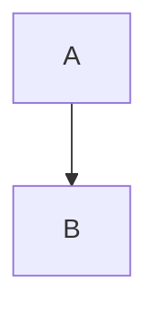

# Folio Fixture

Paragraph with **bold**, *italic*, ~~strike~~, `inline code`, and an autolink: https://example.com.

## Lists

- one
- two
  - nested

1. first
2. second

- [ ] todo
- [x] done

## Table

| Name | Value |
| :--- | ----: |
| a | 1 |
| b | 2 |

## Code

```ts
const answer: number = 42;
```

```python
def hello():
    return "world"
```



> A blockquote with a footnote.[^1]

<details>
<summary>More</summary>

Press <kbd>⌘</kbd> + <kbd>F</kbd>.

</details>


[Next plan](../plans/next.md#setup)

[^1]: The footnote text.
